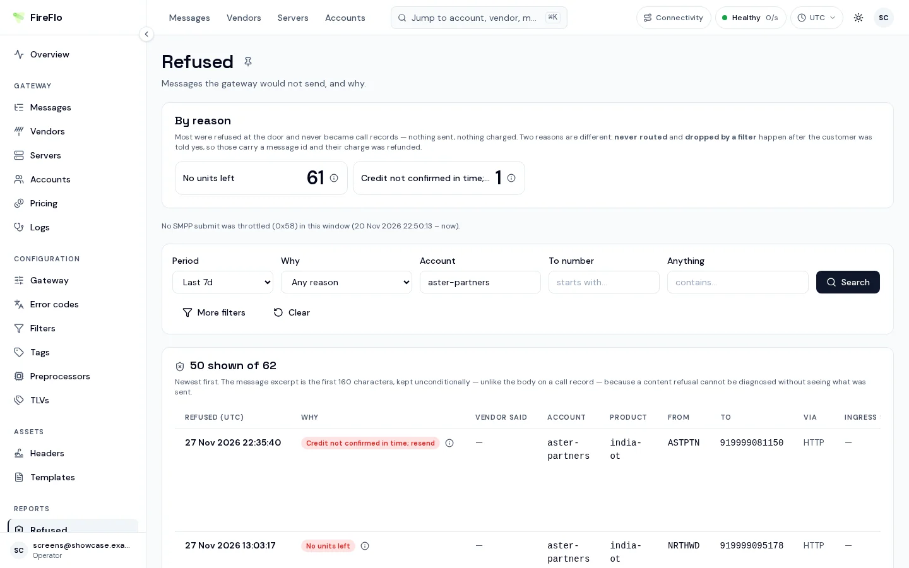
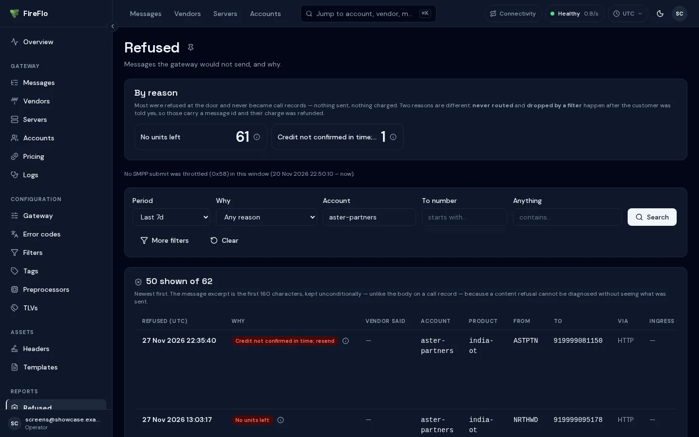
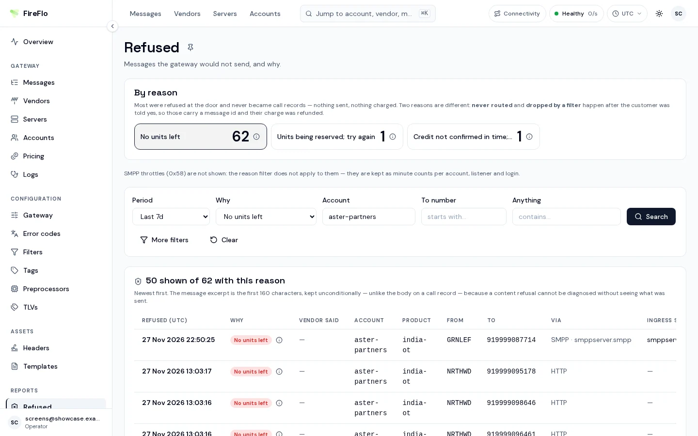
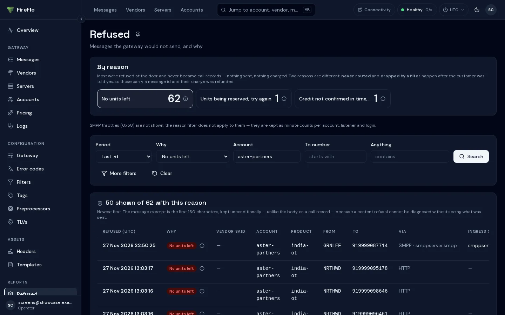

**Messages the gateway would not send, and why.** The first screen to open when a customer says
nothing is arriving.

Most refusals happened at the door: nothing was sent and nothing was charged. A few did not, and the
difference is the most important thing on this page.

## Refused at the door, or refused after acceptance

<Warning>
**Four reasons happen after the customer was told yes** — *never routed*, *vendor refused it*,
*dropped by a filter* and *expired waiting for its vendor*.

Those messages were accepted and charged, and on *vendor refused it* actually sent. They carry a
**message id**, they appear in the call records, and **their charge was refunded**. Everything else on
this page was turned away before it became traffic at all.

The **Stage** filter separates the two, and it is the filter to reach for when reconciling a
customer's count against your own.
</Warning>

## The reasons

**By reason** leads the page — a card per reason, with a count for the whole window and an info
button that explains it. The cards do not shift as you page, and choosing one filters to it; choose it
again to clear. From 0.12.14 the summary is taken over the **latest 50,000 refusals** and the page
says so: on a gateway refusing more than that in the window, the cards describe the recent shape
rather than an exact total, and the table beneath is still complete.

<Frame caption="Refusals for one account over 7 days: a card per reason above the filters and the newest refusals.">
  
  
</Frame>

<Frame caption="The same page after choosing the No units left card: the card is highlighted, Why is set to it, and the count above the table is for that reason alone.">
  
  
</Frame>

SMPP submits answered with a throttle (`0x58`) are not rows here. They are kept as minute counts per
account, listener and login, and a line under the cards says how many there were in the window, or
that there were none.

| Reason | Usually means |
| :--- | :--- |
| **Sender ID not approved** | The sender is not on the account's approved list for that product |
| **Content not approved** | The body matched no approved template — one changed word is enough |
| **Out of credit** | Prepaid credit would not cover it |
| **No units left** | From 0.16.0. A login of a [units account](/platform/billing/units-accounts) has no units of its product left. The account shown is the parent that pays |
| **Units being reserved; try again** | A units account's units were held by another node for a moment. A retry goes through |
| **Required parameter missing** | A TLV the ingress requires was absent, and nothing supplied it |
| **Rate limit exceeded** | Over the account's messages per second |
| **Product not sold** | The login named a product with no enabled catalogue row |
| **No price configured** | No sell-side rate matched, and the gateway refuses rather than send unbilled |
| **Product not allowed for this login** | The login may not name that product |
| **Credit not confirmed in time; resend** | From 0.17.2 (`creditPending`). A funded account's credit was not confirmed within `smsg.balance.park.seconds`, usually because the database was slow or not answering. Nothing charged; a resend goes through — see [Refusals](/platform/troubleshooting/refusals#credit-not-confirmed-in-time) |
| **Too many waiting for credit; resend** | From 0.17.2 (`creditQueueFull`). 10,000 of the account's messages, or 100,000 on the gateway, were already waiting for credit. Same cause as the above, at volume |
| **Queue full** | The router queue was at capacity and refused rather than growing the heap. Before 0.17.2, REST and gRPC sends refused for credit not confirmed in time were also counted here |
| **Could not be queued** | Accepted by the checks, but could not be handed on — usually the broker |
| **Vendor backlog full** | From 0.15.1. Every vendor the message could go to was past its backlog limit, and no other route was usable. Nothing charged |
| **Vendor unavailable** | From 0.15.1. The vendor it would go to has had no bind for longer than `smsg.vendor.unbound.refuse.after.seconds`, and no other route was usable. Nothing charged |
| **Database not answering; try again** | From 0.15.1. The database was too slow to take new messages, so new submits were refused before anything was charged. Messages already accepted carry on |
| **Gateway stopping** | The gateway was shutting down and took no new messages. Nothing charged; a retry goes through once another node or the restarted gateway takes it |
| **Hand-off outcome unknown** | Accepted and handed to the broker, and the hand-off ended without a definite answer: it may have been sent. Not refunded, so it cannot be billed twice; the gateway settles it once the answer is known |
| **Never routed** | *After acceptance.* No enabled rule matched; refunded |
| **Vendor refused it** | *After acceptance.* The carrier rejected the submit; refunded |
| **Dropped by a filter** | *After acceptance.* A routing filter stopped it; refunded |
| **Expired waiting for its vendor** | *After acceptance.* Queued for a vendor, it waited longer than `smsg.vendor.backlog.expire.seconds` (or its own validity) and was not sent; refunded, with a failed receipt where one was asked for |

<Note>
**A funded account's messages wait for their credit** after a restart, or whenever its block runs out,
rather than being refused. Many **Credit not confirmed in time** refusals across accounts in the same
minutes point at the database. **Out of credit** on a funded account that persists is a real shortage,
or credit held in `reserved`.
</Note>

Two reasons deserve their own note. **Content not approved** is an exact comparison outside the
placeholders — a single changed word refuses. And on **vendor refused it**, the carrier's own numeric
status sits beside the row; the 192–196 family is always about TLVs, which on an India DLT lane
usually means a missing or unstamped entity or template id.

An empty summary says so plainly, and adds the check worth making first: if you expected refusals and
see none, confirm enforcement is switched on at all — **an unloaded whitelist allows everything by
design**.

## Finding one

The always-visible row is **Period**, **Why** (the reason), **Account** (exact), **To number** (starts
with) and **Anything**. **Anything** is the wide net: it looks inside account, sender, destination,
product, login, refusal detail and message excerpt at once. **More filters** adds **Bind name (system
id)**, **Product**, **Came in via**, **Listener**, **From number**, **Message id**, **Carrier status**
and **Stage**. **Clear** empties them all.

**Carrier status** takes the carrier's number in decimal — 69 is the generic "refused and will not
say why" — and only vendor refusals carry one.

**The page always needs a period, of at most 92 days.** Refusals cannot be listed over all time:
earlier builds quietly showed a day's refusals under an **All time** heading, which is the kind of
wrong that gets believed, so from 0.12.14 the page asks for a period instead.

## The table

Ten columns by default: refused, why, vendor said, account, product, from, to, via, ingress server,
message. The chooser adds the English reason, the refusal detail, whether it was charged and refunded,
what the customer was told, the vendor code name, and the row and message ids.

The **message excerpt** — the first 160 characters — is kept **unconditionally**, unlike the body on
a call record. A content refusal cannot be diagnosed without seeing what was sent, so this is the one
place message text is always available.

<Note>
A dash under **Parts** means the message was refused before its segments were counted — not zero
parts. **Data coding** does show `0`, which is real: that is GSM 7-bit.
</Note>

## Exporting

Prepared in the background, kept seven days, and — as on Messages — it **carries every column plus
the plain-English reason and carrier code**, whatever you chose on screen. These files are read by
people with no panel open.

## Related

<CardGroup cols={2}>
  <Card title="Why a message was refused" icon="circle-question" href="/platform/troubleshooting/refusals">
    Working back from a refusal to its cause.
  </Card>
  <Card title="Vendor rejections" icon="triangle-exclamation" href="/platform/troubleshooting/vendor-rejections">
    What each carrier status code means.
  </Card>
</CardGroup>
