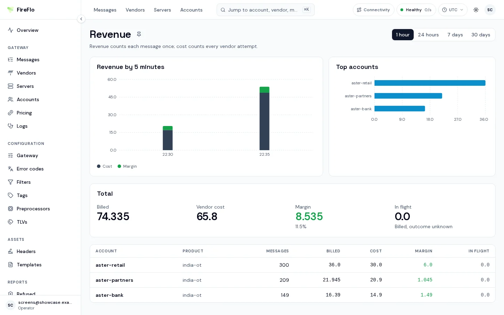
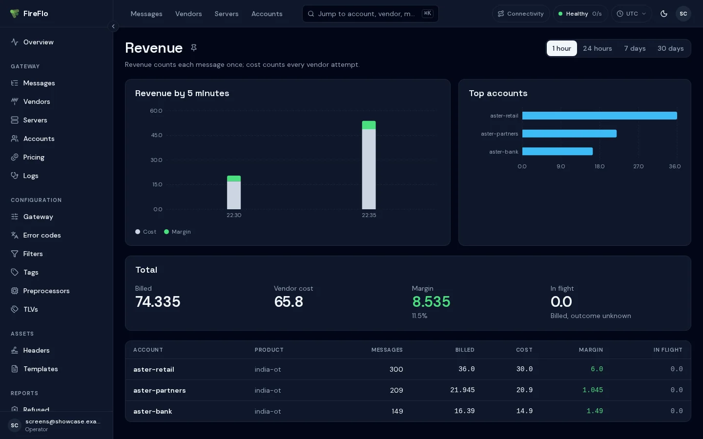

**Revenue counts each message once; cost counts every vendor attempt.**

That sentence is the whole screen. A message you billed for at one rate may have been submitted to a
vendor three times before it stuck, and you were charged for all three. The tariff says your margin
is a third; the report says it is much less; both are correct, and only the report is about money
that actually moved.

If margin here is persistently below what the tariff predicts, the question to ask is not "is the
pricing wrong" but **"how many attempts is each message taking"** — which is a retry and vendor
quality question, answered on [Receipt quality](/platform/control-panel/receipt-quality) and the
vendors' own pages.

## The charts

The range picker offers **1 hour**, **24 hours**, **7 days** or **30 days**; the page opens on the last
hour, and after that on whichever range you last picked in that browser.

Two charts lead the page. **Revenue by 5 minutes** (by hour on 24 hours, by day on 7 and 30 days)
draws each step's vendor cost with the margin stacked on top. **Top accounts** ranks the accounts by what they were billed, seven at most, with the rest
folded into one **Other** bar.

<Frame caption="Revenue for the last hour: cost and margin per five minutes, the accounts behind it, the totals and the table by account and product.">
  
  
</Frame>

## The totals

| Figure | Meaning |
| :--- | :--- |
| **Billed** | What customers were charged |
| **Vendor cost** | What vendors charged you, every attempt |
| **Margin** | The difference, with its percentage, red when negative |
| **In flight** | Billed, outcome unknown |

<Warning>
**"In flight" is not lost money and not an error.** It is traffic that has been billed and has no
outcome yet.

It should always be small and always be recent. The gateway's sweeper closes unreported messages as
expired after 48 hours — so **anything in this figure older than 48 hours means the sweeper is not
running**, and that is an operator problem, not an accounting one.
</Warning>

From 0.12.15 the 7- and 30-day views take every whole day the nightly rollup has summarised from the
daily usage summary and read only today live. Billed and cost on a summarised day are the settled
figures the summary holds; **In flight** on such a day reads zero, because the summary does not record
pending revenue — the live figure is today's.

## By account and product

One row per account and product pairing:

**Account · Product · Messages · Billed · Cost · Margin · In flight**

Negative margins are red, positive green. A missing account or product shows a dash rather than being
folded into a total that would hide it.

On a narrow screen each row becomes its own card and the in-flight column is dropped, keeping
messages, billed, cost and margin.

There is no search, no column chooser and no export here. This is a summary to be read; the
per-message detail behind it lives in the call records, which do export.

## What has to be true for this to be right

Margin can only be computed where both sides of the trade were priced at the moment the message was
submitted:

- a **sell-side rate** scoped to the account, and
- a **cost rate** scoped to the vendor that carried it.

Rate scope is one field with two meanings — an account id is what you charge, a vendor name is what
you are charged — and nothing in the schema tells them apart. With no cost rate configured, cost is
zero, and margin will read as the full billed amount. That is not a healthy platform; it is an
unconfigured one.

<Note>
Prices are fixed at submission and do not move afterwards. Changing a tariff today does not restate
last week — which is what makes a closed period on a customer's statement final, and is deliberate.
See [how pricing works](/platform/billing/how-pricing-works).
</Note>

With nothing billed in the window, the screen reads **No billed traffic in this period**.
