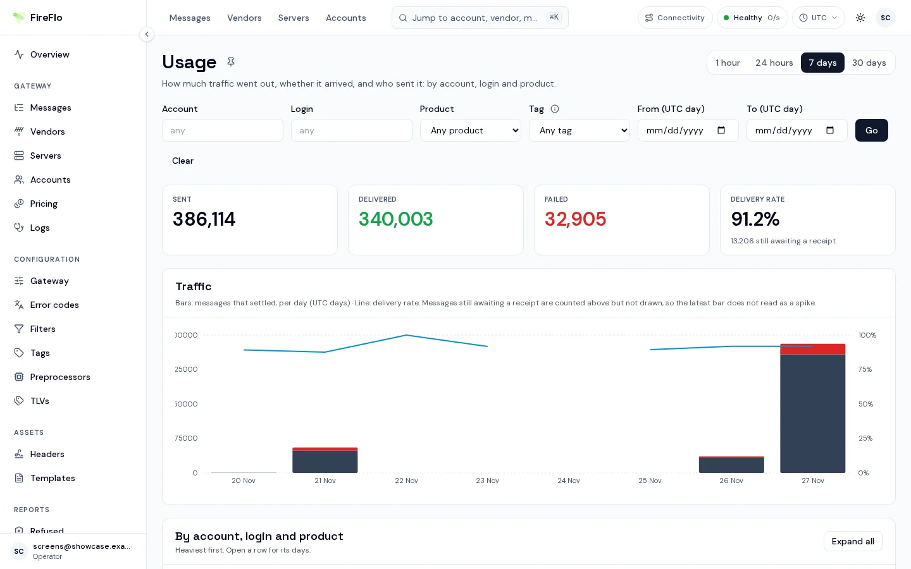
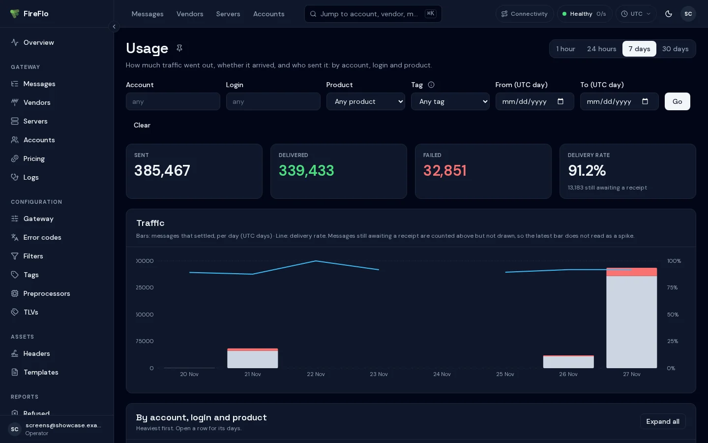
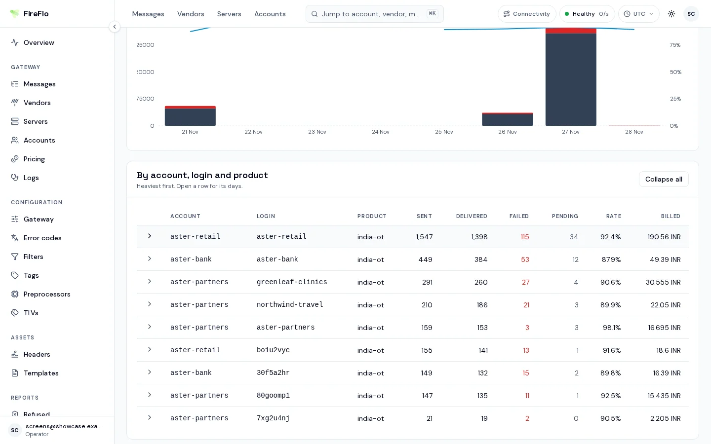
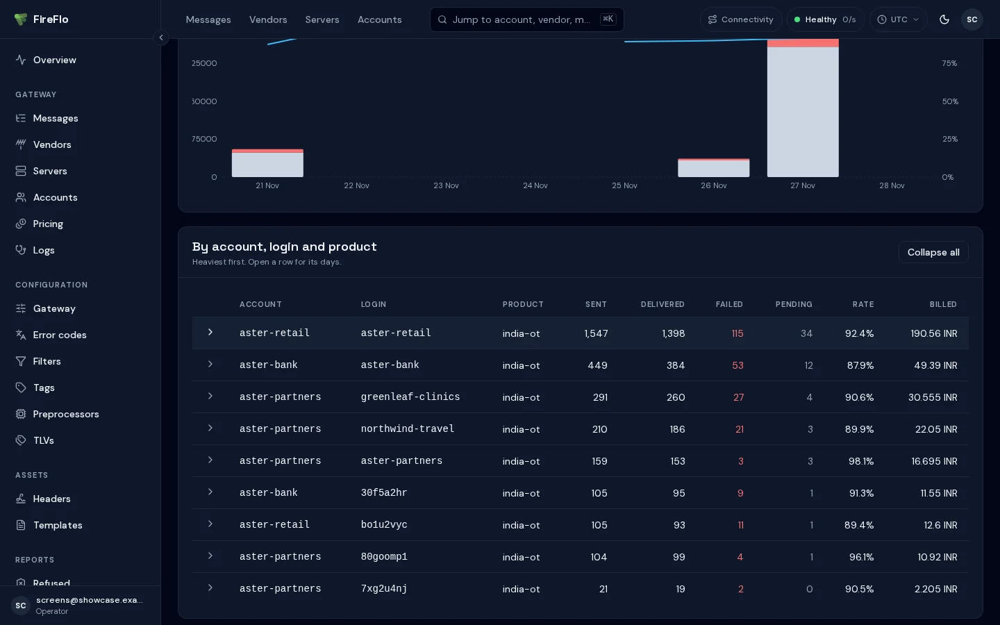

How much traffic went out, whether it arrived, and who sent it: by account, login and product.
Volume and delivery lead; money is the last column rather than the headline — the commercial question
is answered on [Revenue](/platform/control-panel/revenue).

The range picker offers **1 hour**, **24 hours**, **7 days** or **30 days**. Like every traffic page it
opens on the last hour, and after that on whichever range you last picked in that browser. A day is
the unit a usage question usually gets asked in, so for a weekday-to-weekend shape pick 7 or 30 days.

<Frame caption="Usage for 7 days. The bars count only messages that settled; the line is the delivery rate against its own 0–100% axis.">
  
  
</Frame>

## Filters

Under the title: **Account** and **Login** (each suggests names as you type), **Product**, **Tag**, and
**From** and **To** days in the billing zone. Nothing is read until you press **Go**; **Clear** removes
them all. A date range replaces the range picker while it is set. The filters you applied are
remembered in that browser.

## The figures

Four cards — **Sent**, **Delivered**, **Failed**, **Delivery rate** — with the rate card noting how
many messages are still awaiting a receipt.

<Warning>
**The delivery rate is delivered over what has settled, not over what was sent.**

Dividing by sent would count every message still in flight as a failure. The rate would collapse
every busy afternoon and recover by itself overnight, and nobody could tell a real delivery problem
from ordinary traffic.

So a rate of 98% means 98% *of the messages that have an outcome*. Messages still waiting are counted
in **Sent**, and in **Pending** in the table, and are in neither half of the rate.
</Warning>

From 0.15.1 the page reads the gateway's usage summaries only, and the call records for the last few
minutes and nothing else, whatever is filtered or opened — which is what keeps a 30-day view quick at
volume. A summarised hour's or day's **Pending** is what was still awaiting a receipt when the gateway
last summarised it.

## Traffic

Delivered and failed stacked per day (per hour on the shorter ranges) against volume on the left,
and the delivery rate as a line against a fixed 0–100% axis on the right.

Two deliberate choices worth knowing:

- **Messages still awaiting a receipt are counted in the totals but not drawn.** Today would
  otherwise always read as a spike of unknowns.
- **A day with nothing settled has no rate at all**, and the line breaks rather than dropping to
  zero. A gap is "no evidence"; a zero would be "everything failed".

## By account, login and product

Heaviest first, one row per account, login and product:
**Account · Login · Product · Sent · Delivered · Failed · Pending · Rate · Billed**. Fifty rows to a
page.

Open a row with its arrow to see its days, or its hours on the 24-hour view; **Expand all** opens the
first 25 rows at once. The 1-hour view has nothing to open.

<Frame caption="The table by account, login and product for 7 days. The arrow on each row opens its days.">
  
  
</Frame>

Each account links through to that customer, where the same question is answered for them alone.

From 0.17.0 the **Tag** filter narrows the page to accounts that carry an [account tag](/platform/routing/account-tags)
themselves. It reads the tags accounts have now: a message does not record its account's tags, so a past
period is read with today's.

Traffic that named no account shows a dash in the **Account** column — not an error, and not an
account whose name is empty. It is traffic that arrived without one, which usually means a login with
no account attached, and is worth chasing because it prices and bills differently. Days the gateway
summarised before it recorded logins (before 0.15.1) show every login together in one row, and the
page says so.

## Usage against the statement

This screen counts messages. A customer's [statement](/platform/billing/statements) counts money, and
is billed on submission rather than delivery — so the delivered figure here keeps moving after a
statement is cut while the invoiced amount does not.

They are not meant to agree on delivery. They are meant to agree on **sent**.

## Related

<CardGroup cols={2}>
  <Card title="Revenue" icon="coins" href="/platform/control-panel/revenue">
    The same traffic, valued.
  </Card>
  <Card title="Usage rollups and retention" icon="database" href="/platform/billing/usage-and-retention">
    The daily rollup this screen falls back on, and what the purge deletes.
  </Card>
</CardGroup>
