An **account** is an id that a login, a rate scope, a balance row and a call record all agree on.
Nothing has to create it: an account exists the moment a login names it or a message arrives carrying
it, and the `app_account` row is a label bolted on afterwards.

<Frame caption="The Accounts list, one row per login. Not named yet counts the account ids in use that have no name of their own.">
  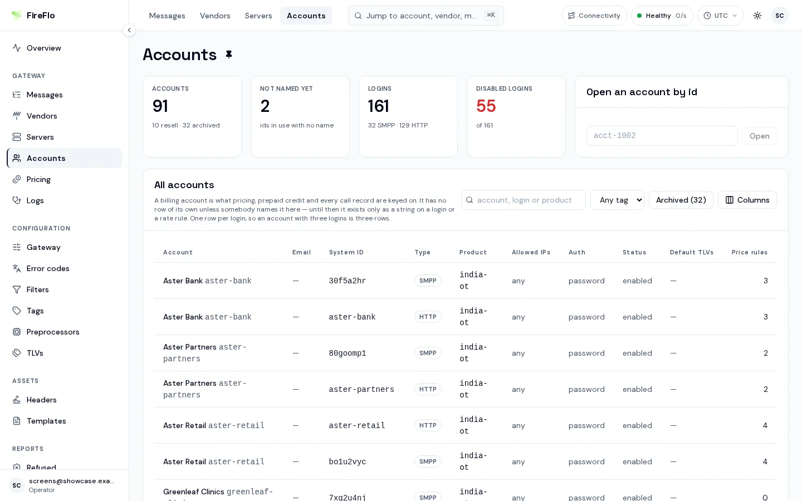
  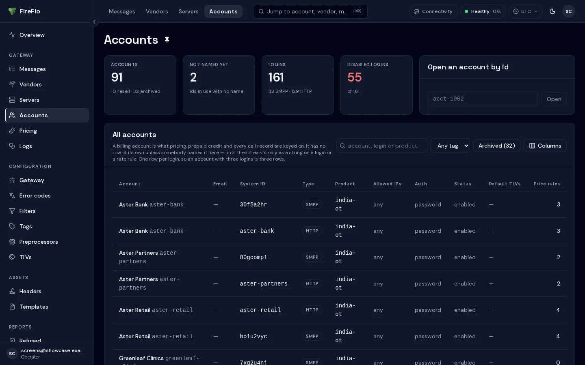
</Frame>

## Leave `accountId` blank and something else becomes the account

`accountId` is optional on a credential, and what fills the gap **differs by protocol**.

| Protocol | Falls back to |
| :--- | :--- |
| SMPP | the `systemId` |
| HTTP | the *lookup key*, which is the `apiKey` when one is set |

<Warning>
**An HTTP login with an `apiKey` and no `accountId` bills to the API key itself.** The secret lands in
`cdr_submit.account_id`, in the control panel's revenue figures and in every CSV export — copied into
records that live as long as billing history does, and that leave the platform in spreadsheets.
Rotating the key afterwards splits that customer's history across two ids.

Set `accountId` explicitly on every credential and neither fallback matters.
</Warning>

<Frame caption="A login open for editing. Account sits under Billing and tariff: rate scopes and prepaid balances are both keyed on it, and it is fixed once the login is created.">
  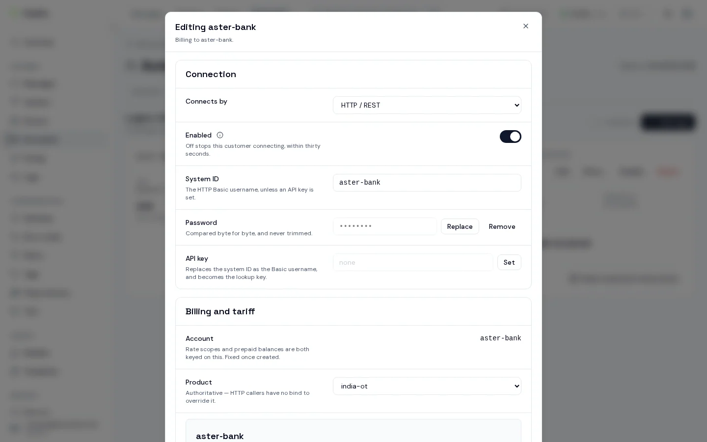
  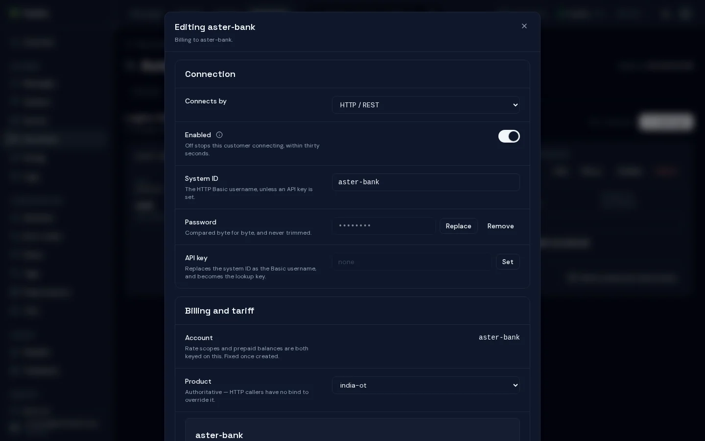
</Frame>

## Why the account and not the login

One account may hold several logins, and everything that carries money or a ceiling is keyed on the
account:

| Keyed on the account | Where it lives |
| :--- | :--- |
| Prepaid balance and reserved credit | `account_balance` |
| Credit limit and billing mode | `account_balance.billing_mode`, `credit_limit` |
| Tariff — what this customer pays | a rate scope named after the account id |
| Statement and daily usage | `cdr_submit`, `usage_daily` |
| Rate ceilings | the account, not the bind |

<Note>
A per-login limit would let a customer raise their own ceiling by creating another login. Keying on
the account is what makes any of these mean something.
</Note>

Approvals are the one thing that can go either way: a sender ID or template row may name a
`system_id` to bind it to one login, or leave it null for every login on the account. See
[Sender IDs](/platform/customers/sender-ids).

## What the catalogue row actually holds

`app_account` is name, contact and hierarchy. When the gateway loads logins it reads only two things
from it: whether the account is enabled, and whether it is archived.

| Column | Meaning |
| :--- | :--- |
| `id` | The billing key. Trimmed and non-empty, and the primary key. |
| `label`, `description` | For the people reading the panel (**Name** and **Notes**). |
| `email` | The account's contact address and a portal login. One account per address, ignoring case. |
| `enabled` | **Enabled**, under Settings → Advanced. Off pauses the account: its logins stop and nobody can sign in to the portal for it. |
| `resells` | **Resells services**: this account may hold others and move balance to them. |
| `parent_account_id` | **Belongs to**: the reseller it sits under. |

The tree is exactly two levels deep, and the database enforces it: `app_account_two_levels` refuses a
row that both names a parent and resells, so an account either holds others or belongs to one.

<Frame caption="An account's Settings tab. Organisation holds the name, email, notes and tags; Advanced holds Enabled, reselling and the parent; Archive sits below.">
  
  
</Frame>

<Warning>
**Switching an account off stops its traffic.** The gateway stops serving the account's logins within
one configuration poll (30 seconds by default), and nobody can sign in to the portal for it. Binds
already open stay up until they drop.

To stop one login rather than the whole account, disable that **login**. To stop spend, use the
balance.
</Warning>

To retire an account for good, **Archive** it at the foot of the Settings tab. Its logins are switched
off, live binds are dropped and portal sign-in is closed; its balance and history stay, and it leaves
the account list. **Unarchive** switches back on exactly what the archive switched off, and customers
reconnect their binds themselves.

## Resellers and sub-accounts

Switch **Resells services** on and the account becomes a reseller. Its people then run their own
customers from the portal, under **Customers → Sub-accounts**. There are two levels, never more: a
sub-account cannot resell.

<Frame caption="A reseller's Sub-accounts list in the portal. Each sub-account's credit comes from the reseller's own balance.">
  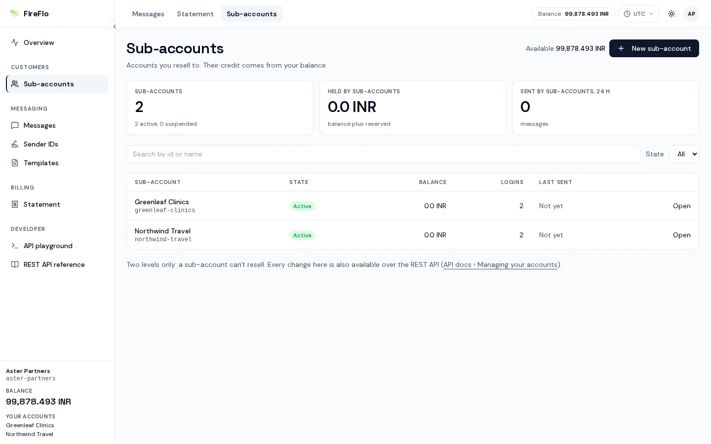
  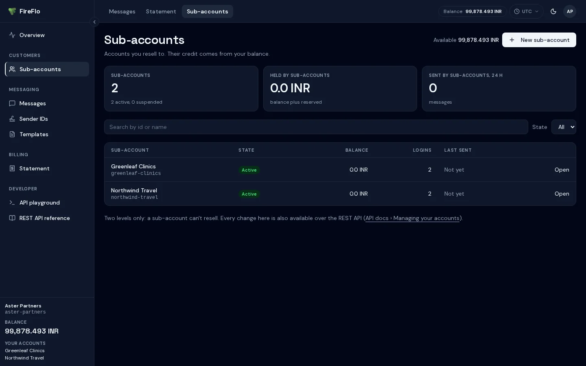
</Frame>

**New sub-account** asks for an account id (fixed once created), a name and an opening credit, moved
from the reseller's balance at once; leave it at 0 to recharge later. The sub-account gets one HTTP
login straight away, and SMPP logins are added on its Logins tab.

<Frame caption="New sub-account. The opening credit shows the reseller's balance after the move before anything is created.">
  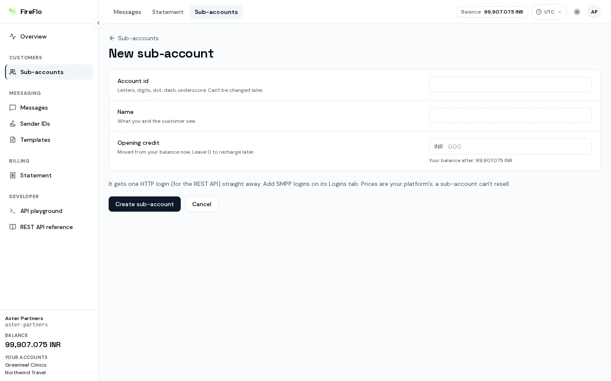
  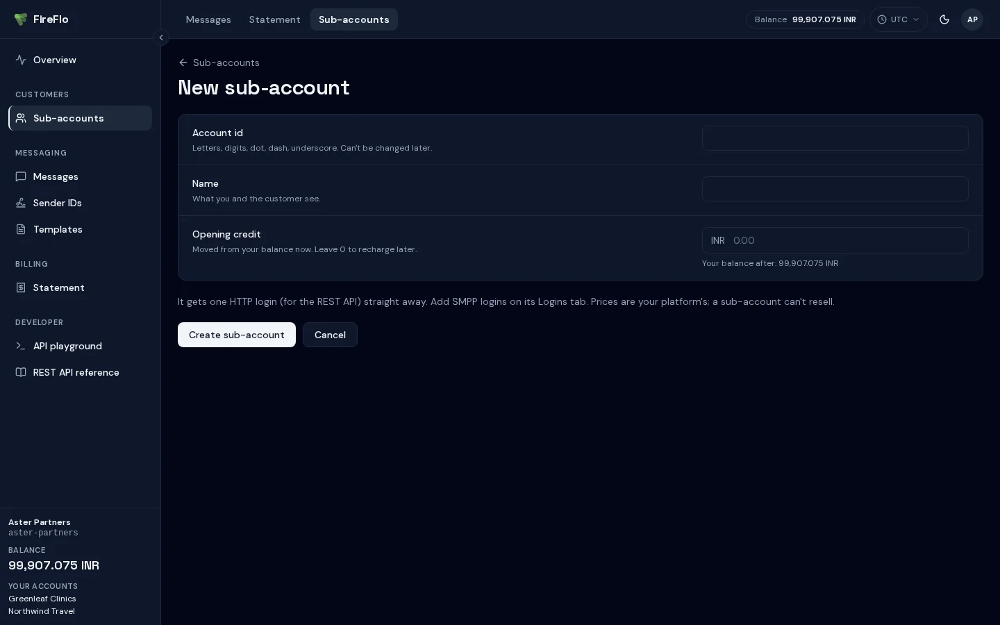
</Frame>

A sub-account's page shows its balance, **Recharge** and **Withdraw** to move credit between it and
the reseller, and its transfers, with tabs for its logins, messages, approvals, statement, credit terms
and settings.

<Frame caption="A sub-account in the reseller's portal. Withdraw frees credit reserved for messages being sent before it moves it back.">
  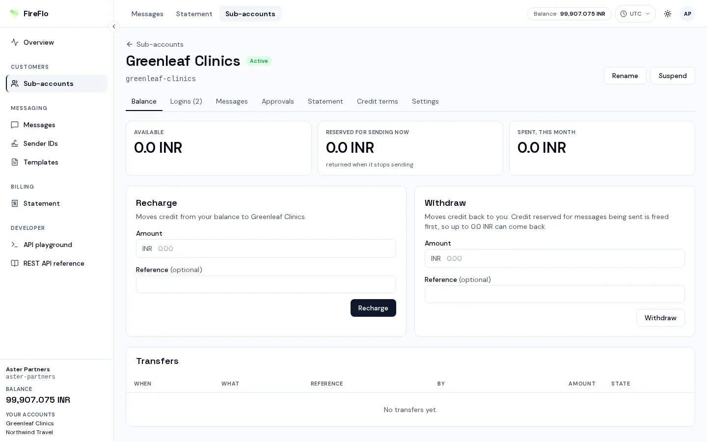
  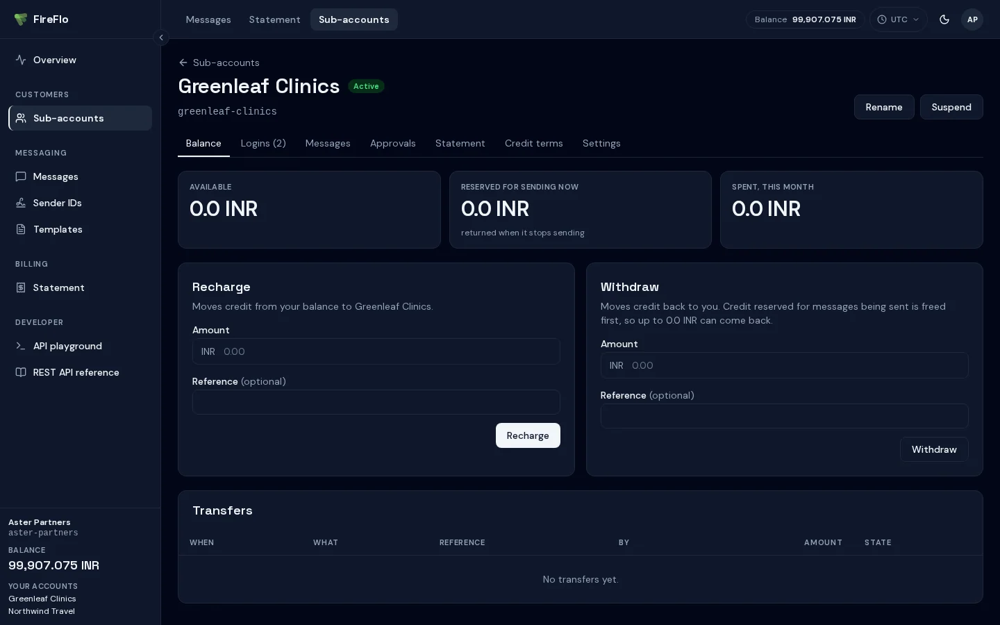
</Frame>

## Creating a login does not create a balance

An account with no `account_balance` row is **not at zero** — it has no balance, which is a different
state and the one that quietly swallows a top-up.

<Warning>
**A `RECHARGE` written for an account with no balance row credits nothing.** It stays pending and
logs, and applies itself the moment the row appears — but until then the customer has paid and cannot
send. Open the account for credit first (*Open for credit* on the account page), then top up.
</Warning>

The panel tells the two apart deliberately: "no balance row" and "credit switched off" are shown as
different answers rather than collapsed into one empty figure. See
[Prepaid credit](/platform/billing/prepaid-credit).

## An account id that is also a vendor name

Rating matches a rate scope by name alone, and the same table holds both sides of the trade. An id
that is also a vendor instance name has its rules read as **our cost for that vendor** as well as
what this customer pays.

The account page paints that red rather than letting it be discovered in a margin report. Rename one
before pricing either. `*` is reserved outright and cannot be used as an account or a vendor name.

## What is on the account page

One tab at a time: **Overview**, **Settings**, **Logins**, **Approvals**, **Billing**, **Tariff** and
**Statement**. A units account has no Tariff or Statement tab; its prices and statement are its
parent's.

<Frame caption="An account's Overview tab: its traffic by login and product, its SMPP ceiling, a delivery check and where its messages went.">
  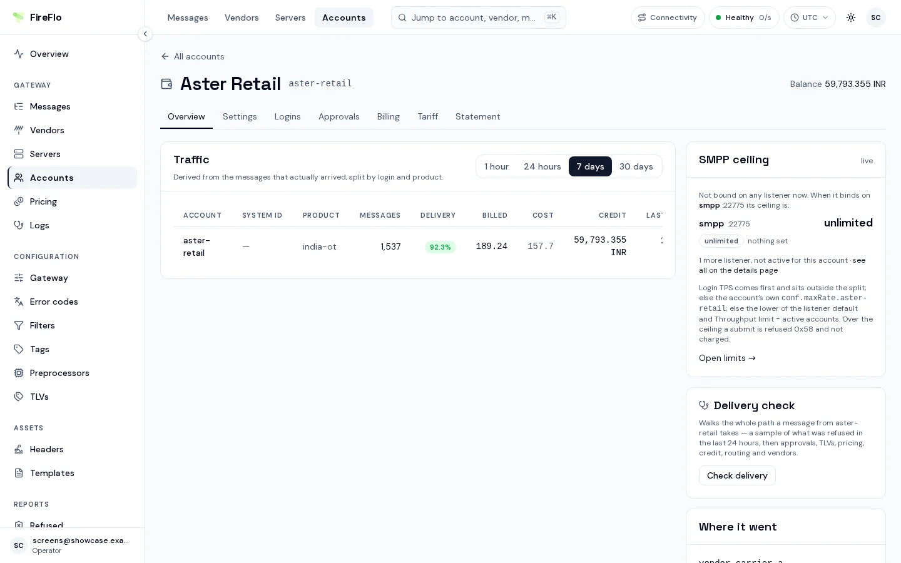
  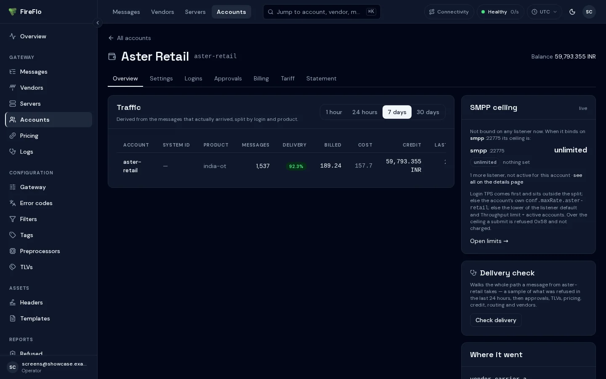
</Frame>

<CardGroup cols={2}>
<Card title="Logins" href="/platform/connections/credentials">
Who may connect as this account, what product each carries, and rotating a secret.
</Card>
<Card title="Custom tariff" href="/platform/billing/tariffs">
What this account pays. No rules of its own means it is priced by whatever catch-all covers it.
</Card>
<Card title="Statement" href="/platform/billing/statements">
What is owed for a period, billed on submitted — so the amount stops moving when the period does.
</Card>
<Card title="Sender IDs and content" href="/platform/customers/whitelisting-rollout">
The two approval lists and the enforcement switch beside them.
</Card>
</CardGroup>

Traffic on the page is derived from the messages that actually arrived, split by login and product —
so it shows traffic that came in under this account from a login this panel has never seen.
