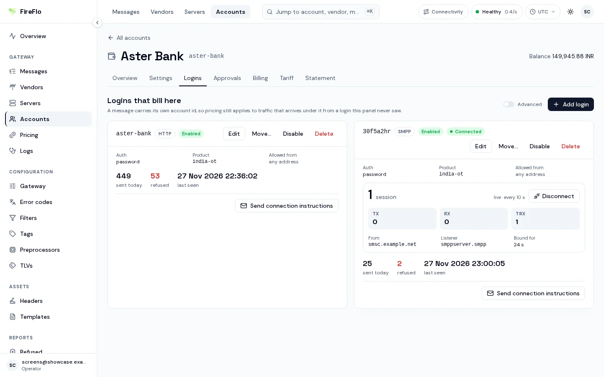
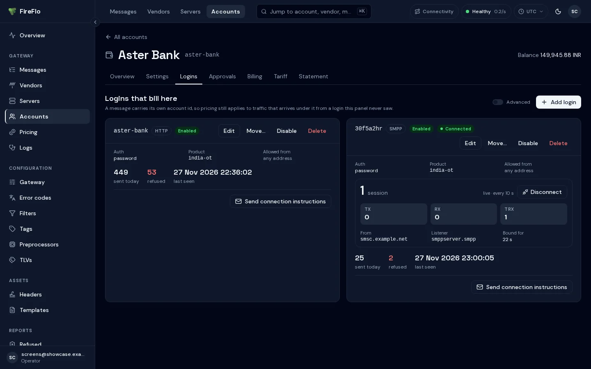

Customers sign in to the portal with a **portal login**: an email address that signs in by a one-time
emailed link, or with a password once one is set. An account's portal logins are on its **Settings**
tab, in the **Portal access** card.

## What an operator sets

<Steps>
<Step title="Set the email address">
The **Email** field on the **Organisation** card. One account per address, ignoring case — a second
account claiming the same address is refused rather than silently shadowing the first.

A malformed address is refused as you type it, so an address that saved is an address the portal can
match. Saving it gives the account a portal login for that address. If that login is missing, the
Portal access card offers **Create a login for** the address.
</Step>

<Step title="Choose how it signs in">
Each login on the Portal access card says how it signs in: **Emailed link only**, or **Password, or
emailed link**. **Set password** or **Change password** sets one; **Remove password** goes back to
links only. Without a password, the customer signs in by emailed link and can set a password from
the portal.
</Step>

<Step title="Leave the account enabled">
The **Enabled** switch, under **Advanced**. Nobody can sign in to the portal for an account that is
switched off or archived.
</Step>
</Steps>

<Frame caption="An account's Settings tab. The portal login is on the right, with how it signs in and when it last did.">
  
  
</Frame>

To stop one person signing in, press **Turn off** on their login; **Turn on** lets them back in.
Switching the whole account off also stops its traffic — see
[Accounts](/platform/customers/accounts#what-the-catalogue-row-actually-holds).

## What the deployment needs

The panel must be able to send mail, and must know its own public address, or no link can be issued
at all. Where either is missing the customer is told plainly that sign-in by email is not available
on this panel and to ask their account manager — an honest refusal rather than a link that never
arrives. See [the control panel's configuration](/reference/config/control-panel).

## What the customer sees, and what you will not be told

After submitting an address the customer always gets the same answer:

> If that address is on an account, a sign-in link is on its way. It expires in 15 minutes.

<Note>
**That response is identical whether the address exists, belongs to a disabled account, or has never
been heard of.** A form that said "no such account" would let anyone test a list of addresses against
your customer base and learn which of your competitors' customers are also yours.

The consequence for support is worth knowing: **the panel cannot confirm to you that a customer's
address was recognised.** If a customer reports no link arriving, check the address on the account
rather than looking for a rejection that was never surfaced.
</Note>

Links work once and expire after fifteen minutes. A used or expired link says so and offers a fresh
one. Requests are rate limited per account and per network, and hitting the per-account limit is
answered with the same neutral sentence — the customer is not told they have been throttled.

## What portal access is not

**The Logins tab is not portal access.** It holds SMPP and HTTP credentials, which are how a
customer's *software* connects. Nothing on it grants or revokes a person's sign-in. An account can
have a dozen logins and no portal access, or portal access and no logins at all.

<Frame caption="The Logins tab: the SMPP and HTTP logins that bill to the account, whether each is connected, and its live sessions. None of them is a portal sign-in.">
  
  
</Frame>

Once in, a customer sees their own traffic, statement, sender IDs, templates and API playground — and
never your cost, your margin or which vendor carried anything. What they can do there is described
for them under [the portal](/developers/portal/signing-in).
