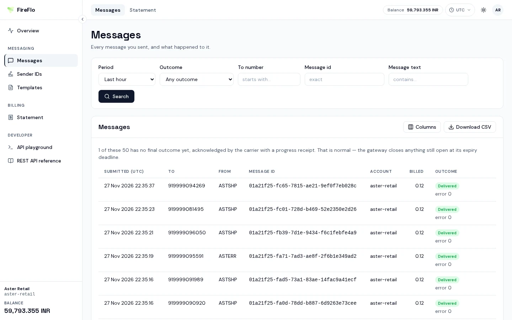
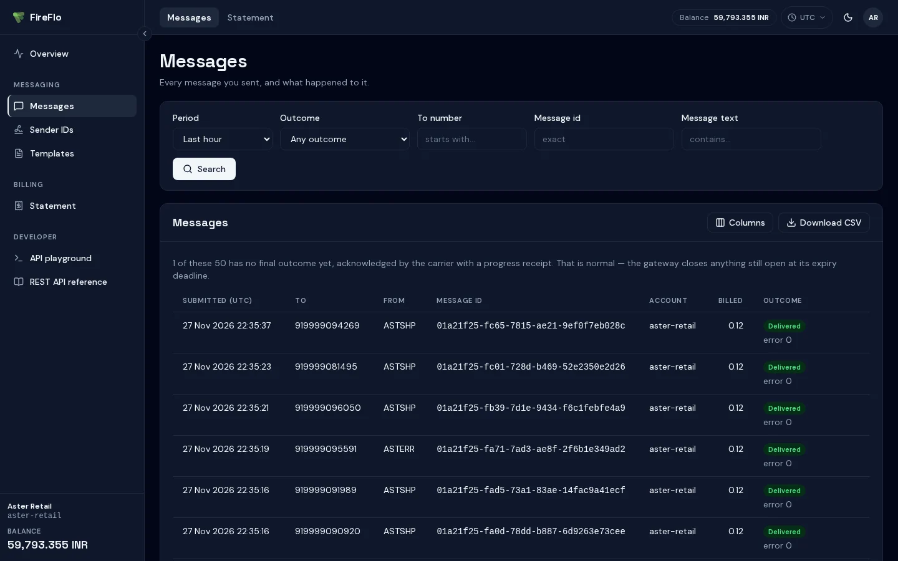
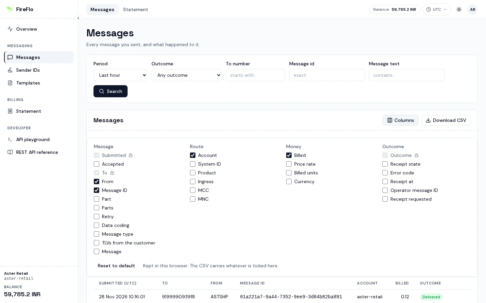
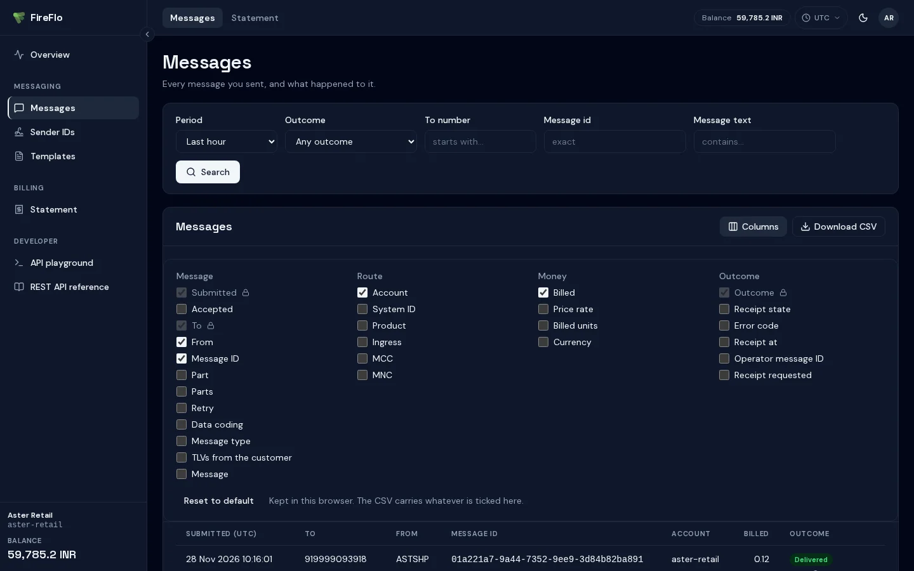
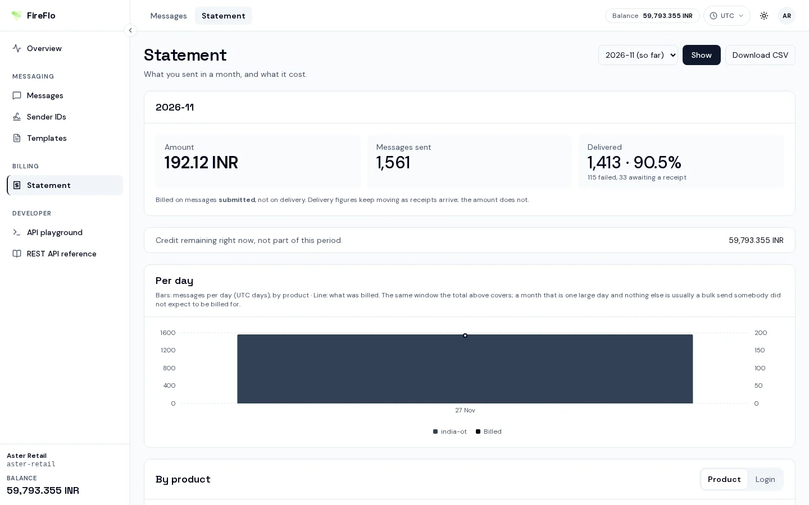
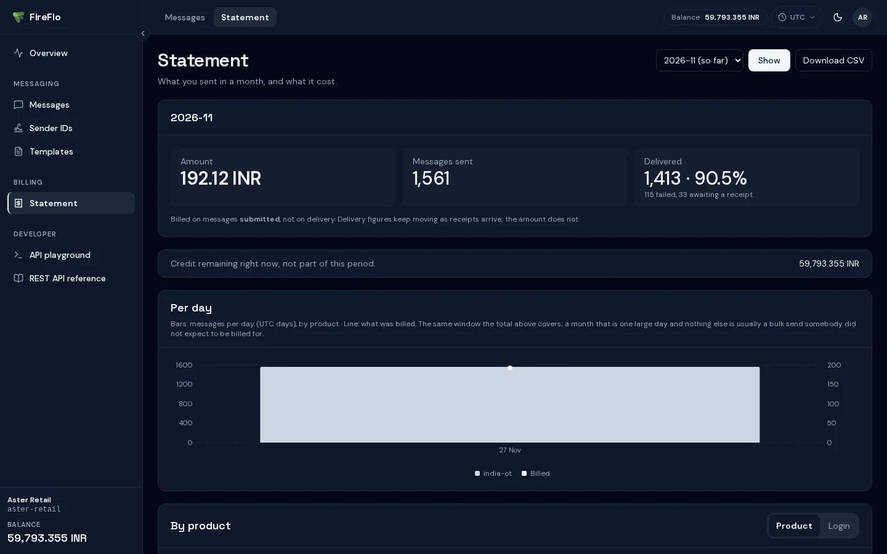
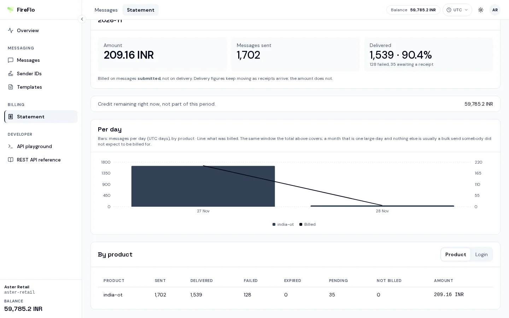
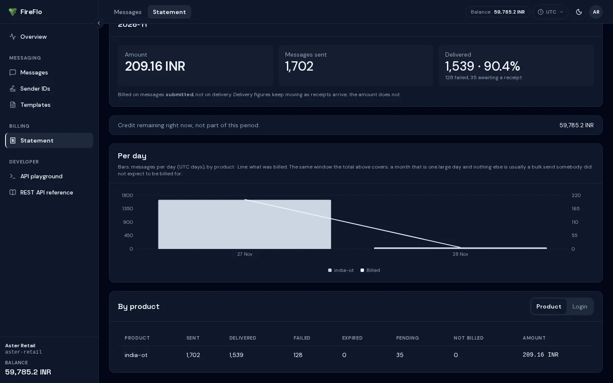

Duas telas respondem duas perguntas diferentes. **Messages** é "o que aconteceu com esta".
**Statement** é "pelo que estou pagando". Elas discordam levemente de propósito, e o motivo está no
fim desta página.

## Mensagens

Uma barra de filtros sobre uma tabela. Os filtros são aplicados quando você aperta **Search**, não
enquanto digita, e eles são carregados na barra de endereços. Assim, uma visão filtrada pode ser
salva nos favoritos ou colada em um chamado, de forma que quem ler veja exatamente o que você viu.

<Frame caption="Messages: a barra de filtros e depois a tabela, com Columns e Download CSV acima dela. A linha sobre as linhas da tabela diz quantas ainda não têm desfecho final, para que uma coluna em branco não pareça uma falha.">
  
  
</Frame>

| Filtro | Observações |
| :--- | :--- |
| **Period** | Última hora, 24 horas, 7 dias, 30 dias, ou um intervalo customizado. Abre na última hora, ou no período que você escolheu por último naquele navegador |
| **Outcome** | Qualquer, ou um específico |
| **To number** | Match pelo início do número |
| **Message id** | Exato |
| **Message text** | Busca dentro dos corpos das mensagens |

**Awaiting a receipt** aparece primeiro entre os desfechos, e não em ordem alfabética, porque é o
que as pessoas vêm procurar.

<Note>
**A busca por texto de mensagem não acha nada se seu provedor não guarda o conteúdo.** Armazenar
corpos é uma escolha de implantação com consequências óbvias de privacidade, e vários operadores
desligam. Um resultado vazio aqui pode significar que o conteúdo não é guardado, não que nenhuma
mensagem casou.
</Note>

Revendedores ganham um filtro extra para restringir a uma única conta ou buscar em todas.

### Colunas

Sete são exibidas por padrão: submetida, para, de, message id, conta, cobrado e desfecho.
**Columns** abre um seletor agrupado em Message, Route, Money e Outcome. Cerca de trinta ao todo,
incluindo contagens de partes e retries, data coding, as TLVs que você enviou, tipo de mensagem, MCC
e MNC, tarifa, unidades cobradas, estado do recibo, código de erro e hora do recibo.

<Frame caption="O seletor de colunas. Os cadeados marcam as três que não podem ser desligadas, e a linha no rodapé é a regra a lembrar: o CSV carrega o que estiver marcado aqui.">
  
  
</Frame>

Três não podem ser desligadas: **Submitted**, **To** e **Outcome**. Uma linha sem elas não é
identificável.

A sua escolha fica salva naquele navegador, e **o CSV carrega o que estiver marcado**. Configure as
colunas que você quer antes de exportar.

<Warning>
**Custo, margem e fornecedor não estão no seletor nem nos dados.** Você vê o que foi cobrado. O que
seu provedor pagou para transportar, e quem transportou, é dele. Sem coluna, sem export, sem campo
na API.
</Warning>

**Download CSV** respeita os filtros e as colunas atuais.

Os horários aparecem no fuso escolhido na barra do topo: o fuso da plataforma do seu provedor, a
menos que você escolha o do seu navegador ou UTC. Cada coluna de horário diz o fuso no cabeçalho, e o
rodapé repete, para que uma linha discutida entre fusos possa ser fixada. O CSV mantém suas colunas
de horário em UTC e acrescenta uma cópia local de cada uma no fuso em que você estava lendo a tabela.

Onde algumas linhas ainda não têm desfecho, uma nota acima da tabela informa:

> *n* de *total* ainda não têm desfecho final. Isso é normal. O gateway fecha tudo o que ainda
> estiver aberto no seu prazo de expiração.

Onde a operadora já confirmou algumas delas com um recibo de progresso, a linha diz isso também.

## Extrato

Escolha um mês e aperte **Show**. Os últimos treze são oferecidos, e o atual é marcado como
**(so far)**. Escolher um mês só o marca como alterado; os números e o CSV continuam sendo os do mês
indicado no rótulo até você apertar Show. Abre no mês *anterior* completo, porque é aquele que você
está sendo cobrado.

<Frame caption="O extrato de um mês: o valor, as mensagens enviadas e entregues com o que aconteceu com o resto e depois, numa linha própria, porque não faz parte do mês, o que está na conta agora.">
  
  
</Frame>

O card do topo mostra o valor, as mensagens enviadas e as entregues com a sua taxa. Abaixo de
entregues, o resto é contabilizado (quantas falharam, expiraram e ainda aguardam um recibo), então
toda mensagem enviada está em um desses números.

Abaixo dele, numa linha própria e rotulado como **right now** em vez de parte do mês, um de dois
números, nunca os dois: um **limite de crédito** para contas faturadas a posteriori, ou o **crédito
restante** para contas em crédito pré-pago. Ler um limite de crédito como saldo é a leitura errada
que custa dinheiro, então eles nunca têm o mesmo nome.

Se algum tráfego saiu sem preço, uma nota diz quantas mensagens e confirma que não estão no valor.

Abaixo: um gráfico **por dia** (mensagens por dia por produto, com o valor cobrado como uma linha) e
depois um detalhamento **por produto**, ou **por login** se você alternar. Cada linha tem enviadas,
entregues, com falha, expiradas, pendentes, não cobradas e valor; **Not billed** é o que concilia a
contagem de enviadas de uma linha com o seu valor. Onde existirem, segue uma lista de **períodos
faturados**.

<Frame caption="O detalhamento por produto. Entregues, com falha, expiradas, pendentes e não cobradas são contadas à parte; a chave Product e Login no canto superior direito muda o que as linhas representam.">
  
  
</Frame>

> Um período fechado é final. Qualquer coisa que caia nele depois aparece como um ajuste no período
> seguinte.

Cada mês exporta em CSV com **Download CSV**, ao lado de Show.

Os dias no gráfico e no extrato vão de meia-noite a meia-noite no fuso da plataforma do seu provedor,
seja qual for o fuso que você escolheu para os horários.

## Por que as duas telas discordam

> Cobrado nas mensagens **submetidas**, não na entrega. Os números de entrega continuam se movendo à
> medida que os recibos chegam; o valor não.

Uma mensagem aceita no dia 31 e reportada no dia 1º é cobrada no mês anterior e entregue no
seguinte. Então a contagem de entregues em Messages vai variar depois que um extrato é fechado, e o
valor do extrato não.

Essa é a alternativa a uma fatura que muda por semanas depois que você a recebe. Os preços são
fixados na submissão, o que também explica por que uma mudança de tarifa não retifica o histórico.
