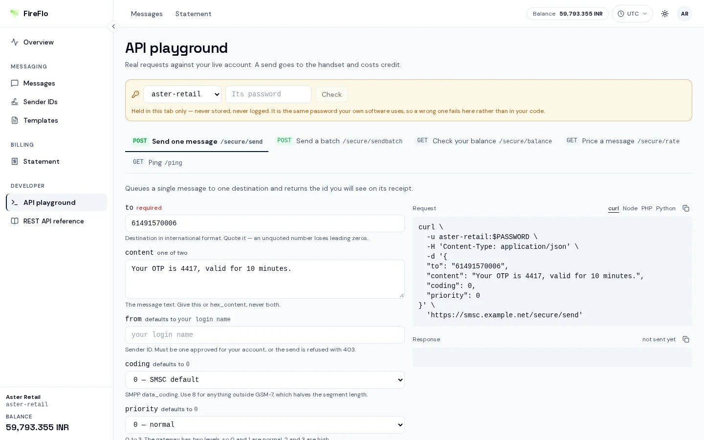
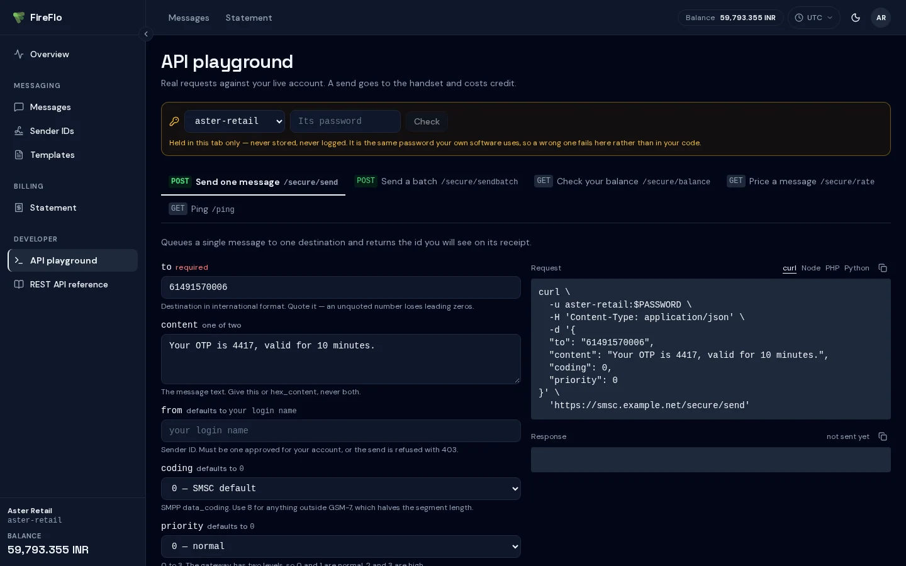
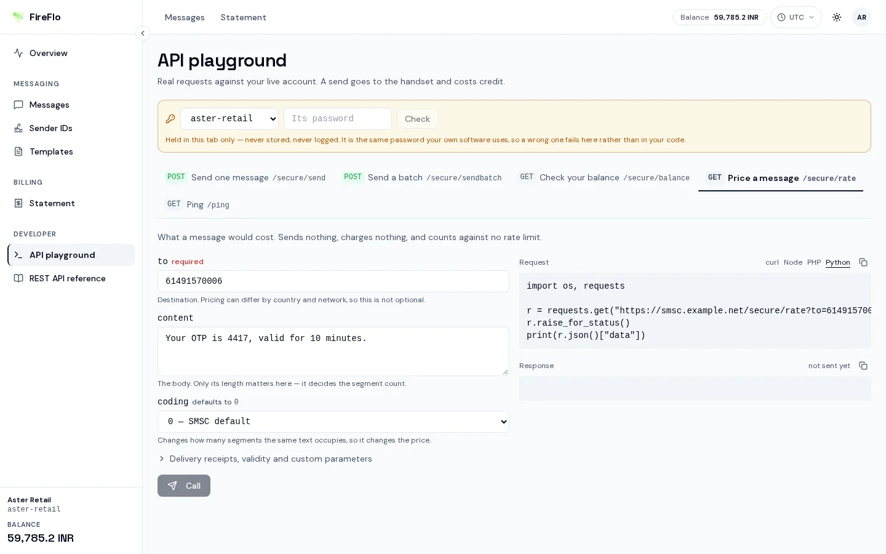
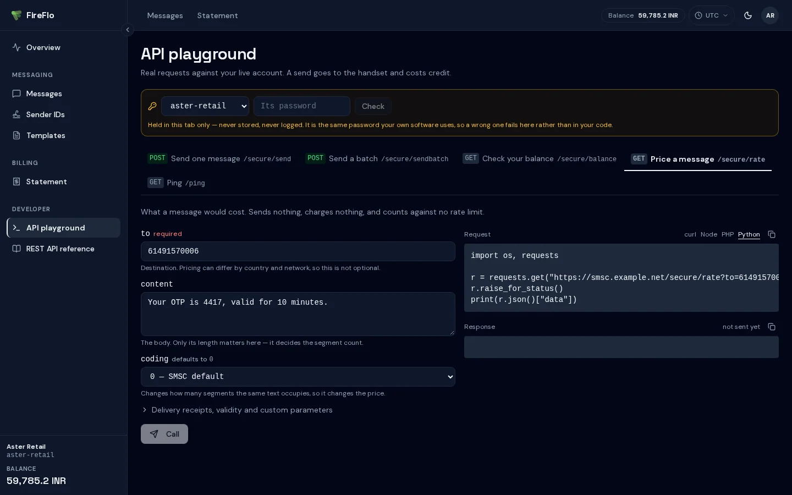
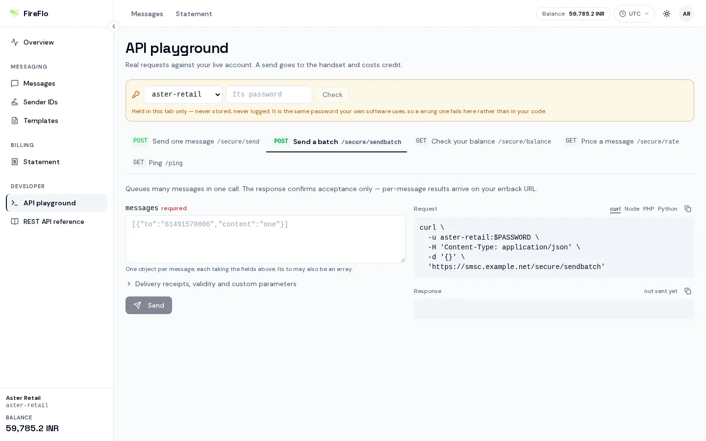
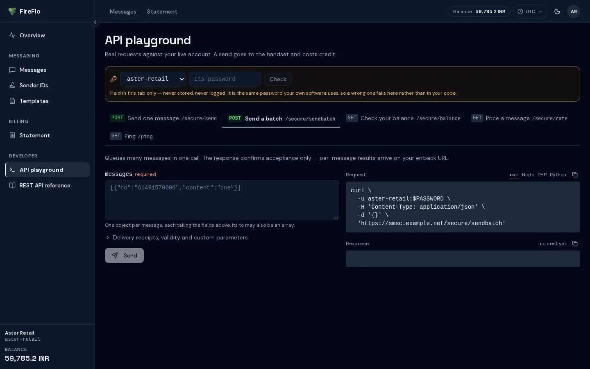
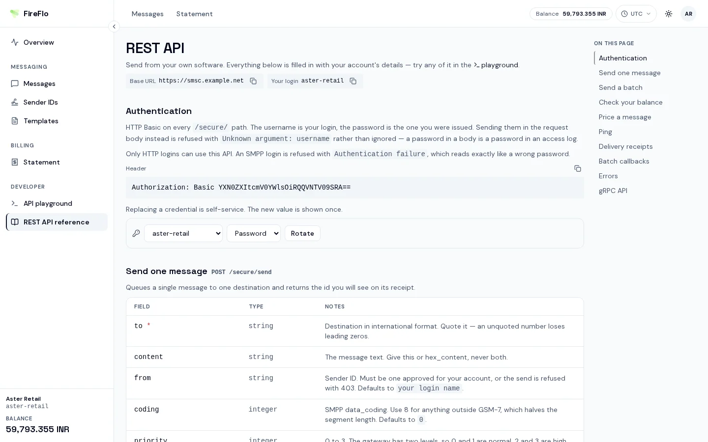
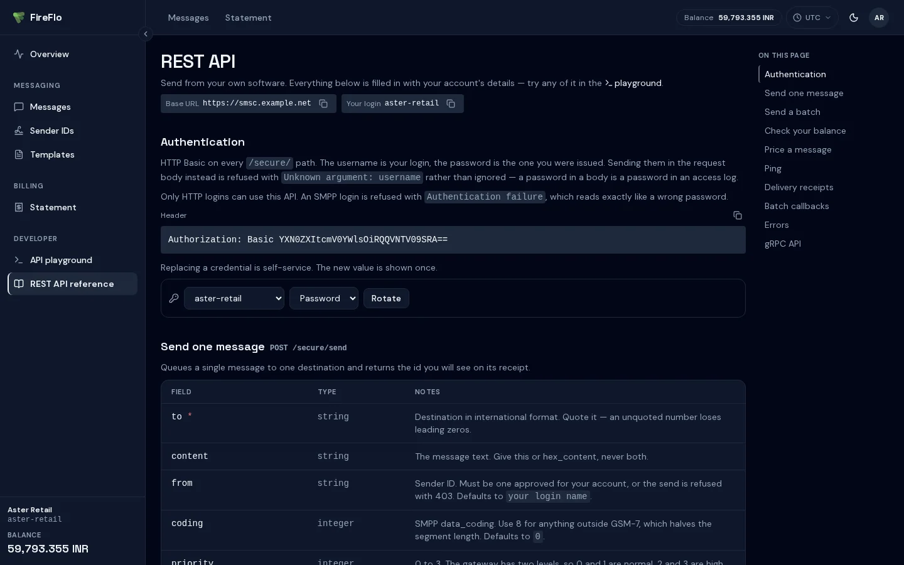

**Requisições reais contra sua conta ao vivo. Um envio vai para o aparelho e custa crédito.**

Não existe sandbox. O playground existe porque o intervalo entre um exemplo documentado e uma
chamada funcional é onde integrações se perdem: um número entre aspas que perdeu os zeros à
esquerda, um `custom_tlvs` enviado como lista em vez de objeto, um sender ID que nunca foi aprovado.
Tudo isso falha aqui, onde você vê as palavras do próprio gateway, em vez de no seu código às três
da manhã.

<Warning>
**Um envio é um envio.** Não existe diálogo de confirmação antes, deliberadamente. O custo está na
descrição da página e de novo ao lado do botão, e não há como desfazer. Aponte para um aparelho seu.

Tarifar uma mensagem é a única chamada que não envia nada, não cobra nada e não conta em nenhum
rate limit. Use à vontade.
</Warning>

<Frame caption="O playground em Send one message: escolha um login e verifique a senha dele no topo, preencha o formulário, e a requisição é construída ao lado a partir da sua própria base URL e login. A senha vive na aba e em nenhum outro lugar.">
  
  
</Frame>

## Conectando

Escolha um login de API e insira a senha. Ela é verificada contra o gateway antes de qualquer outra
coisa ser habilitada, e uma senha errada é recusada nas palavras do próprio gateway, não no palpite
do painel.

> Mantida apenas nesta aba, nunca armazenada, nunca registrada em log. É a mesma senha que seu
> software usa, então uma senha errada falha aqui, e não no seu código.

Só logins HTTP podem usar essa API. Um login SMPP é recusado com uma falha de autenticação que se
parece exatamente com uma senha errada.

## Os cinco endpoints

| Endpoint | O que faz |
| :--- | :--- |
| **Enviar uma mensagem** | Enfileira uma única mensagem e retorna o id que aparecerá no recibo |
| **Enviar um batch** | Enfileira muitas em uma chamada. A resposta confirma apenas aceitação |
| **Verificar seu saldo** | O que sobrou na conta em que este login fatura |
| **Tarifar uma mensagem** | Quanto uma mensagem custaria. Não envia nada, não cobra nada |
| **Ping** | Liveness. O único endpoint que não precisa de credenciais. Útil para um monitor |

Cada campo é rotulado com seu nome no wire, marcado como obrigatório ou opcional com seu padrão, e
tem uma nota de uma linha. Várias dessas notas existem por causa de um erro específico:

- `to` — **entre aspas.** Um número sem aspas perde os zeros à esquerda.
- `content` — informe este ou `hex_content`, nunca os dois.
- `from` — precisa ser um aprovado para sua conta, ou o envio é recusado com `403`. Vazio, assume o
  nome do seu login. A caixa sugere apenas sender IDs **aprovados**; os pendentes estão
  deliberadamente ausentes, porque oferecer um que você ainda não pode usar produziria uma recusa que
  o formulário poderia ter previsto. Você ainda pode digitar um, já que uma aprovação pode chegar
  depois que a página carregou.
- `coding` — use 8 para qualquer coisa fora de GSM-7. Isso reduz o comprimento do segmento pela
  metade.
- `validity_period` — minutos inteiros, não uma string de duração.

`custom_tlvs` tem um editor por linhas, porque o formato JSON é o erro de integração mais comum:

> Parâmetros SMPP extras como objeto JSON — `{"0x1401": "…"}` — não uma lista de pares e não uma
> string entre aspas.

O editor também avisa quando duas linhas nomeiam a mesma tag: o gateway recusa a requisição inteira
em vez de escolher uma para você.

## Lendo a resposta

O painel de resposta traz o status HTTP, o tempo de ida e volta e (a parte útil) uma explicação em
linguagem simples do que o status significa. *"Seu saldo pré-pago não cobre a mensagem. Nada foi
enviado ou cobrado."* é mais acionável do que um 402 seco.

Quando um envio dá certo, o message id é oferecido com um botão de copiar. Esse id vai aparecer no
recibo de entrega e na sua [lista de mensagens](/developers/portal/messages-and-statement).

Ao lado, um painel de **Requisição** mostra a mesma chamada em curl, Node, PHP ou Python, preenchida
com sua própria base URL e login. Copie direto para o seu código.

<Frame caption="Price a message, com a requisição mostrada em Python. Tarifar não envia nada e não cobra nada, então esta é a aba para testar primeiro.">
  
  
</Frame>

As últimas chamadas ficam em um pequeno histórico que você pode recarregar no formulário. Ele vive
na aba e morre com ela.

## Batches

O endpoint de batch aceita uma lista JSON: um objeto por mensagem, cada um com os mesmos campos de um
envio único, e um `to` que pode ser ele mesmo uma lista. A textarea se recusa a enviar JSON
malformado em vez de deixar o gateway rejeitar.

<Frame caption="Send a batch. A linha abaixo das abas avisa antes de você enviar: a resposta confirma apenas aceitação, e os resultados por mensagem chegam na sua errback URL.">
  
  
</Frame>

<Warning>
**A resposta de um batch confirma aceitação, não entrega, e nem mesmo aceitação por mensagem.** Uma
mensagem recusada dentro de um batch (remetente não aprovado, saldo vazio, rate limit) nunca muda a
resposta HTTP, e não há endpoint para perguntar depois como um batch foi.

Recusas por mensagem aparecem em **um único lugar**: sua errback URL. Se você envia batches e não
configurou uma, essas recusas são invisíveis para você.
</Warning>

## A referência ao lado

A **referência da API REST** na mesma seção documenta cada endpoint, preenchido com os valores da
sua conta, além de recibos de entrega, callbacks de batch, a tabela de erros compartilhada, a
gramática de custom TLVs e a API gRPC. Se você revende, ela acrescenta as chamadas para gerenciar
suas próprias contas. Ela também trata de **rotação de credenciais** — trocar uma senha ou API key
por conta própria, com o novo valor mostrado exatamente uma vez.

<Frame caption="A referência da API REST, escrita com sua própria base URL e login; até o cabeçalho Authorization vem preenchido. O controle de rotação fica em Authentication; o sumário corre pela direita.">
  
  
</Frame>

<Note>
Depois de rotacionar, o gateway recarrega credenciais em um timer. Por aproximadamente o próximo
meio minuto, sua credencial **antiga** ainda funciona e a nova ainda não. A página informa quanto
esperar.

Onde uma API key funciona também como nome de usuário, rotacioná-la muda o nome de usuário também.
Então as duas metades da sua configuração precisam mudar juntas, e não há período de graça.
</Note>
