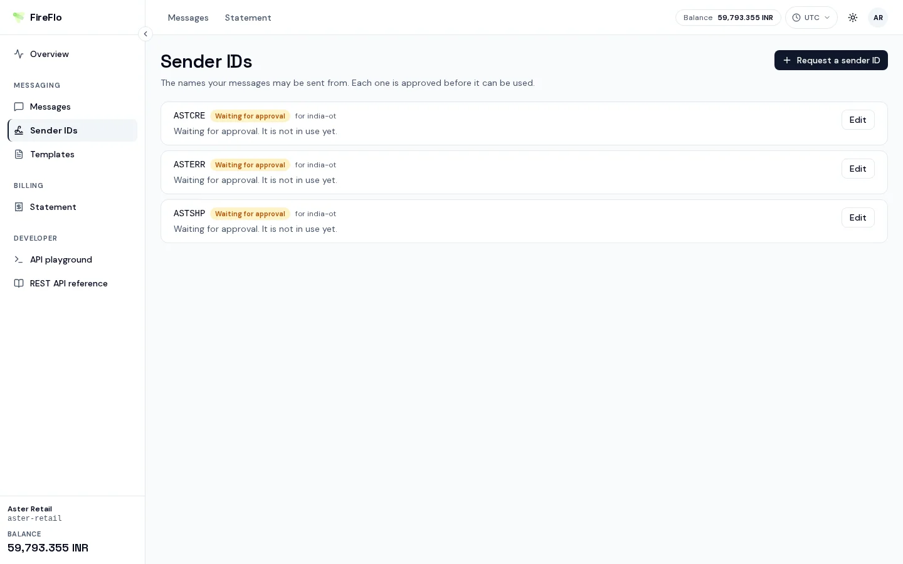
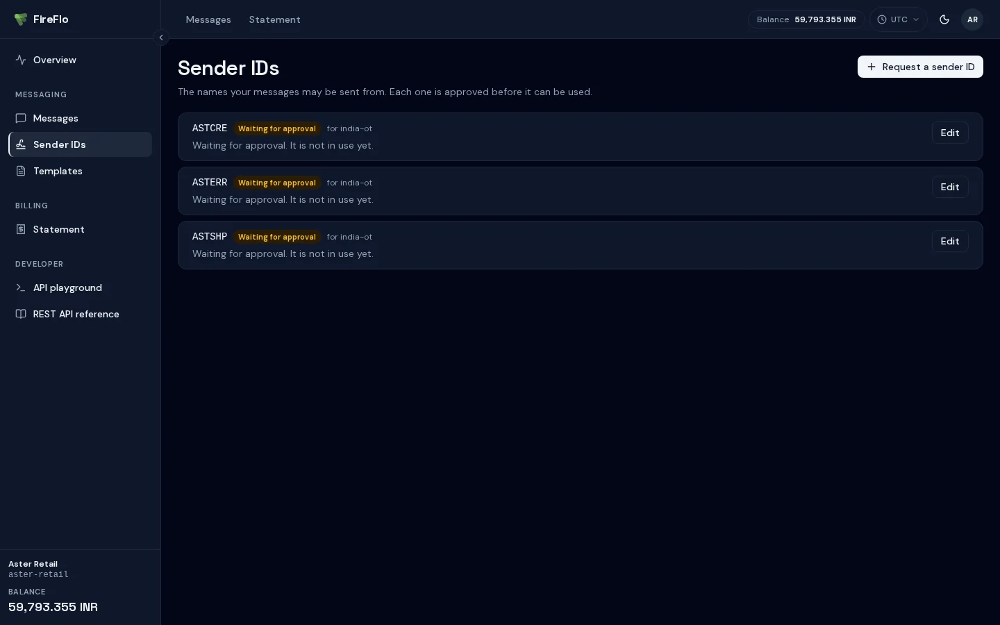
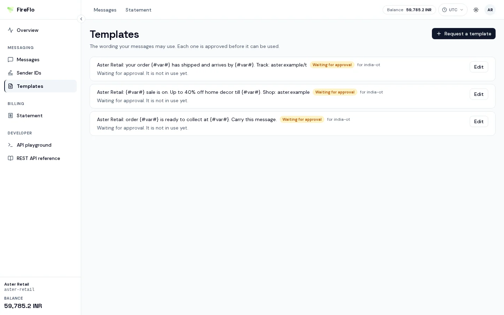
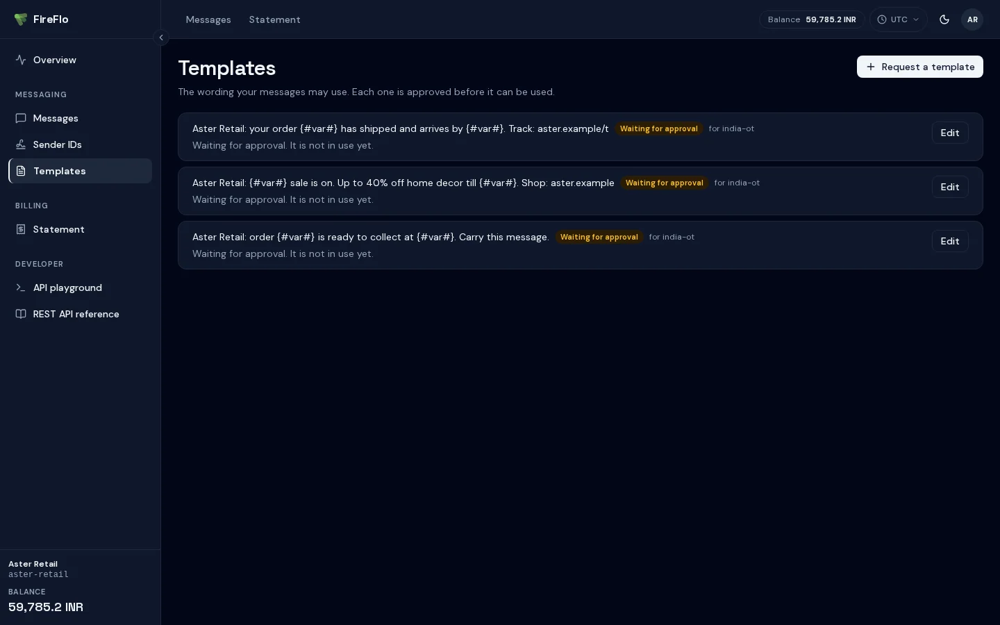
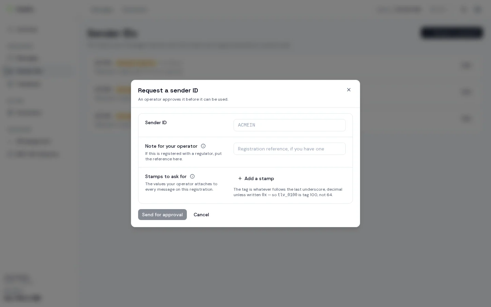
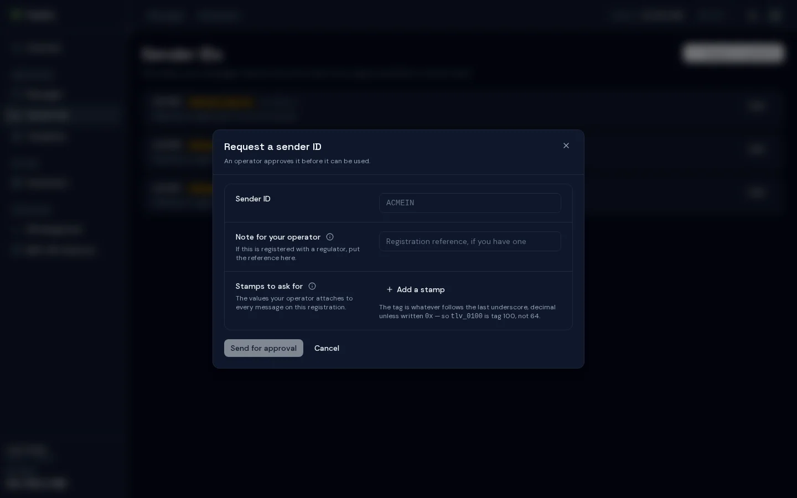

Duas telas, o mesmo formato. **Sender IDs** são os nomes de onde suas mensagens podem partir.
**Templates** são o texto que elas podem usar. Cada um é aprovado pelo seu provedor antes de poder
ser usado.

<Note>
**Nada nessas telas aprova nada.** Cada save é uma solicitação. Essa é a parte que mais surpreende
clientes: um registro que você acabou de criar e vê na lista ainda não é utilizável.
</Note>

Se algum dos dois é obrigatório é escolha do seu provedor. Onde é (o regime DLT indiano é o caso
óbvio), um remetente não registrado ou texto não aprovado é recusado na submissão.

## Os quatro estados

| Badge | Na API | Significado |
| :--- | :--- | :--- |
| **Aguardando aprovação** | `PENDING` | Submetido, ainda não revisado. Não utilizável |
| **Em uso** | `APPROVED` | Aprovado e no ar |
| **Não aprovado** | `REJECTED` | Recusado, com o motivo do seu provedor exibido |
| **Retirado** | `WITHDRAWN` | Foi aprovado, desligado pelo seu provedor. Não utilizável |

A coluna do meio é o que [`/secure/senders`](/reference/api/senders) e
[`/secure/templates`](/reference/api/templates) retornam, então as duas superfícies descrevem os
mesmos quatro estados em vez de oito. **Somente `APPROVED` é utilizável** — os outros três
significam que uma mensagem será recusada, por motivos diferentes.

Cada linha também diz a qual produto se aplica. Assim que algum dos seus registros estiver vinculado
a um login, todas as linhas passam a dizer também qual login cobrem: um específico ou **todos os seus
logins**.

<Frame caption="Sender IDs, cada um com seu estado e o produto a que se destina. Estes três ainda aguardam aprovação, e cada um diz isso com todas as letras: ainda não está em uso.">
  
  
</Frame>

<Frame caption="Templates, no mesmo formato. Os espaços {#var#} são o que pode mudar; tudo ao redor é comparado exatamente.">
  
  
</Frame>

## Solicitando um sender ID

**Request a sender ID** abre um formulário curto: o próprio sender ID, uma **Note for your operator**
e os [stamps a solicitar](#stamps).

<Frame caption="O formulário de solicitação. Só o sender ID é necessário; a nota é onde vai a referência de registro junto a um regulador, e nada é utilizável até que seu operador aprove.">
  
  
</Frame>

> **Note for your operator** — se isto está registrado junto a um regulador, coloque a referência
> aqui. Seu operador define o valor que o gateway envia; você não precisa.

O sender ID é o campo que é verificado. Vale conhecer as recusas antes de encontrá-las:

- Um sender ID tem no máximo 64 caracteres, **mas o SMPP permite 21**. Qualquer coisa perto do
  limite superior pode ficar armazenada aqui e nunca ser entregue.
- Espaços iniciais ou finais são recusados diretamente. Um sender ID é comparado exatamente, e um
  espaço final é invisível em todos os lugares em que é exibido.
- Precisa ser ASCII imprimível.

## Solicitando um template

Um **nome**, para você e seu provedor reconhecerem, comparado com nada. Depois, o **texto**, que é
comparado exatamente, exceto pelos espaços que você marca. A nota para o seu operador e os stamps vêm
em seguida, como para um sender ID.

> Coloque `{#var#}` onde a mensagem muda: um nome, um código, um número de pedido. Tudo o mais
> precisa bater exatamente.

Existem três placeholders:

| Placeholder | Aceita |
| :--- | :--- |
| `{#var#}` | Qualquer coisa |
| `{#num#}` | Dígitos 0–9 |
| `{#alp#}` | Letras, espaços e pontuação de nome |

Um preview ao vivo mostra uma mensagem de exemplo que seu template aceitaria. É o jeito mais rápido
de detectar um template mais restrito ou mais amplo do que você pretendia.

### Onde os templates dão errado

O formulário recusa cada um destes com uma frase, e não com um código:

**Um token escrito errado.** `{#VAR#}` ou `{#Var#}` não é placeholder. Escreva o token em
minúsculas, sem espaços dentro. É a grafia, não uma afirmação sobre o que ele aceita.

**Algo que parece placeholder e não é**, como `{#VAR}` ou `{{#var#}}`. Os caracteres em volta de um
placeholder real são comparados literalmente, então isso só aprovaria uma mensagem que os carregue
exatamente como escritos.

**Dois placeholders colados.** Duas variáveis sem nada entre elas não podem ser separadas, então
funcionam como uma variável do dobro do comprimento. Coloque o texto que as separa entre elas.

**Um template feito só de um placeholder**, que aceita qualquer mensagem. É o mesmo que não ter
template.

Você também pode receber um aviso em vez de recusa, quando o texto se repete em volta da parte
variável. Isso pode fazer o template casar menos do que você espera, e vale confirmar com seu
provedor.

## Stamps

Em **Stamps to ask for** você pode propor os valores que seu provedor anexa a cada mensagem neste
registro. No DLT, os identificadores de entidade e template. **Add a stamp** dá a você uma tag e um
valor por linha.

> A tag é o que vem depois do último sublinhado, em decimal a menos que escrita com `0x`; então
> `tlv_0100` é a tag 100, não 64.

> **Perguntar é grátis:** nada aqui chega a uma mensagem até que seu operador aceite, então um
> registro aprovado continua funcionando enquanto isso.

Se você já pediu e não teve resposta, salvar substitui o que seu provedor vai ver, em vez de
enfileirar uma segunda solicitação.

## Qual login

Onde sua conta tem mais de um login de API, o formulário também oferece **Which login**, para
vincular um registro a um deles. Com um único login, a escolha não aparece.

<Warning>
**Deixe em "Todos os meus logins" a menos que você saiba que quer outra coisa.** Vinculado a um só
login, o registro não faz nada pelos outros. E um login sem nada aprovado não consegue enviar nada.
</Warning>

## Pedindo para um dos seus clientes

Se você revende, o formulário também pergunta **Who this is for**: sua própria conta ou um dos seus
clientes. Escolha um cliente e o registro é solicitado na conta dele, e seu operador o aprova antes
que o cliente possa enviar com ele. Um registro pedido para um cliente cobre todos os logins dele.

## Editando algo que está em uso

Mudar o texto, o sender ID, o nome, a nota ou o login em um registro ao vivo envia de volta para
aprovação, e o botão de salvar pede confirmação:

> Isso deixa de ser utilizável até que um operador aprove a mudança.

Se for o seu único registro em uso, o aviso diz, porque a consequência é maior:

> Isso deixa de ser utilizável até que um operador aprove a mudança. E é o seu único em uso, então
> nada será aceito desta conta até lá.

**Mudar apenas os stamps propostos não suspende nada** e salva sem confirmação, já que eles não
entram em vigor até serem aceitos, de qualquer forma.

Se você precisa do novo texto ao vivo antes do antigo sair, solicite o novo como um template
separado e deixe seu provedor retirar o antigo em seguida.

## Fazendo isso do seu próprio código

Tudo o que há nessas duas telas também está na API REST, então um cliente com muitos registros não
precisa passar pelo portal um a um:

<CardGroup cols={2}>
  <Card title="/secure/senders" icon="id-card" href="/reference/api/senders">
    Listar, solicitar, alterar e retirar sender IDs.
  </Card>
  <Card title="/secure/templates" icon="align-left" href="/reference/api/templates">
    As mesmas quatro chamadas para texto.
  </Card>
</CardGroup>

As mesmas credenciais com que você envia, e as mesmas regras — o que você escreve é uma
**solicitação**, e a API diz em qual estado está cada registro e se registros estão sendo exigidos
na sua conta.

<Note>
**Disponível a partir do gateway 0.9.7.** Se esses endpoints respondem `404`, seu provedor está
rodando um gateway mais antigo e essas telas são o jeito de pedir.
</Note>
