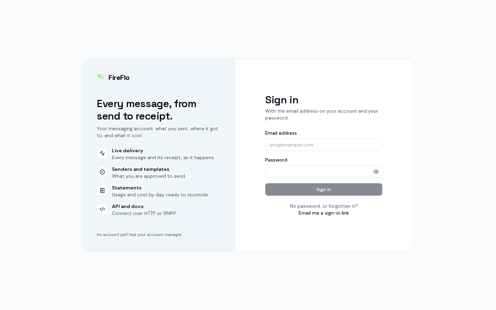
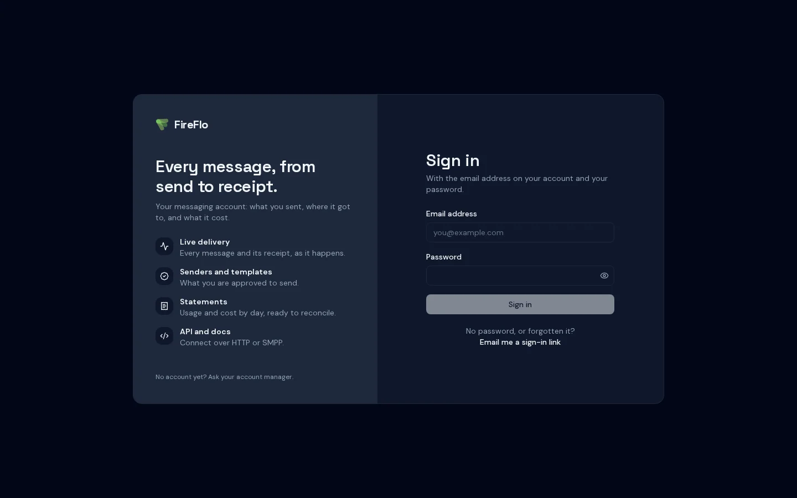
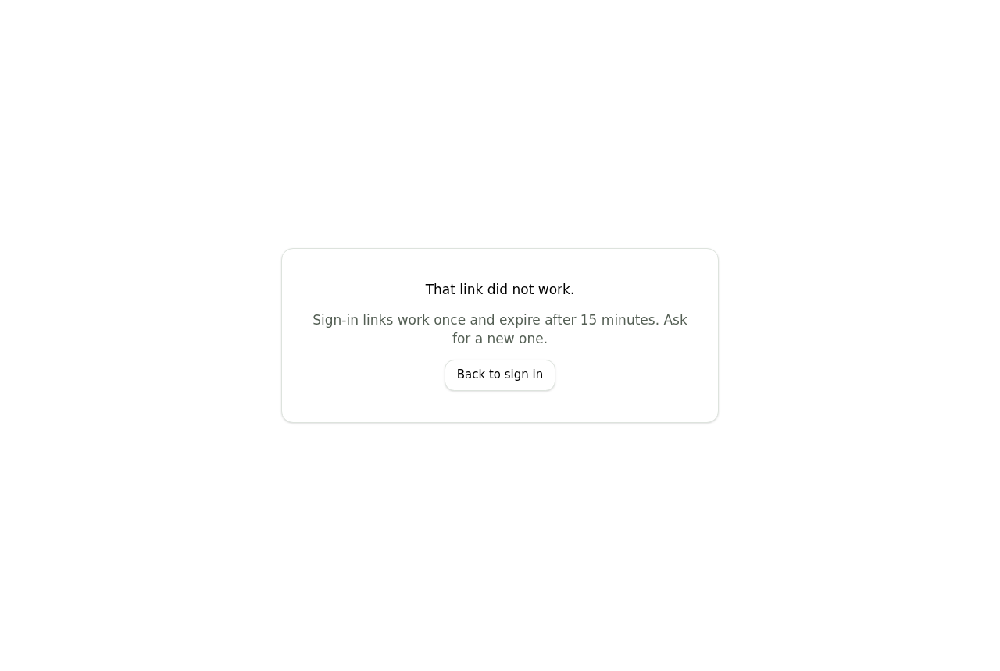
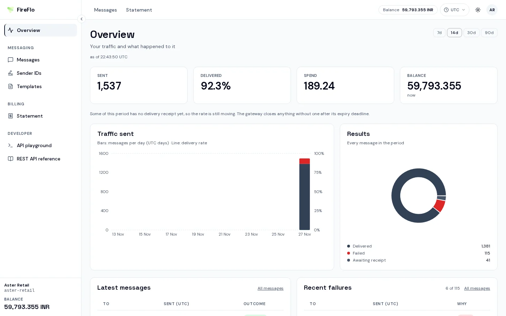
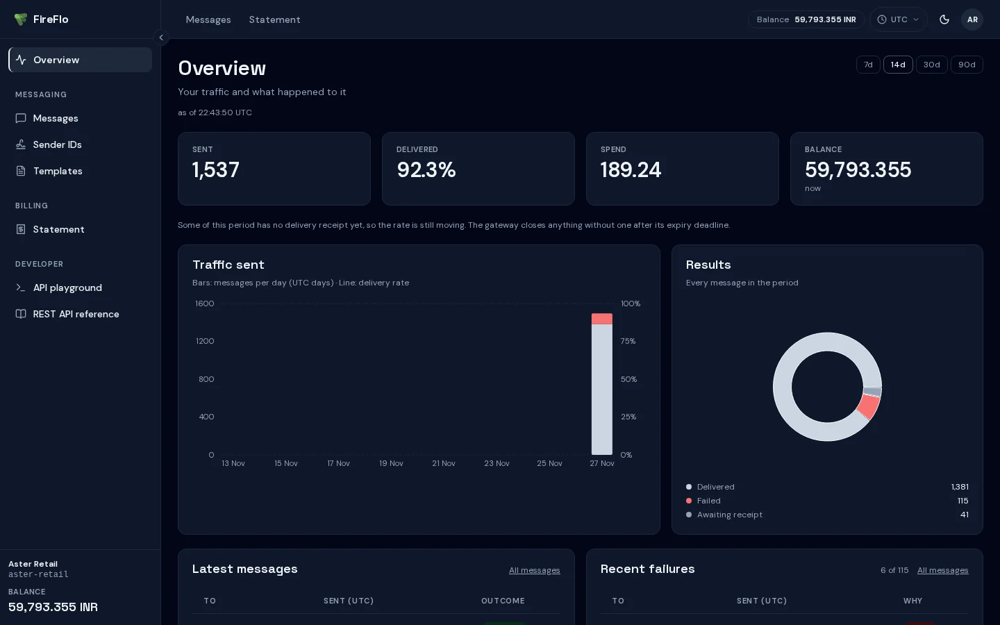

Você entra no portal com o endereço de e-mail que seu operador mantém para o seu login e com uma de
duas coisas: **sua senha** ou **um link de uso único** enviado para esse endereço. Os dois levam ao
mesmo lugar, e você pode usar qualquer um em qualquer dia. Ter uma senha não desliga o link.

<Frame caption="A tela de sign-in do portal. Endereço de e-mail e senha primeiro; abaixo deles, um link de sign-in por e-mail para quem não tem senha ou a esqueceu.">
  
  
</Frame>

## Com senha

> Entre com o endereço de e-mail da sua conta e sua senha.

Se qualquer uma das metades estiver errada, a resposta é uma frase:

> Esse e-mail e essa senha não conferem, ou esse login ainda não tem senha. Você pode entrar por um
> link enviado por e-mail.

<Note>
**Essa frase é a mesma, seja qual for o erro**: um endereço que não está em nenhuma conta, uma senha
errada, um login sem senha ou uma conta desativada. Um formulário que dissesse qual metade estava
errada contaria a qualquer um com uma lista de endereços quais deles são clientes do seu provedor.
</Note>

### Senhas erradas demais

Depois de **dez** senhas erradas para um endereço a partir da mesma rede dentro de quinze minutos, ou
de **trinta** para esse endereço de qualquer lugar, o sign-in com senha é recusado para esse endereço
até passarem os quinze minutos, **mesmo com a senha certa**. A recusa é exatamente igual à de uma
senha errada, então ela não vai avisar que isso aconteceu.

Se uma senha de que você tem certeza continua falhando, espere quinze minutos ou use o link de
sign-in: o link não é afetado.

## Conseguindo uma senha

Há duas formas de ter uma:

- **Seu operador define** quando adiciona seu login, ou depois.
- **Você mesmo define.** Entre pelo link, abra o menu da conta no canto superior direito e escolha
  **Password**. Definir a primeira não pede mais nada: entrar pelo link já mostrou que o endereço é
  seu.

> Pelo menos 12 caracteres. Uma frase funciona bem.

O formulário mostra a força da senha enquanto você digita e recusa uma que seja fácil demais de
adivinhar: uma das senhas mais comuns, seu próprio endereço de e-mail, um caractere repetido, uma
sequência do teclado ou do alfabeto.

**Trocar a senha pede a atual primeiro**, para que uma sessão deixada aberta numa máquina
compartilhada não possa ser usada para tomar seu login. Tentativas erradas ali contam para o mesmo
limite de quinze minutos do sign-in:

> Tentativas erradas demais. Tente novamente em quinze minutos.

Definir ou trocar a senha **encerra sua sessão em todos os outros lugares**. O navegador em que você
a trocou continua conectado.

<Tip>
**Esqueceu a senha?** Entre pelo link: ele sempre funciona. A página Password não troca uma senha sem
a atual, então, para substituir uma esquecida, peça ao seu operador que a redefina ou a remova. Sem
senha definida, você entra pelo link até definir uma nova.
</Tip>

## Com um link de sign-in

**Email me a sign-in link**, abaixo do formulário de senha, muda para um único campo:

> Envie-me um link: vamos mandar um link de sign-in de uso único para o endereço da sua conta.

O que quer que você tenha digitado, a tela então diz a mesma coisa:

> **Confira sua caixa de entrada.** Se esse endereço está em uma conta, um link de sign-in está a
> caminho de *you@example.com*. Ele funciona uma vez e expira em 15 minutos.

<Note>
**Essa resposta não muda se o endereço estiver errado.** É idêntica para um endereço em uma conta,
em uma conta desativada e para um endereço nunca visto.

É deliberado, pelo mesmo motivo da resposta de senha acima. O custo dessa proteção é que um erro de
digitação parece exatamente com sucesso. Se nada chegar, verifique o endereço antes de supor uma
falha.
</Note>

Dois controles ficam abaixo. **Send it again** fica desativado por dois minutos e faz uma contagem
regressiva; o timer sobrevive a um reload de página e se corrige quando você volta do seu cliente de
e-mail, em vez de mostrar um número desatualizado. **Use a different address** volta para um
formulário vazio.

> Nada após um ou dois minutos? Verifique o spam e depois envie de novo. O link mais recente é o que
> funciona.

Essa última frase importa: solicitar um segundo link não deixa o primeiro válido. Siga o e-mail mais
recente.

**Have a password? Sign in with it** leva de volta ao formulário de senha.

### Seguindo o link

Se o link já foi usado, ou tem mais de quinze minutos:

> **Esse link não funcionou.** Links de sign-in funcionam uma vez e expiram em 15 minutos. Peça um
> novo.

<Frame caption="O que aparece com um link usado ou expirado. Os dois são normais. Um link é gasto no momento em que dá certo, então seguir o mesmo e-mail duas vezes produz isso.">
  
</Frame>

Os dois são normais. Um link é gasto no momento em que funciona, então seguir o mesmo e-mail duas
vezes (ou ter um scanner de e-mail seguindo antes de você) produz isso.

### Limites dos links

Solicitações de link têm rate limit por conta e por rede. O limite por conta responde com a mesma
frase neutra do sucesso, então você não é avisado de que atingiu. O limite por rede avisa:

> Muitas solicitações de sign-in desse endereço. Tente novamente em breve.

Se seu provedor não configurou o painel para enviar e-mail, você recebe um erro real em vez de um
link que nunca chega:

> Sign-in por e-mail não está disponível neste painel. Fale com seu gerente de conta.

É uma configuração de implantação do lado dele, não algo que você pode contornar. Uma senha, se você
tiver uma, continua funcionando.

## Onde você cai

De um jeito ou de outro, você cai em **Overview**, não nas suas mensagens, porque a primeira pergunta
depois do sign-in costuma ser "como estão as coisas", não "mostre a linha 4.000".

<Frame caption="Overview, a primeira página depois do sign-in: enviadas, entregues, gasto e saldo do período, o gráfico de tráfego e os resultados, com as últimas mensagens e as falhas recentes embaixo.">
  
  
</Frame>

O gráfico, os cartões e os resultados dessa página são montados a partir do seu tráfego uma vez por
minuto e servidos dali; uma linha abaixo do título diz **as of** que horas. Seu saldo e as duas
listas de mensagens recentes são lidos ao vivo toda vez. Se a última montagem tiver falhado, a linha
diz que os números são os anteriores, em vez de mostrar uma página de erro.

Os horários em todo o portal aparecem no fuso escolhido na barra do topo: o **fuso da plataforma** do
seu provedor por padrão, para que você e ele citem os mesmos horários um ao outro, ou o fuso **do seu
navegador**, ou **UTC**. A escolha fica guardada nesse navegador. Os dias nos gráficos e nos extratos
sempre vão de meia-noite a meia-noite no fuso da plataforma, seja qual for a sua escolha.

## Continuando conectado

Sua sessão é mantida em um cookie no navegador em que você entrou. Ela dura doze horas e é renovada
enquanto o portal está aberto, então um portal deixado sem uso por mais tempo pede um novo sign-in.
**Sign out** fica no menu da conta, no canto superior direito. Entrar no celular não encerra a sessão
no desktop. Se você usar o portal em uma máquina compartilhada, saia em vez de fechar a aba.
