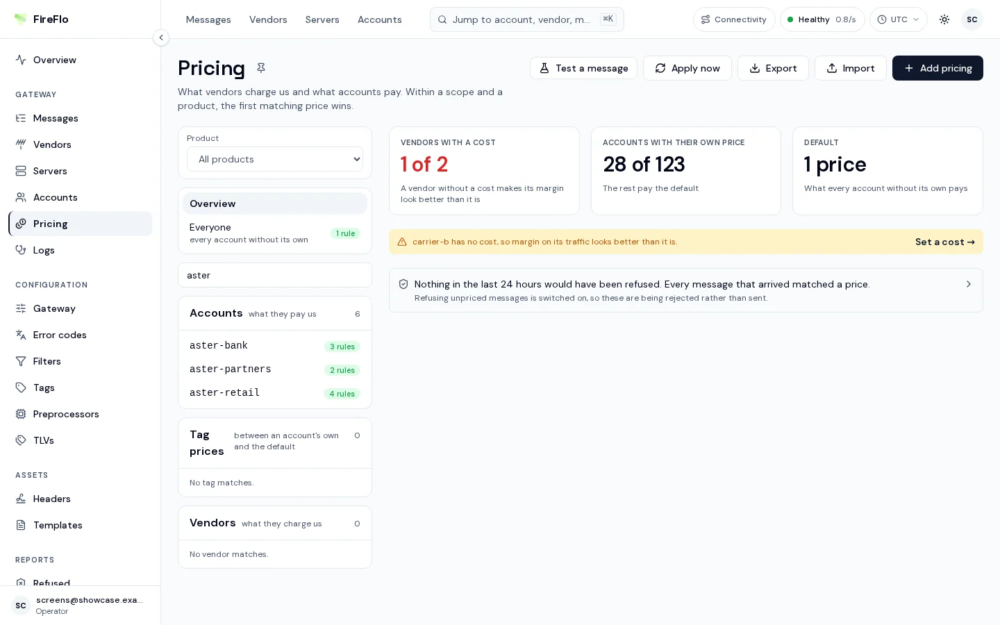
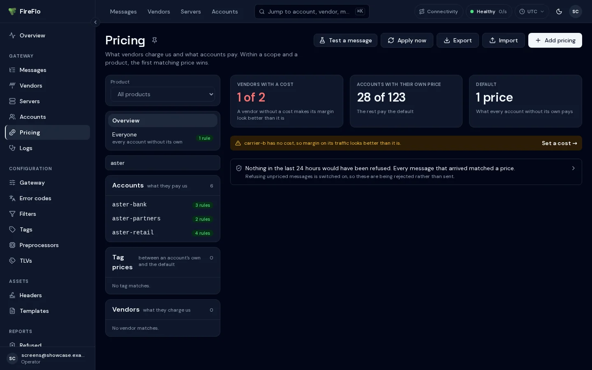
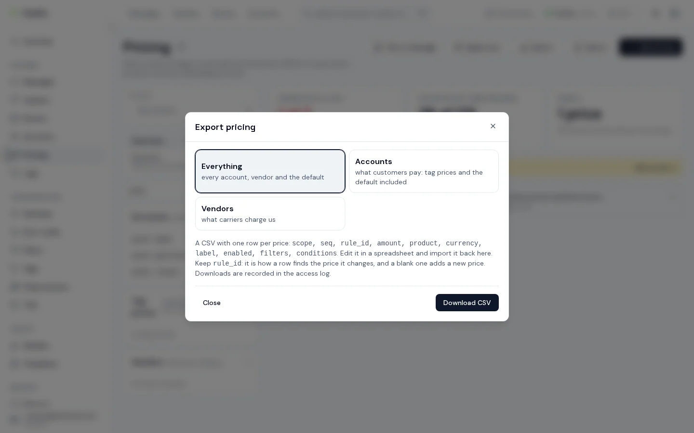
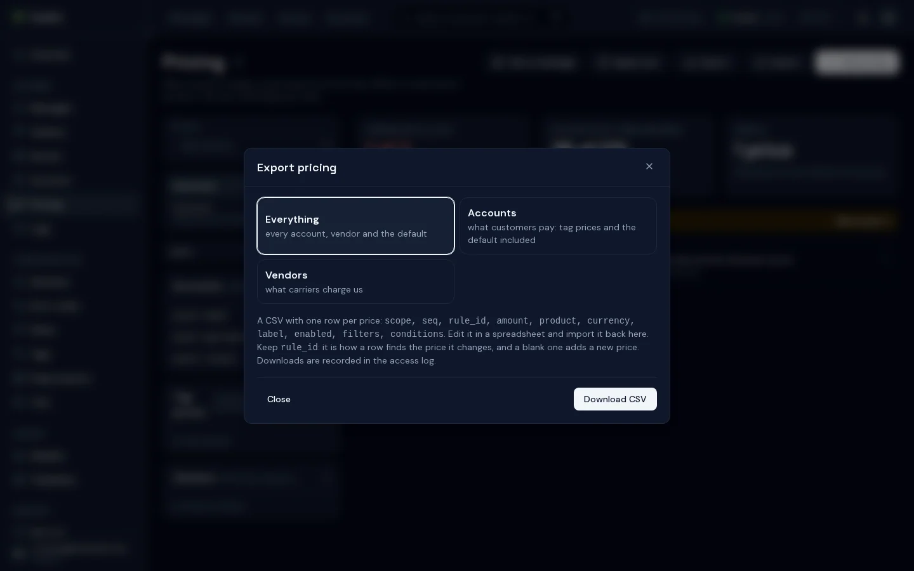

## Editando rates a partir do painel

Os preços são editados na página **Pricing**. À esquerda ficam os scopes: **Everyone** (o default
`*`), **Accounts** (o que elas nos pagam), **Tag prices** e **Vendors** (o que eles nos cobram). O
seletor **Product** restringe a página a um produto.

<Frame caption="A página Pricing. Os cartões respondem às perguntas que custam dinheiro: quais vendors não têm custo, quantas contas pagam um preço próprio e quanto todos os outros pagam.">
  
  
</Frame>

Abra um scope para ver os preços dele, agrupados por produto. Edições, adições, movimentações e o
ligar ou desligar de um preço ficam preparados e são salvos juntos. **Add pricing** pergunta de quem
são os preços a acrescentar (uma conta, um vendor, uma tag ou todos) e abre esse scope. Quando um
produto não tem default, a página dele e a visão geral de Pricing oferecem **Set what everyone pays**.

A partir da 0.17.0 a página *Pricing* também lista **Tag prices**: uma lista de preços por
[tag de conta](/platform/routing/account-tags), tentada depois dos preços próprios de uma conta e antes
do default, na ordem da lista Tags.

A aba **Tariff** de uma conta mostra os mesmos preços para essa conta e qual nível a precificaria.
Quando uma plataforma gestora definiu uma tarifa customizada para a conta, a aba a mostra acima das
regras: ela é aplicada antes delas e só é alterada naquela plataforma.

<Warning>
As regras próprias de uma account são tentadas primeiro e **a primeira que casar vence**, portanto
qualquer coisa que a account carregue bate o default. **Inclusive um catch-all puro.**

É isso que faz de uma tarifa negociada um override em vez de uma sugestão. Também significa que um
catch-all no nível da account desabilita silenciosamente todos os defaults que você configurar depois.
O mesmo vale para os preços por tag: o catch-all próprio de uma conta também os vence.
</Warning>

## Exportando e importando preços

**Export** na página Pricing baixa os preços como CSV, uma linha por preço: **Everything**,
**Accounts** (o que os clientes pagam, com os preços por tag e o default) ou **Vendors** (o que as
operadoras nos cobram). Os downloads ficam registrados no access log.

<Frame caption="Export pricing. Mantenha a coluna rule_id ao editar o arquivo: é por ela que uma linha encontra o preço que altera.">
  
  
</Frame>

Edite o arquivo numa planilha e traga de volta com **Import** (até 2 MB). Uma linha com `rule_id` em
branco acrescenta um preço novo.

<Warning>
**Cada conta ou vendor citado no arquivo é substituído pelas linhas do arquivo.** Um preço que o
arquivo não lista para esse scope é removido. Os scopes que o arquivo não cita ficam como estão.
</Warning>

Nada muda até você ler o preview. Ele lista, por scope, o que é acrescentado, alterado e removido. As
remoções precisam ser ligadas à parte antes que **Apply** seja oferecido, e aplicar pede confirmação
mais uma vez. Cada scope é salvo separadamente, então, se um falhar, os anteriores já estão
aplicados. O gateway passa a precificar pelas linhas novas a partir do próximo poll de configuração.

## Duas identidades, não uma

Se o crédito de uma conta bate é verificado contra **duas** equações. Errar isso reporta uma
discrepância falsa em toda conta, portanto vale a pena declarar com precisão.

```
MONEY:        Σ(RECHARGE + TRANSFER)  =  balance + reserved
CONSUMPTION:  reserved − consumed     =  credit reserved but not yet spent   (≥ 0)
```

<Warning>
**A equação óbvia está errada.** `credited − consumed = balance + reserved` foi escrita dessa forma
no design e os dados a refutaram imediatamente. Estava errada por exatamente o consumo em toda conta.

Consumo nunca toca as colunas de balance. Crédito é reservado em blocos (`balance -= n, reserved
+= n`), gasto de um contador em memória, e **a parte gasta nunca é escrita de volta**. Portanto
`reserved` é um contador de lifetime-consumed, não um hold, e todo movimento que o banco vê deixa
`balance + reserved` inalterado.
</Warning>

A identidade do dinheiro se mantém no décimo em toda account, o que é o que torna uma discrepância
genuína significativa.

### O que é excluído, e por quê

| Tipo de entrada | Contado? | Por quê |
| :--- | :--- | :--- |
| `RECHARGE`, `TRANSFER` | **Sim** | Dinheiro entrando na account |
| `RESERVE`, `RELEASE` | Não | Movem um valor entre duas colunas da mesma linha, com net zero |
| `BILL` | Não | Um período fechado registra o que foi faturado e não move nada |

## Lifetime, nunca um período

Crédito é um **total corrente**. Qualquer janela mais curta precisa de um saldo inicial que nada
registra. E uma cifra inicial errada inventa uma discrepância toda vez que roda.

<Tip>
Portanto, "reconcilie esta conta para março" não é uma pergunta que os dados podem responder.
"Reconcilie esta conta" é, e sempre foi.
</Tip>

## De onde vêm os dois lados

| Lado | Fonte |
| :--- | :--- |
| Creditado | `Σ RECHARGE + TRANSFER`, **apenas aplicadas** — entradas pendentes não moveram dinheiro |
| Consumido | `usage_daily` para dias resumidos **mais** `cdr_submit` para o rabo vivo |

Nunca ambos para um dia. Esse é o join que faz a reconciliação sobreviver à janela de retenção: uma
vez que um dia é resumido e purgado, seu consumo ainda conta.

## Quando os números não batem

Vá por esta ordem:

<Steps>
  <Step title="Há recharges pendentes?">
    Um `RECHARGE` para uma account sem linha `account_balance` credita nada e permanece pendente.
    Está no ledger e não no balance — o que é exatamente uma lacuna no lado do dinheiro.
  </Step>
  <Step title="Houve um shutdown não limpo?">
    Um `kill -9` deixa crédito preso em `reserved`. `balance + reserved` ainda é conservado, portanto
    a identidade do dinheiro se mantém — mas a account tem menos gastável do que deveria até que
    `POST /ops/credit/release` rode.
  </Step>
  <Step title="O rollup está atrasado?">
    Um dia nem resumido nem ainda em `cdr_submit` é consumo que ninguém conta. O purge deveria tornar
    isso impossível; verifique se ele não foi contornado.
  </Step>
  <Step title="O painel está lendo o mesmo banco?">
    `METRICS_DATABASE_URL` contra o `FIREFLO_DB_URL` do gateway. Uma divergência aqui faz toda cifra
    discordar de uma forma que se parece com um bug de contabilidade.
  </Step>
</Steps>

## Relacionado

<CardGroup cols={2}>
  <Card title="Como o pricing funciona" icon="tag" href="/platform/billing/how-pricing-works">
    Scopes, o default `*` e LCR.
  </Card>
  <Card title="Crédito prepaid" icon="wallet" href="/platform/billing/prepaid-credit">
    Blocos, reservas e o ledger.
  </Card>
</CardGroup>
