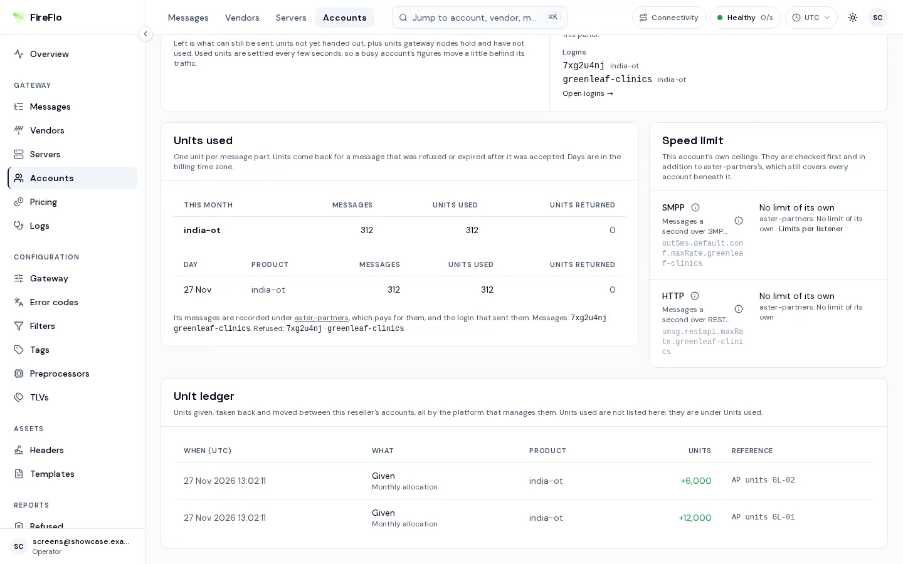
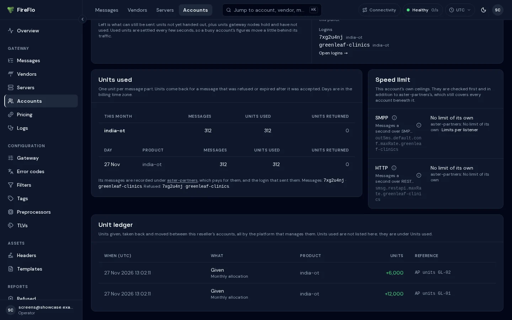

A partir da **0.16.0**, uma conta filha pode ser uma **conta de unidades**. Ela tem unidades de mensagem
por produto e nenhum dinheiro. As mensagens dela são cobradas, em dinheiro, da sua conta-pai.

Ela existe para um reseller que vende a um cliente "5.000 SMS" em vez de um valor em crédito: o cliente
pode enviar exatamente o que recebeu, tanto em SMPP quanto pela API HTTP, e o gateway conta conforme as
mensagens são enviadas.

## Quem paga, e quem é limitado

| | A conta de unidades | A conta-pai |
| :--- | :--- | :--- |
| **Tem** | Unidades, por produto. Nunca dinheiro | Dinheiro: um saldo pré-pago ou um limite pós-pago |
| **Preços** | Nenhum próprio | A tarifa da conta-pai precifica toda mensagem |
| **Cada parte de mensagem** | Consome **uma unidade** do produto do login | É cobrada pelo preço da conta-pai |
| **Registros de faturamento** | Nomeada ao lado da mensagem, como a sua conta de unidades | É a conta em que a mensagem é faturada |

Um envio precisa dos dois: uma unidade na conta de unidades **e** crédito na conta-pai. Unidades são um
limite, não dinheiro pré-pago. Uma mensagem de três partes consome três unidades.

Uma conta de unidades é sempre filha direta de uma conta que tem dinheiro. Uma conta de unidades não
pode ter filhas próprias.

## Como as unidades são contadas

As unidades são contadas pelo mesmo motor que conta o [crédito pré-pago](/platform/billing/prepaid-credit):
cada nó do gateway reserva um bloco, gasta-o da memória sem nenhuma chamada ao banco por mensagem, e
liquida o que foi gasto. A contagem é exata após um crash.

- **Uma mensagem reembolsada devolve a sua unidade**, uma vez: uma recusa do fornecedor, uma expiração,
  um descarte, uma mensagem que não pôde ser enfileirada.
- **Pequenas franquias são repartidas com justiça.** Um nó nunca reserva mais do que a sua parte do que
  está livre, e devolve um bloco que não usou por alguns segundos, então cinco unidades num gateway de
  dois nós são cinco mensagens enviáveis, seja qual for o nó que o cliente alcance.
- As unidades são aplicadas onde quer que o crédito pré-pago seja. Num gateway com a aplicação do
  pré-pago desligada, os logins de uma conta de unidades não são carregados e não podem fazer bind nem
  enviar: nada as estaria contando.

## O que um cliente vê quando elas acabam

| Situação | Motivo registrado | SMPP | API HTTP | gRPC |
| :--- | :--- | :--- | :--- | :--- |
| Não restam unidades do seu produto | `noUnits` | `0x403` (`conf.status.noUnits`) | `402`, código `NO_UNITS` | `FAILED_PRECONDITION`, `NO_UNITS` |
| As unidades dela estão retidas por outro nó por um momento | `unitsPending` | `0x14` | `503`, código `UNITS_PENDING`, `Retry-After: 5` | `UNAVAILABLE`, `UNITS_PENDING` |
| Ela tem unidades, a conta-pai não tem crédito | `insufficientCredit` | `0x402` | `402` | `FAILED_PRECONDITION`, `INSUFFICIENT_CREDIT` |
| Ela tem unidades, o crédito da conta-pai não é confirmado a tempo (0.17.2; uma nova tentativa passa) | `creditPending` | `0x58` | `503`, code `CREDIT_PENDING`, `Retry-After: 2` | `UNAVAILABLE`, `CREDIT_PENDING` |

Nada é cobrado em nenhum dos três, e no terceiro a unidade é devolvida.

`0x403` deliberadamente não é o `0x402` de sem crédito: um cliente consegue distinguir "estou sem
unidades" de "meu provedor está sem dinheiro". O status é definido por listener com
`conf.status.noUnits`, em hexadecimal ou decimal; o padrão é `0x00000403`.

`unitsPending` é o único que vale a pena repetir: unidades retidas em outro lugar voltam em segundos.

## De onde vêm as contas de unidades

Uma conta de unidades é criada, recebe unidades e tem unidades retiradas pela **plataforma que a
gerencia** (o FireFlo OMNI, por exemplo), pela API de gerenciamento do gateway. O painel de controle
mostra as contas de unidades e o seu ledger; ele não as cria nem move unidades.

Toda concessão, retirada e movimentação é escrita num ledger de unidades somente de inclusão, sob uma
referência, e uma repetição com a mesma referência não muda nada. Para toda conta e produto, livres +
reservadas + usadas é igual à soma do seu ledger.

Uma plataforma só pode criar contas de unidades enquanto a aplicação do pré-pago estiver ligada **e
todo nó do gateway em execução for 0.16.0 ou mais novo**. Durante uma atualização gradual, isso começa
assim que o último nó mais antigo sai.

Uma conta existente nunca é convertida. Uma conta de dinheiro continua sendo uma conta de dinheiro; uma
conta de unidades é uma conta nova sob a conta-pai.

Dinheiro não pode ser movido para ou de uma conta de unidades: top-ups, débitos e transferências de
crédito que nomeiem uma são recusados.

## O que um login de unidades não pode fazer

Um login de unidades não é a sua conta-pai na API de autoatendimento.

- **Balance** responde com as suas próprias unidades, nunca com o dinheiro da conta-pai. Veja
  [Balance](/reference/api/balance#a-units-login).
- Um envio aceito não mostra o preço da conta-pai.
- A cotação de tarifa, as transferências de crédito, os registros de sender ID e de template e a lista
  de lotes respondem `403` com código `UNITS_LOGIN`. Eles pertencem à conta que paga.

## Com que velocidade ela pode enviar

Uma conta de unidades pode ter um limite de velocidade próprio, além do da sua conta-pai. A plataforma
que a gerencia o define; dois valores, e qualquer um deles pode ficar sem definição.

| | SMPP | HTTP (REST, gRPC) |
| :--- | :--- | :--- |
| **Chave** | `conf.maxRate.<conta de unidades>` | `smsg.restapi.maxRate.<conta de unidades>` |
| **Escopo** | Por listener; num cluster cada nó aplica a sua parte | Por nó, a sua parte do cluster |
| **O que limita** | Submits por segundo de toda sessão de todo login da conta de unidades. Cada parte de uma mensagem longa conta como um | Requisições de envio por segundo dos logins da conta de unidades. Uma por mensagem |
| **Acima do limite** | `0x58` (`ESME_RTHROTTLED`) | `429`, código `RATE_LIMITED` |

**Precedência.** Um submit é verificado primeiro contra o limite próprio da conta de unidades. Acima
dele, o submit é recusado sem consumir o limite da conta-pai, então um cliente enviando rápido demais
não esgota a franquia do seu reseller. Dentro dele, os limites da conta-pai se aplicam como sempre: o
`conf.maxRate` próprio da conta-pai, o padrão do listener e o orçamento da porta. Um login com um
limite próprio mais rápido continua preso ao limite da sua conta de unidades.

`0x58` significa "vá mais devagar"; `0x14` significa "tente de novo em instantes". Ambos são
reenviados por um cliente bem-comportado. `0x58` não é só o limite de velocidade: a partir da 0.17.2
a mensagem de uma conta em dinheiro cujo crédito não foi confirmado a tempo (`creditPending`) também
responde `0x58`, por padrão; veja [Códigos de status](/reference/smpp/status-codes). As recusas
próprias de um login de unidades não mudam: `noUnits` é `0x403` e `unitsPending` é `0x14`.

Vazio ou `0` significa que a conta de unidades não tem limite próprio, e só os da conta-pai se
aplicam.

Os binds de um login de unidades contam contra o limite de conexões da sua conta-pai. Não há limite de
binds separado por conta de unidades.

## No painel de controle

A página de uma conta de unidades diz **units** no lugar de um saldo e nomeia a conta em que ela é
cobrada. A sua aba **Billing** mostra as unidades restantes e usadas por produto, os seus logins, as
unidades usadas neste mês e por dia, os seus limites de velocidade e o ledger de unidades. As abas
Tariff e Statement não são mostradas: os preços e o extrato são da conta-pai. Nenhuma ação de dinheiro
é oferecida.

<Frame caption="A aba Billing de uma conta de unidades. As unidades restantes por produto à esquerda, a conta que paga à direita, e depois as unidades usadas e os limites de velocidade próprios da conta.">
  
  
</Frame>

**Left** é o que ainda pode ser enviado: unidades ainda não distribuídas, mais as unidades que os nós
do gateway seguram e não usaram. As unidades usadas são acertadas a cada poucos segundos, então,
numa conta movimentada, os números andam um pouco atrás do tráfego.

O **Unit ledger** lista toda concessão, retirada e movimentação, com o seu produto e a sua referência.
As unidades usadas não aparecem ali; elas ficam em **Units used**.

<Frame caption="O ledger de unidades. Cada lote de unidades que a plataforma gestora concedeu ou retirou, cada um sob a sua própria referência.">
  
  
</Frame>

A aba **Billing** de uma conta-pai lista as suas subcontas, com as unidades restantes por produto e um
estado "no units". Se as contas de unidades ainda não podem ser usadas, porque um nó é mais antigo que
0.16.0 ou a aplicação do pré-pago está desligada, a aba diz qual dos dois.

As mensagens recusadas aparecem em [Refused](/platform/control-panel/refused) sob **No units left** e
**Units being reserved; try again**. A conta mostrada ali é a conta-pai, que paga; o login é o da conta
de unidades.

## Atualizando para a 0.16.0

O schema passa de 1.129.0 para 1.131.0, então atualize com `--migrate`. Isso adiciona tabelas de
unidades vazias e uma coluna anulável no registro de chamada. Uma instalação sem contas de unidades se
comporta como na 0.15.13. Uma chave é nova, `conf.status.noUnits`; nada precisa ser definido.

Atualize o painel de controle junto com o gateway: um painel mais antigo reporta o schema como mais
novo do que espera.

## Relacionado

<CardGroup cols={2}>
  <Card title="Crédito pré-pago" icon="wallet" href="/platform/billing/prepaid-credit">
    O motor pelo qual as unidades são contadas.
  </Card>
  <Card title="Códigos de status" icon="hashtag" href="/reference/smpp/status-codes">
    `0x403`, e o que ele deliberadamente não é.
  </Card>
</CardGroup>
