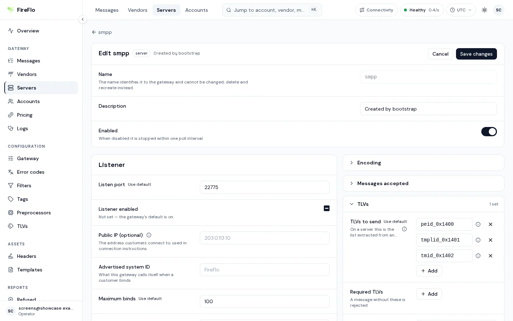
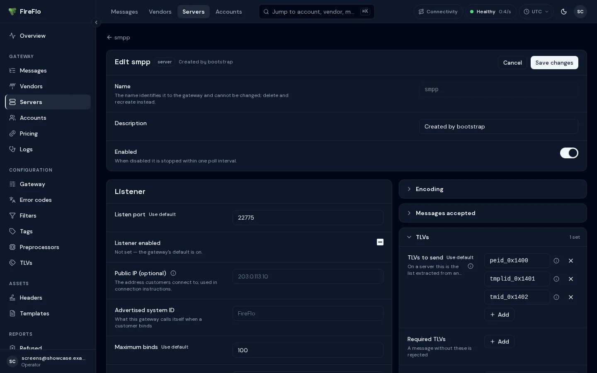
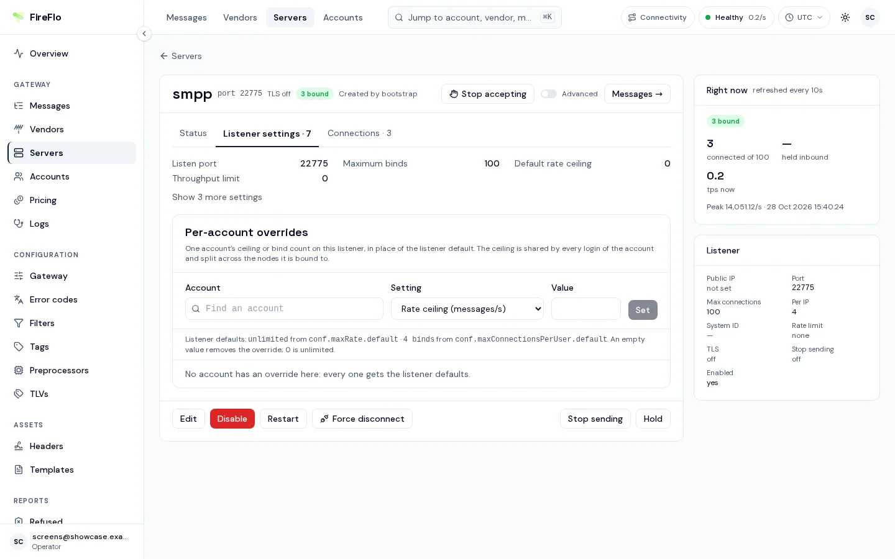
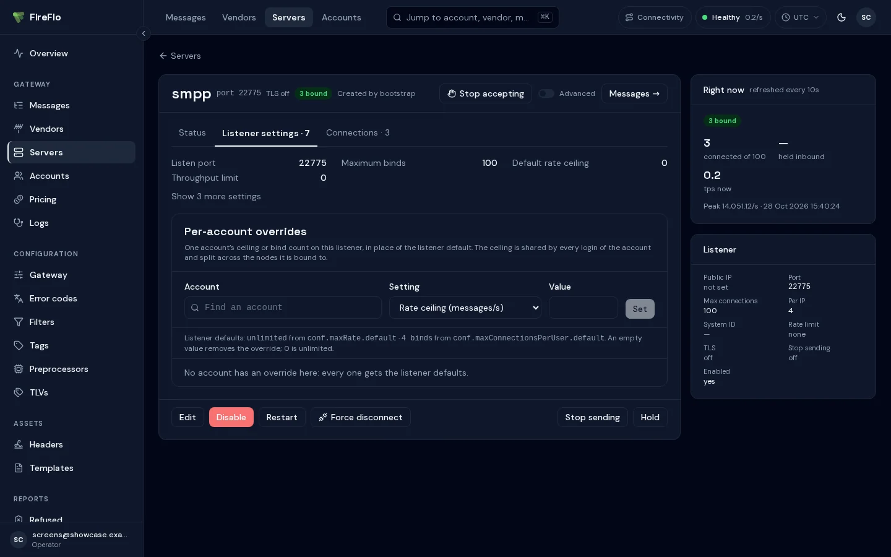
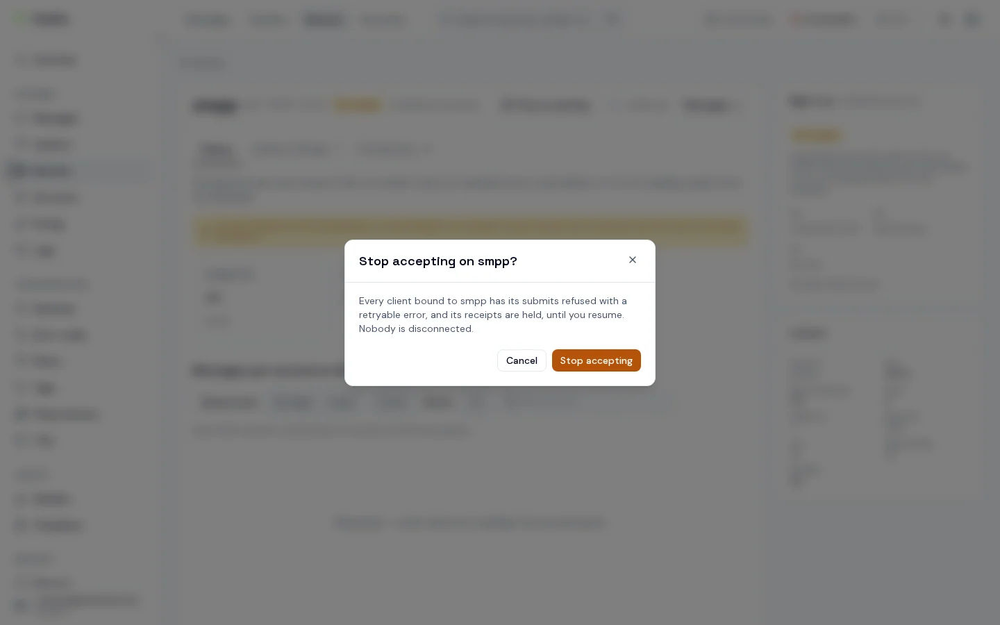
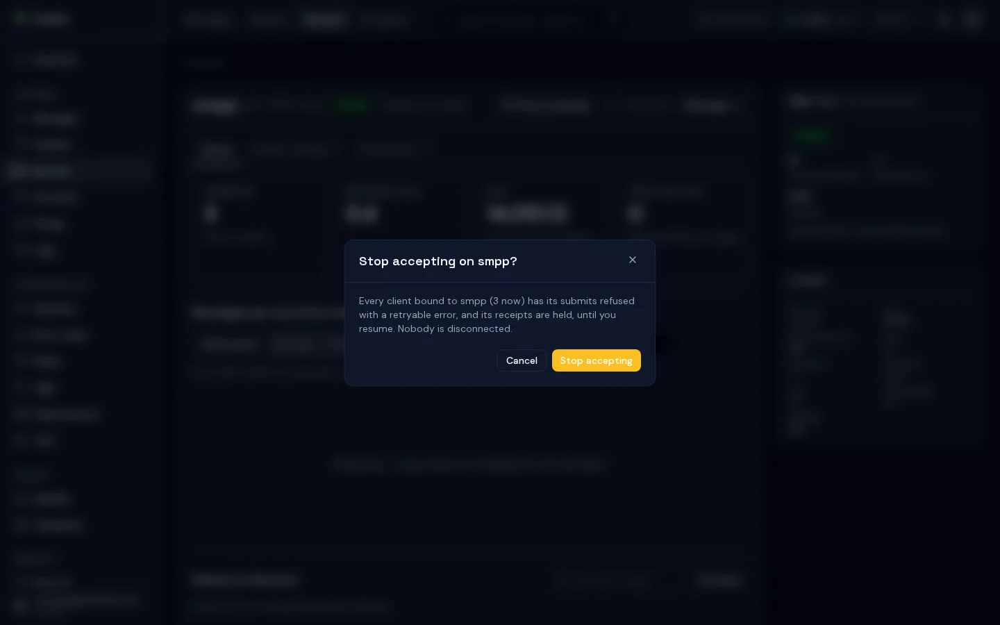
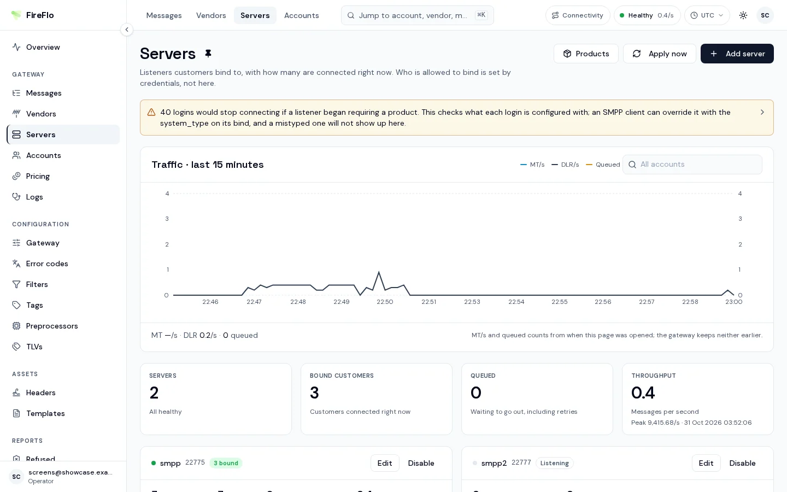
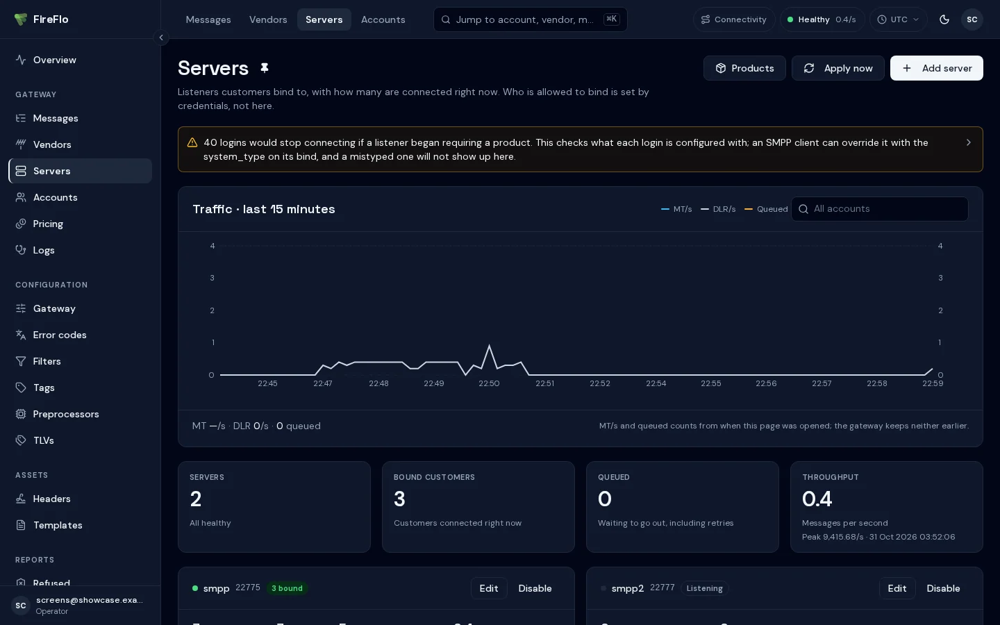
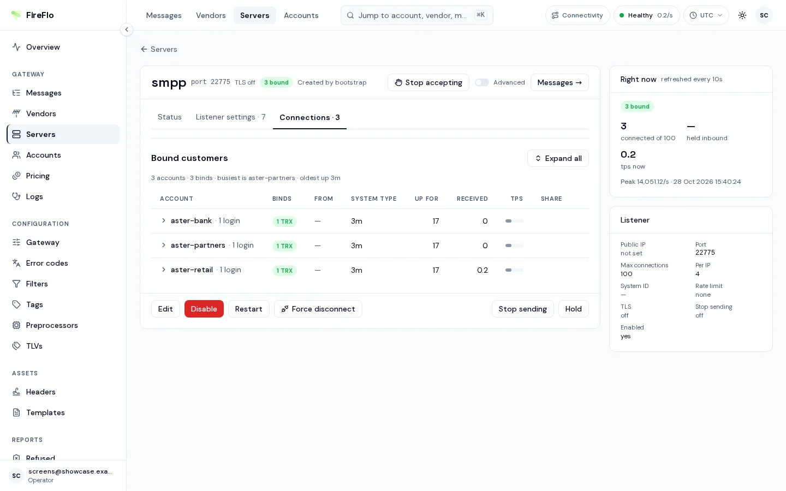
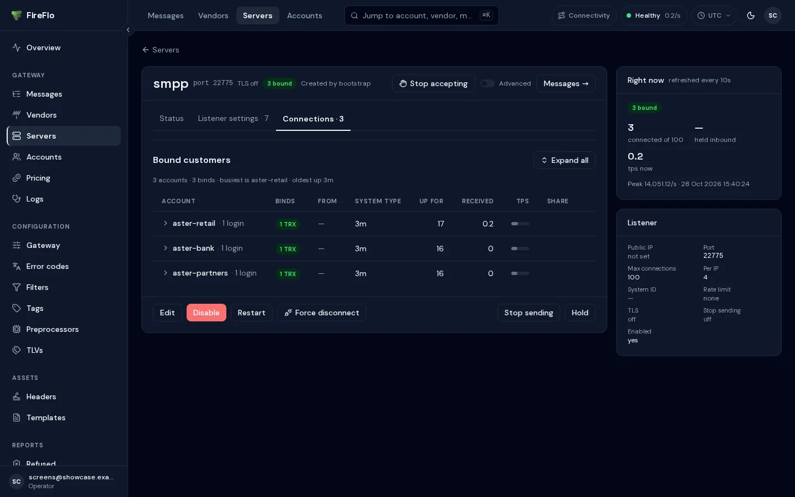

Um **server** é um listener ao qual seus clientes se conectam. Adicionar um é uma porta, um nome e
então a política que você quer aplicada a todos que se conectarem a ele.

## Adicionando um

<Tabs>
  <Tab title="Painel de controle">
    **Servers → Add server.** Nome e porta são os únicos campos obrigatórios; tudo o mais tem um
    default funcional.
  </Tab>
  <Tab title="smsg.properties">
```properties
outSms.instance.smpp.type     = smppserver
outSms.instance.smpp.srv.port = 27777
outSms.instance.smpp.enable   = true
```
  </Tab>
</Tabs>

Todas as configurações estão em [Configurações do Listener](/reference/smpp/server).

<Frame caption="O formulário de edição de um listener. O nome não pode ser mudado depois que o listener é adicionado; em vez disso, apague-o e adicione de novo.">
  
  
</Frame>

<Warning>
**Um listener que não consegue pegar sua porta não para o gateway.** Ele loga e todo o resto
continua rodando — correto para uma implantação com vários listeners, e surpreendente na primeira vez.

Uma inicialização limpa não é prova de que todo listener está no ar. Verifique `/ops/health`.
</Warning>

## Contra o que um bind é verificado, em ordem

<Steps>
  <Step title="A credencial">
    `systemId` e `password` precisam casar com uma credencial `SMPP` habilitada. Veja
    [credentials.yml](/reference/files/credentials-yml).
  </Step>
  <Step title="allowedIps, se configurado">
    Vazio significa **sem restrição**.
  </Step>
  <Step title="Limites de conexão">
    `srv.maxConnections` no total, `srv.maxConnectionsPerIP`, e
    `conf.maxConnectionsPerUser.default` por account.
  </Step>
  <Step title="O product, se conf.product.required está ligado">
    O product resolvido precisa nomear uma linha **habilitada** no catálogo de products. Em branco
    ou desconhecido é recusado com `0x40F` — no bind, não no submit, porque o product vive no
    contexto da sessão.
  </Step>
</Steps>

## De onde vem o product

`system_type` no bind request, com fallback para o campo `product` da credencial.

<Warning>
`system_type` é texto livre validado em nenhum outro lugar. Um cliente bindando `prem` em vez de
`premium` passa em qualquer teste não-vazio e cai no estado **unrated** onde mensagens são entregues
e nada é cobrado.

É por isso que `conf.product.required` verifica **pertencimento ao catálogo** em vez de presença de
um valor — e por que, no modo file, onde não há catálogo, apenas a metade não-vazia se aplica. É
logado uma vez por load de configuração nomeando o listener.
</Warning>

## O que um listener aplica a todos bindados a ele

| Configuração | Efeito |
| :--- | :--- |
| `conf.maxRate.default` | Teto de throughput por account |
| `conf.maxPending.default` | Tamanho da janela — requests não confirmados em trânsito |
| `forward.dlrs` | **Desligado suprime recibos para todos aqui**, qualquer que seja o que cada cliente tenha pedido |
| `conf.whitelist.enabled` | Se sender ID e conteúdo são verificados |
| `mandatory.tlvs.submit` | Tags que uma mensagem precisa carregar, senão `0xC3` |
| `inQueue.capacity` | Mensagens retidas esperando pelo message store |

Os **overrides por account**, na aba **Listener settings** do listener, dão a uma account o seu
próprio teto de taxa ou número de binds neste listener, no lugar do padrão do listener. O teto é
compartilhado por todos os logins da account. Um valor vazio remove o override; `0` é ilimitado.

<Frame caption="O teto de taxa ou o número de binds de uma account no lugar do padrão do listener. Os padrões que ele substitui aparecem abaixo do formulário.">
  
  
</Frame>

## Os estados em que um listener pode estar

| Verbo | Efeito |
| :--- | :--- |
| `enable` / `disable` | Carregado, ou não |
| `suspend` / `resume` | Continua aceitando, não roteia nada: os submits ficam estacionados e são roteados no resume, os mais antigos primeiro; quando o estacionamento enche, os submits são recusados com um erro que permite retry. Os recibos continuam chegando aos clientes |
| `hold` / `release` | Recusa todo submit com um erro que permite retry (`ESME_RMSGQFUL`) e **retém os recibos**. Ninguém é desconectado |

No painel de controle, suspend é **Stop sending** e hold é **Stop accepting** (também **Hold**, no pé
da página do listener). Cada um pergunta antes de agir.

<Frame caption="Stop accepting pergunta primeiro: os clientes bindados têm seus submits recusados com um erro que permite retry e seus recibos retidos até você retomar. Ninguém é desconectado.">
  
  
</Frame>

O painel mostra estes como um badge por card. `Listening` sem ninguém bindado **não** é falha. Um
listener sem clientes conectados é quieto, não quebrado, e é por isso que ele não é pintado de
vermelho como um vendor sem sessão é.

<Frame caption="A página Servers. Um listener tem três clientes bindados; o outro diz Listening, o que só significa que ninguém está bindado.">
  
  
</Frame>

## Derrubando o bind de um cliente

```bash
scripts/fireflo disconnect smpp 7
```

Ids de sessão vêm de `fireflo health`. Eles são o contador do próprio listener, portanto colidem
entre listeners e reiniciam com o gateway.

No painel de controle, abra a aba **Connections** do listener, expanda a account e aperte
**Disconnect** na sessão. Marque **Also disable this login** para mantê-lo fora também.
**Force disconnect**, no pé da página do listener, derruba todas as sessões de um endereço, de uma
account ou de um login nesse listener.

<Frame caption="A aba Connections: cada account bindada com seus binds, system type, tempo conectado e mensagens recebidas. Expanda uma account para chegar às sessões dela.">
  
  
</Frame>

<Note>
**Isso encerra uma conexão; não revoga permissão.** Um cliente saudável faz rebind em segundos a
menos que você também desabilite o login dele.
</Note>

## Mensagens de entrada

`mo.owner.map` decide qual account é dona de qual endereço de entrada. `mo.owner.default` é para
onde uma sem correspondência vai — e **vazio significa lugar nenhum**: o listener loga
`message.mo.unmapped` e a consome em vez de adivinhar um dono.

Deliberado, porque entregar a mensagem de um estranho para o cliente errado é pior. Mas tráfego não
mapeado desaparece silenciosamente a menos que você observe essa linha.
