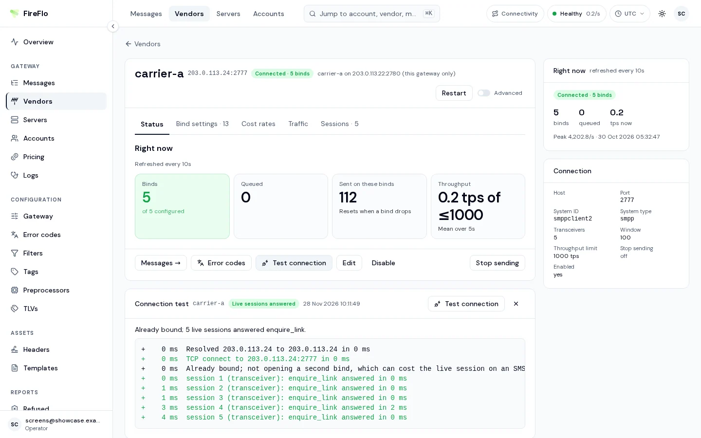
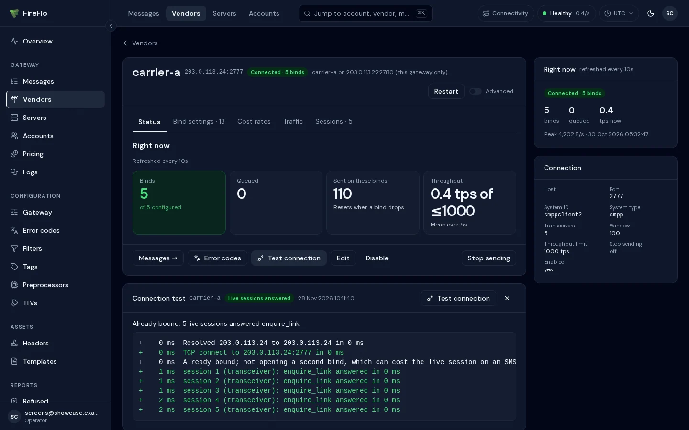
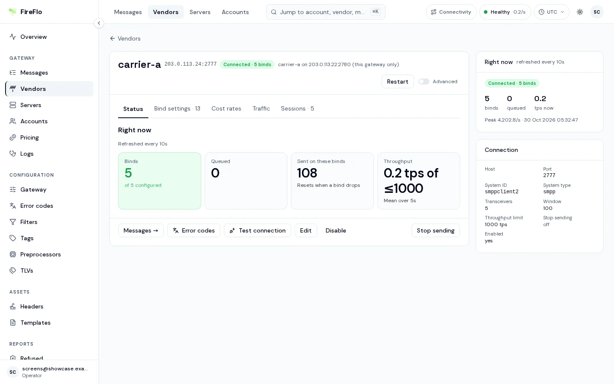
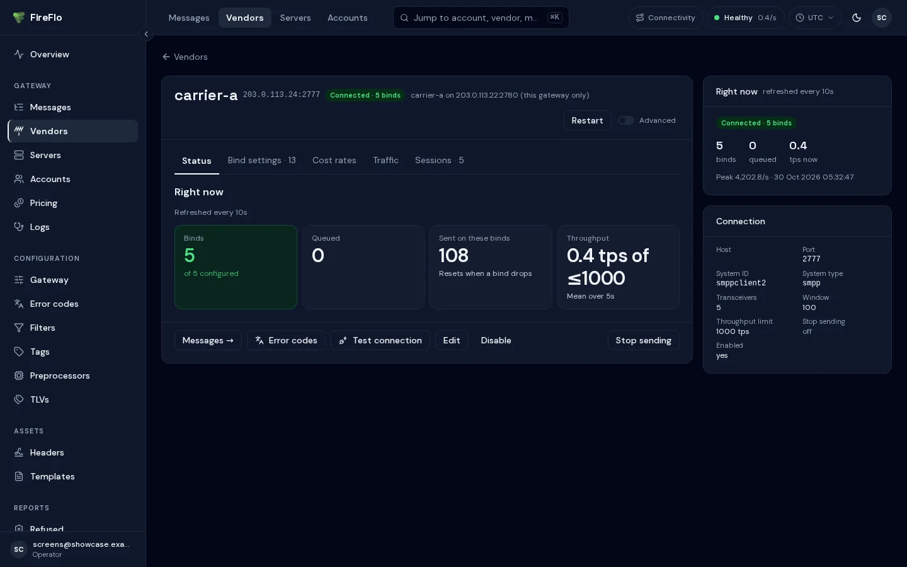
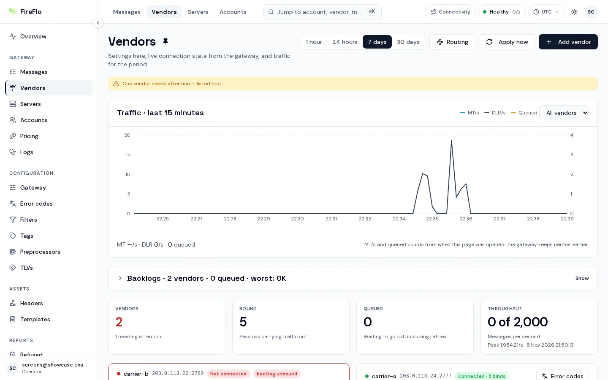
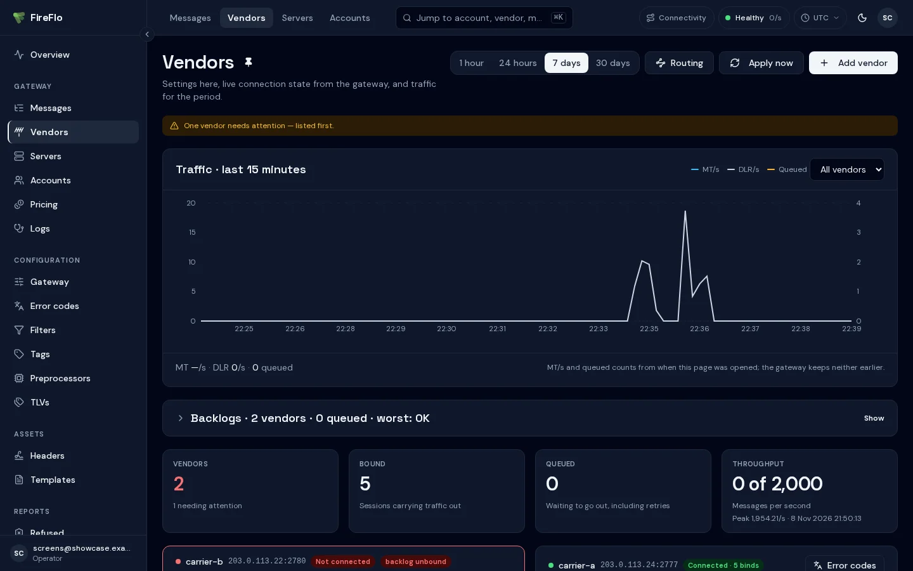
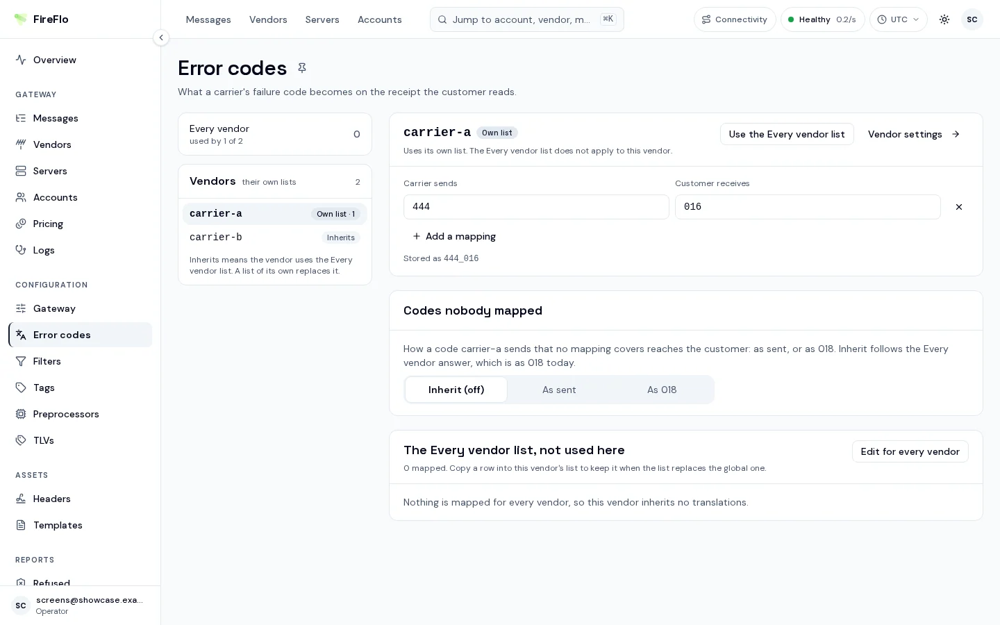
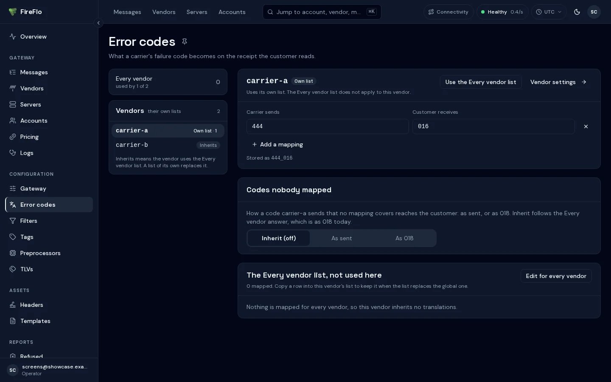

Um **vendor** é uma conexão de saída para quem transporta seu tráfego. O FireFlo disca para ela.

## Adicionando um

<Tabs>
  <Tab title="Painel de controle">
    **Vendors → Add vendor.** Host, port, system id e password. O painel agrupa o resto pelo que
    faz, e cada campo carrega seu default.
  </Tab>
  <Tab title="smsg.properties">
```properties
outSms.instance.vendor1.type     = smppclient
outSms.instance.vendor1.host     = smpp.example.net
outSms.instance.vendor1.port     = 2775
outSms.instance.vendor1.systemId = ourid
outSms.instance.vendor1.password = REPLACE_ME
outSms.instance.vendor1.tps      = 500
outSms.instance.vendor1.connections.transceivers = 2
```
  </Tab>
</Tabs>

Todas as configurações estão em [Configurações do Vendor](/reference/smpp/client).

## Prove antes de o tráfego depender

```bash
scripts/fireflo test-bind vendor1
```

Disca uma vez e reporta cada passo: a resolução do nome, o connect TCP, o bind, três idas e voltas de
`enquire_link` e o unbind. O painel tem a mesma coisa como **Test connection**, na página do vendor.

<Warning>
**Ele nunca abre um segundo bind enquanto o vendor já está bindado.** Um segundo bind no mesmo
`systemId` pode custar a sessão ativa. Muitas operadoras permitem apenas uma. Em vez disso, ele ainda
resolve o endereço e abre uma conexão TCP, depois envia `enquire_link` em cada sessão ativa e mede o
tempo da resposta.
</Warning>

<Frame caption="Um teste de conexão num vendor que já está bindado: o endereço resolvido, o connect TCP e cada sessão ativa respondendo ao enquire_link.">
  
  
</Frame>

## Bound não é o mesmo que capaz de enviar

| Campo | Significa |
| :--- | :--- |
| `bound` | Sessões estabelecidas |
| `bound_transmittable` | Sessões que efetivamente podem carregar tráfego para fora |

Uma sessão carrega tráfego se for um **transceiver**, ou um **transmitter** em uma sessão de
cliente. Um vendor só-receiver binda perfeitamente e não envia nada.

Quando esses dois números diferem, essa é a razão, e o painel mostra **Can send** como sua própria
cifra exatamente para este caso.

<Frame caption="A aba Status de um vendor: seus binds contra os configurados, o que está na fila, o que foi enviado nesses binds e seu throughput contra o limite. Can send aparece ao lado de Binds só quando os dois diferem.">
  
  
</Frame>

## Os quatro estados

| Badge | Significa | Cor |
| :--- | :--- | :--- |
| **Connected** | Bindado e aceitando; o badge acrescenta o número de binds, como **Connected · 5 binds** | Verde |
| **Not connected** | Sem sessão — um vendor sem nenhuma está quebrado | Vermelho |
| **Not accepting** | Suspenso; a fila drena de volta para o router para o tráfego re-rotear | Âmbar |
| **Holding** | Aceitando mas não enviando; **a fila cresce** | Âmbar |
| **Disabled** | Não carregado | Cinza |
| **Not loaded** | O gateway nunca ouviu falar dele | Âmbar |

<Note>
**Not loaded** geralmente significa uma de duas coisas: o gateway não recarregou desde que o vendor
foi adicionado, ou não está lendo workers do banco de forma alguma. O texto de detalhe do badge diz
qual.
</Note>

<Frame caption="A página Vendors. Um vendor que precisa de atenção aparece primeiro: aqui um diz Not connected, o outro Connected com cinco binds.">
  
  
</Frame>

## Retries, e o número que costumava mentir

`maxRetries` limita o **total** de `submit_sm` que uma mensagem pode custar neste vendor —
somando retries dentro do worker **e** toda volta pelo router.

<Warning>
Costumava limitar apenas a metade dentro do worker, e cada hop pelo router entregava uma nova cota.
Um vendor podia ver aproximadamente 100 PDUs para uma mensagem enquanto o painel lia `1`.

Se você ajustou em torno do comportamento antigo, revise o valor. Failing over para um vendor
*diferente* ainda começa um budget fresco — o limite é por vendor.
</Warning>

`status.retry.worker` (default `20,88`) classifica quais status de operadora vale a pena retentar
localmente; `status.retry.router` empurra de volta para outra rota.

`ESME_RSUBMITFAIL` (`0x45`) é tratado como **permanente** — uma lane recusada com ele falha na
primeira resposta em vez de após vinte. Operadoras que significam overload transitório por ele são
reincluídas por vendor: `status.retry.worker = 20,88,69`.

## Formato do número do destinatário

Os destinatários chegam ao fornecedor exatamente como os seus clientes os enviaram, a menos que ative
**Convert recipient automatically** (sob **Detect sender type automatically**, na secção
**Addressing** do fornecedor). Com ela ativa, cada número é reescrito depois do roteamento na forma
que o **Recipient type of number** do fornecedor pede:

| Recipient type of number | O que o fornecedor recebe |
| :--- | :--- |
| 1 — Internacional | Código do país e número, só dígitos: `0412 345 678` → `61412345678` |
| 2 — Nacional | O número como é marcado dentro do país padrão: `+61412345678` → `0412345678`. Um número de outro país segue internacional, com tipo 1 |
| Qualquer outro | Sem alteração |

**Recipient default country** (ao lado de **Address range**) é o código ISO de duas letras, como
`AU` ou `IN`, para números escritos sem código do país. Em branco, só os números escritos com `+` são
convertidos.

Um número que não se consegue ler é enviado como chegou; nada é recusado. Só muda o que vai para o
fornecedor: os registos de chamadas, os recibos, a tarifação e uma nova tentativa por outro
fornecedor mantêm o número como o seu cliente o enviou. Os números que já estão na forma do
fornecedor são reconhecidos sem serem analisados, por isso o débito não é afetado.

## Recibos

`request.dlrs` (default ligado) configura `registered_delivery` em todo `submit_sm` para este vendor.

<Warning>
Desligue e este vendor para de reportar desfechos, portanto toda mensagem por ele se liquida como
`EXPIRED` no prazo. Sua taxa de entrega para aquele vendor se torna **sem sentido**, não zero.
</Warning>

## Controlando um em execução

| Verbo | Use quando |
| :--- | :--- |
| `suspend` | Você quer que o tráfego re-roteie para outro lugar agora — a fila drena de volta para o router |
| `hold` | Você quer que pare de enviar mas mantenha sua fila |
| `disable` | Você quer que suma em um intervalo de poll |

Na página de um vendor, estes são **Stop sending** e **Disable**, deliberadamente com palavras em vez
de icônicos — cada um re-roteia ou para tráfego de produção no momento em que é pressionado, então
cada um pergunta antes. **Restart**, ao lado deles, fecha todas as conexões do vendor e as abre de
novo; as mensagens em trânsito são retentadas. Hold não tem botão na página do vendor; a visão
**Connectivity** o oferece como **Pause sending (queue kept)**.

## Códigos de erro

**Error codes**, na página de um vendor, mapeia um código que a operadora envia para o que o seu
cliente recebe. Um vendor usa a lista **Every vendor** até ter uma lista própria, que a substitui.
**Codes nobody mapped** escolhe se um código que nenhum mapeamento cobre chega ao cliente como foi
enviado ou como `018`; **Inherit** segue a resposta de Every vendor. As configurações por trás disso
estão em [Códigos de erro do delivery receipt](/reference/smpp/client#delivery-receipt-error-codes).

<Frame caption="A lista própria de um vendor: o código 444 da operadora chega ao cliente como 016. Abaixo dela, o que acontece com um código que ninguém mapeou.">
  
  
</Frame>

## Custo

O scope de um vendor na rate table é o que ele cobra de **você**. Sem uma cost rule, a margem sobre
o tráfego por ele é desconhecida em vez de 100%. Veja [rates.conf](/reference/files/rates-conf).
