Abra uma account e escolha **Billing**. No topo, um card responde às duas perguntas com que você a
abre: à esquerda, o que a account tem e as ações que mudam isso; à direita, quantas MT parts ela
enviou. Abaixo dele, **MT usage** ao longo do tempo ao lado de **Does the credit add up?**, e o ledger
completo no fim.

<Frame caption="A aba Billing de uma account. A esquerda do card é o dinheiro e as ações que o mudam; a direita é o que a account enviou.">
  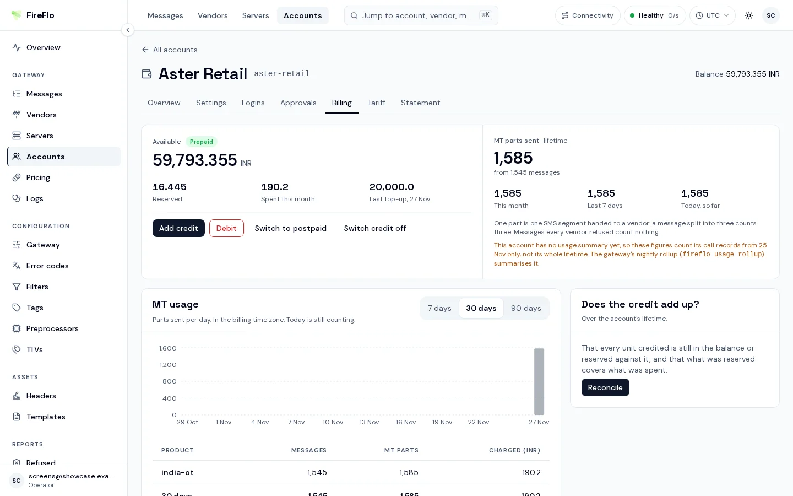
  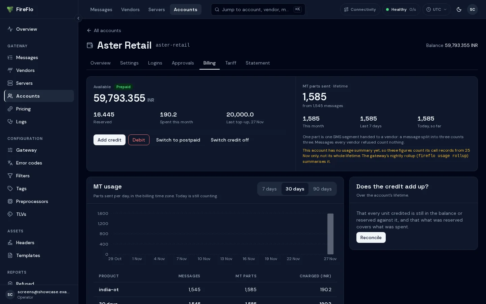
</Frame>

<Warning>
**Adicionar crédito não pode ser desfeito pelo painel.** Um top-up nunca é editado nem revertido. Um
top-up errado é retirado com [**Debit**](#retirando-crédito), que escreve uma entrada separada,
própria.

O formulário pede que você confirme o valor e a referência antes de escrever. Leia a confirmação em
vez de clicar através dela. É o último ponto em que o número ainda é seu para mudar.
</Warning>

<Note>
**Uma conta de unidades não tem dinheiro para mostrar.** A partir da 0.16.0, uma account que tem
unidades de mensagem em vez de dinheiro mostra as unidades restantes e usadas por product, a account
em que é cobrada e o seu ledger de unidades, e não oferece top-up, débito nem troca prepaid/postpaid.
Veja [Contas de unidades](/platform/billing/units-accounts).
</Note>

## O que a account tem

Contas prepaid mostram **Available**, com **Reserved**, **Spent this month** e o **Last top-up**
abaixo. Contas postpaid mostram um **Credit limit** — o que podem acumular antes de o gateway
recusá-las, que é a mesma recusa que uma conta prepaid recebe quando se esgota — com o gasto total e
o deste mês. As duas nunca recebem o mesmo nome.

Os valores aparecem sem os zeros finais, mantendo pelo menos uma casa decimal: `0.0000` aparece como
`0.0`, `0.0100` como `0.01`. Isso é só exibição; veja [Precisão](/platform/billing/how-pricing-works#precisão).

<Note>
**Reserved é crédito que um gateway em execução retém e ainda não gastou.** O que ele gasta é
acertado em **spent** a cada poucos segundos, então, numa conta ocupada, reserved fica pequeno
(alguns segundos de tráfego) e spent cresce.

Ver reserved parado numa conta ociosa significa que crédito ficou preso por uma parada não limpa. O
gateway o devolve na próxima inicialização, e liberar crédito retido o devolve na hora — nada é
perdido de qualquer forma, porque balance mais reserved mais spent é conservado. (Antes da 0.12.23,
reserved só crescia, porque o gasto nunca era acertado a partir dele.)
</Note>

Uma linha de saldo ausente é lida como **No balance row — not zero, absent**, que é um estado
diferente e mais consequente: um top-up contra uma conta sem linha fica pendente em vez de creditado.
**Open for credit** cria a linha em zero.

Moeda não é perguntada. Há uma moeda por plataforma, tomada do gateway, e o FireFlo nunca converte —
um saldo em qualquer outra coisa nunca poderia ser gasto contra um preço. O campo aparece apenas
quando o painel não consegue ler a moeda da plataforma de forma alguma.

## MT parts enviadas

Uma **MT part** é um segmento de SMS entregue a um vendor. Uma mensagem longa o bastante para ser
dividida em três partes conta três; uma mensagem que todos os vendors recusaram não conta nenhuma. O
card mostra o total de toda a vida da account, de quantas mensagens ele veio, e as partes enviadas
neste mês, nos últimos sete dias e hoje até agora. Meses e dias são cortados no fuso de billing, o
mesmo dos statements.

**MT usage** desenha as partes por dia em 7, 30 ou 90 dias, com a barra de hoje mais clara porque
ainda está contando, e uma tabela por product com mensagens, partes e o que foi cobrado na mesma
janela.

Os dias passados vêm do resumo diário de uso; hoje, e qualquer dia ainda não resumido, são contados
diretamente a partir dos registros de mensagens, então os números são ao vivo.

<Note>
**Depois de atualizar para a 0.12.4, os dias resumidos antes da atualização não têm contagem de
partes.** Eles ficam fora dos totais, não contados como zero, e o card diz quantos são. Rodar
`fireflo usage rollup --catch-up` preenche cada um desses dias cujos registros de mensagens ainda
estão guardados — veja [Uso e retenção](/platform/billing/usage-and-retention#mt-parts). Os dias já
expurgados continuam sem contagem.
</Note>

## Adicionando crédito

Três campos: **Amount**, **Reference**, e uma **Note** opcional.

<Frame caption="Add credit. A linha abaixo dos campos é a promessa honesta: o gateway aplica o top-up no próximo poll, então o saldo acima não se move na hora.">
  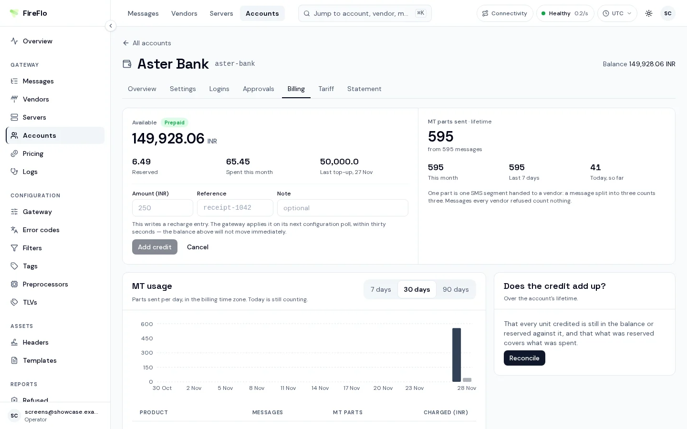
  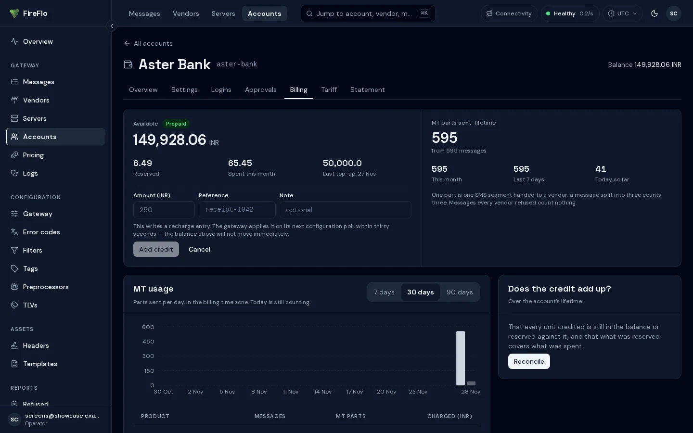
</Frame>

Uma vez que um valor válido é digitado, o formulário ecoa exatamente o que será armazenado, porque
dinheiro é mantido a quatro casas decimais e um decimal fora de lugar é o erro caro aqui.

<Warning>
**A referência é a proteção contra replay, não um memorando.** Um id de recibo ou transação é o
que impede que o mesmo pagamento seja creditado duas vezes, e o banco só pode aplicar isso quando
está configurada.

É obrigatória exatamente por essa razão. Não coloque uma descrição ali — coloque o que identifica
unicamente o pagamento.
</Warning>

Confirmar é em dois passos de propósito. Pressionar Enter em um campo não faz nada, e o botão se
arma em uma confirmação nomeando o valor, a moeda e a referência antes que escreva.

Depois de salvar, **o balance não se move imediatamente**. O painel escreve uma entrada de recharge
e o gateway a aplica em seu próximo poll de configuração, em cerca de trinta segundos. Um balance
que ainda não mudou não é uma falha.

## Retirando crédito

**Debit** retira crédito prepaid da account — um top-up feito por engano, por exemplo. Só é oferecido
em contas prepaid; uma conta postpaid é faturada, não debitada. Três campos, todos obrigatórios:

- **Amount** — retirado do balance na hora. O crédito retido por gateways em execução é liberado
  primeiro e conta. Mais do que o balance é recusado.
- **Reference** — o seu próprio id para este débito. Usá-lo de novo responde "duplicate" e não debita
  nada.
- **Reason** — mostrado no histórico da account e no audit log, e a uma plataforma que gerencia a
  account.

<Frame caption="Debit. Review mostra o saldo antes e depois; nada é retirado até você apertar Debit ali.">
  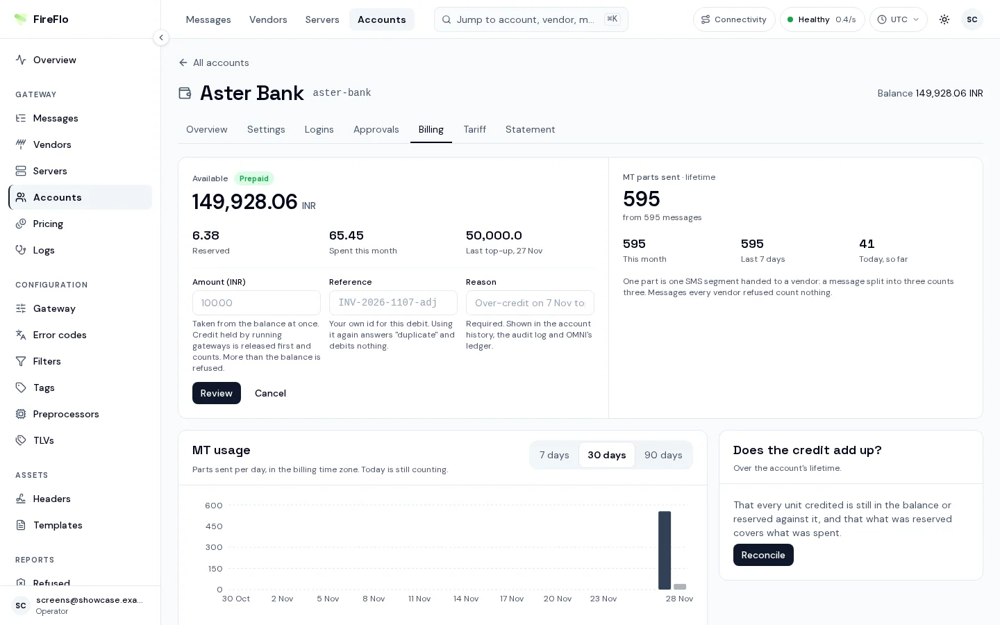
  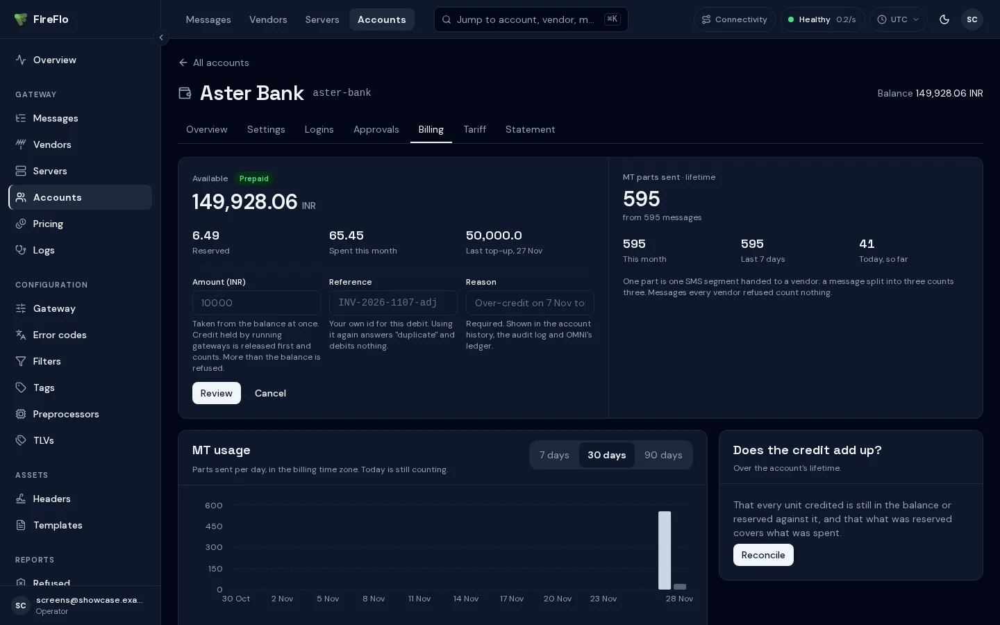
</Frame>

**Review** mostra o que será retirado e o saldo que sobra. Um débito também não pode ser desfeito pelo
painel: um débito errado é corrigido com um top-up.

## Alternando entre prepaid e postpaid

**Switch to postpaid** abre os termos de billing: **Prepaid — spends a balance** ou **Postpaid —
billed in arrears**, e, para postpaid, um **Credit limit**. Numa conta postpaid, o mesmo botão diz
**Change limit or go prepaid**. O formulário avisa antes de salvar em ambos os sentidos:

<Frame caption="Os termos de billing de uma account abertos. Uma conta postpaid precisa de um credit limit; zero significa sem crédito, não ilimitado.">
  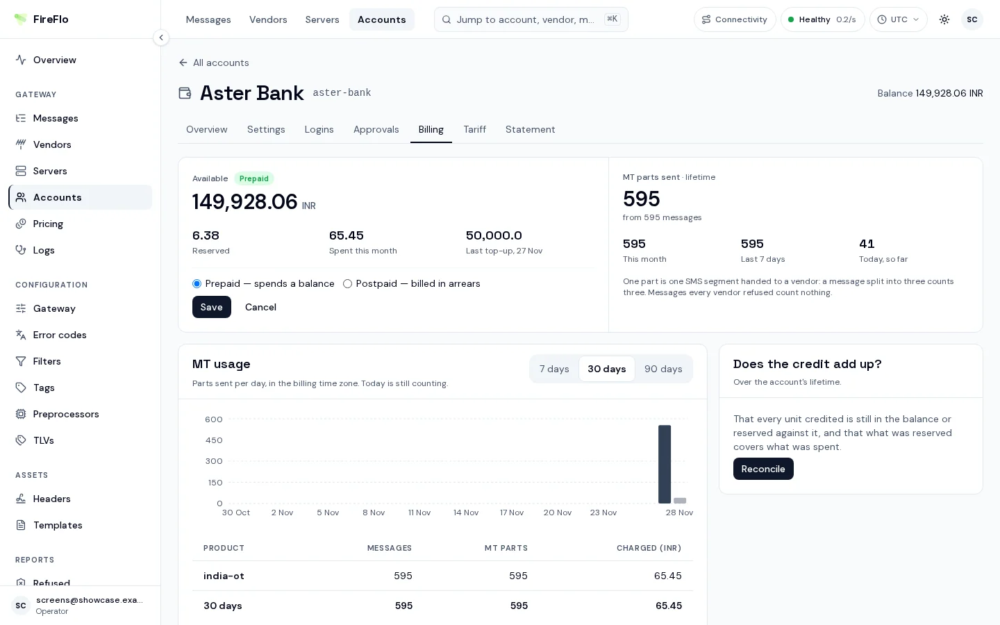
  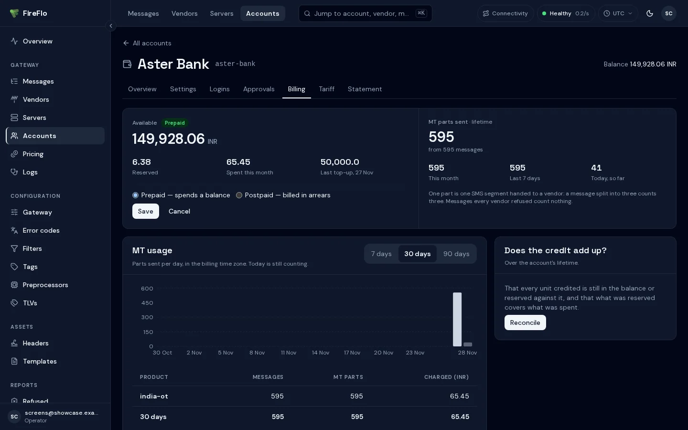
</Frame>

- **Para postpaid** — a account para de gastar seu balance. Qualquer coisa já reservada continua
  reservada até ser liberada.
- **Para prepaid** — o limite é limpo e a account gasta seu balance novamente. Uso desde a última
  fatura ainda é devido.

<Warning>
**Um credit limit postpaid de zero não é ilimitado — é sem crédito**, e a account seria incapaz
de enviar qualquer coisa. O formulário o recusa em vez de aceitar uma configuração que
silenciosamente para um cliente.
</Warning>

**Switch credit off** deixa uma account enviando até o bloco que já mantém acabar, então para. Não
é instantâneo.

## O crédito bate?

Duas identidades sobre a vida inteira da account: toda unidade creditada ainda está no balance,
reservada contra ele ou gasta, e o que foi reservado e gasto cobre o que os call records dizem que foi
consumido.

Não roda sozinho — pressione **Reconcile**. Duas cifras retornam. **Unexplained** é o resíduo, e a
que vale a pena agir. **Reserved, not yet spent** é normal em uma conta que está enviando.

<Frame caption="Depois de Reconcile: nada sem explicação, um pouco reservado e ainda não gasto, e uma nota em linguagem simples sobre cada coisa que vale a pena saber.">
  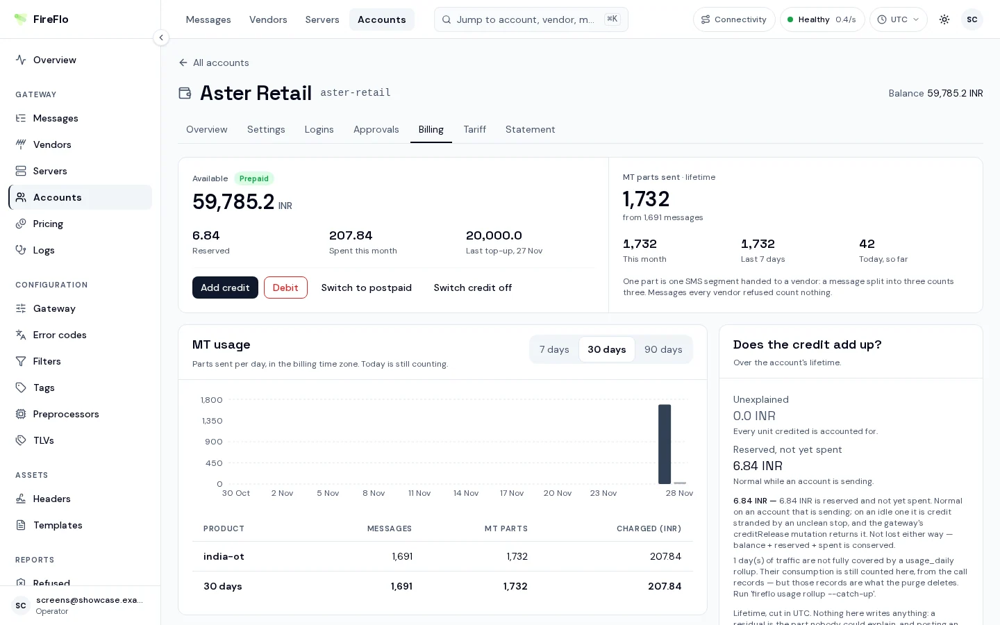
  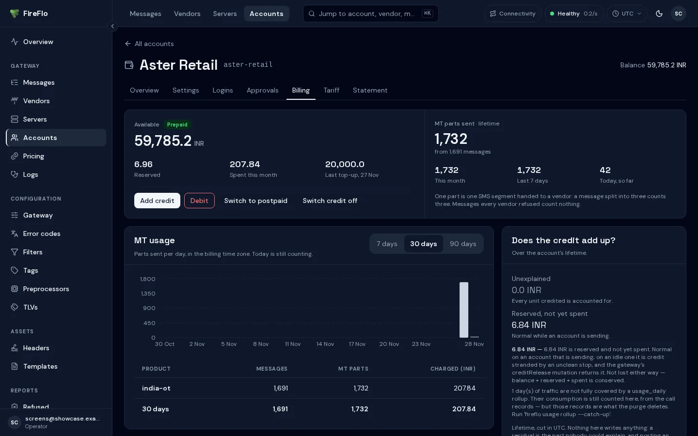
</Frame>

Abaixo delas, uma contabilidade em linguagem simples de tudo que não bateu. As distinções que
importam:

| Veredicto | Significa |
| :--- | :--- |
| **Pending credit** | Top-ups que o gateway ainda não aplicou. Não é problema — espere um poll |
| **Credit lost** | Creditado, e nem em balance, nem em reserved, nem em spent |
| **Credit minted** | Retido, sem top-up ou transferência contabilizando por ele — a direção mais séria |
| **Charged without reserving** | Consumo é real, a reserva não |
| **Held unspent** | Preso por uma parada não limpa. Liberado manualmente, não perdido |
| **Missing rollup** | Dias sem rollup de uso — ainda contados aqui, mas de registros que o purge deleta |
| **Unrated** | Mensagens enviadas sem preço. Em postpaid, receita que ninguém faturou |

<Note>
**Não há botão de "consertar", deliberadamente.** Reconciliação nunca escreve uma entrada de ajuste.

Um resíduo é a parte que ninguém pôde explicar, e postar um ajuste para ela balancearia os livros
escondendo a causa. Também é sempre lifetime-scoped, nunca um período — uma identidade que se
mantém sobre um mês mas não sobre a vida da conta não se manteve.
</Note>

## Dinheiro entrando e saindo

Todo recharge, transferência e débito, buscável por referência, nota ou tipo, ordenável e paginado. O
gateway aplica um recharge ou uma transferência no próximo poll, e um débito na hora.

<Frame caption="Dinheiro entrando e saindo. Cada top-up com seu valor, referência e estado; Applied significa que o gateway o creditou.">
  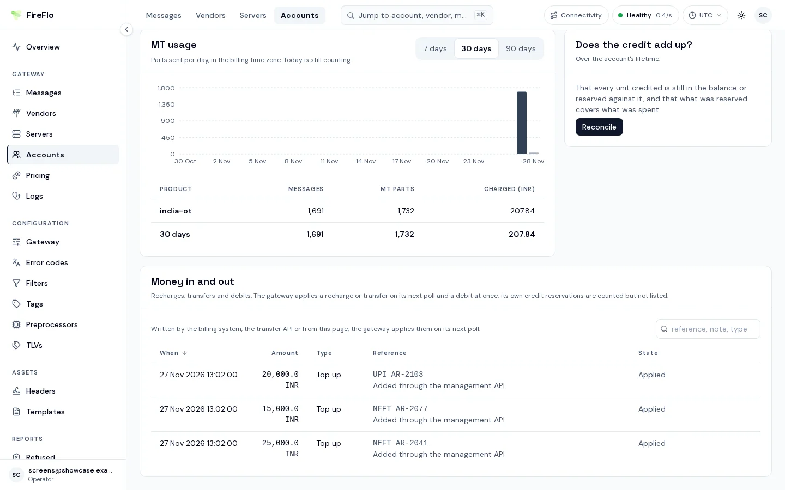
  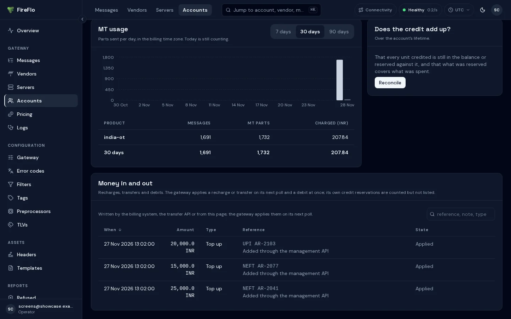
</Frame>

O ledger lista apenas entradas que uma pessoa ou o sistema de billing escreveu. As reservas de
crédito do próprio gateway são contabilidade, não dinheiro — cada uma move crédito entre duas colunas
de uma linha e resulta em zero — e ficam guardadas em outro lugar.

A coluna **State** carrega a parte que as pessoas perdem: **Pending** significa que o gateway ainda
não a aplicou. Onde uma conta não tem linha de saldo, uma entrada positiva diz ou que ela está
esperando a linha e se creditará no momento em que ela existir, ou que foi aplicada antes de a
linha sumir e nada agora pode dizer o que ela creditou.

## Relacionado

<CardGroup cols={2}>
  <Card title="Como o crédito prepaid funciona" icon="wallet" href="/platform/billing/prepaid-credit">
    Blocos, reservas e o que o gateway faz quando o crédito acaba.
  </Card>
  <Card title="Contas postpaid" icon="file-invoice" href="/platform/billing/postpaid">
    Billing em atraso contra um limite.
  </Card>
</CardGroup>
