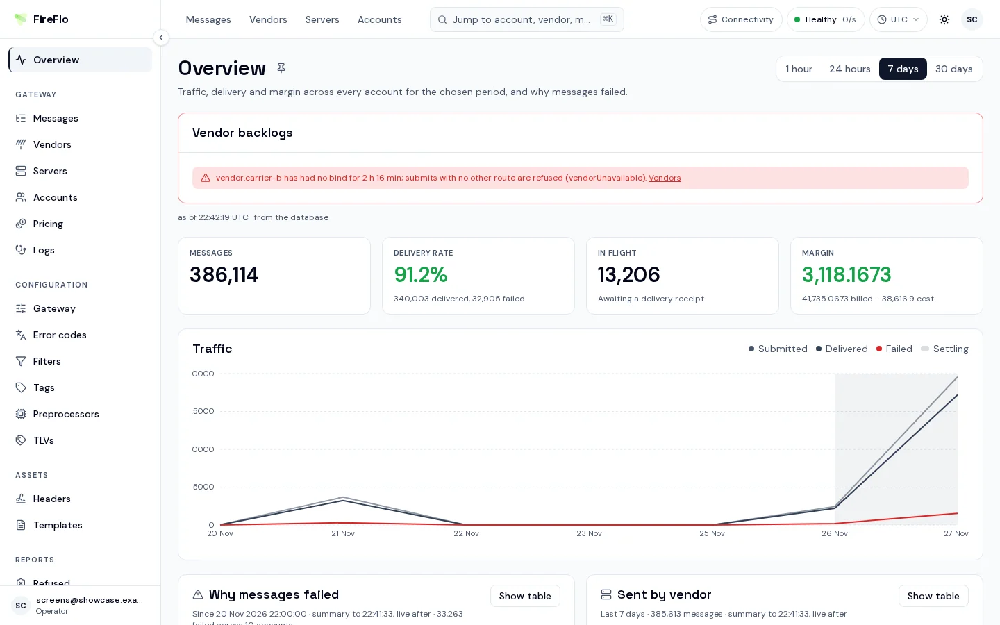
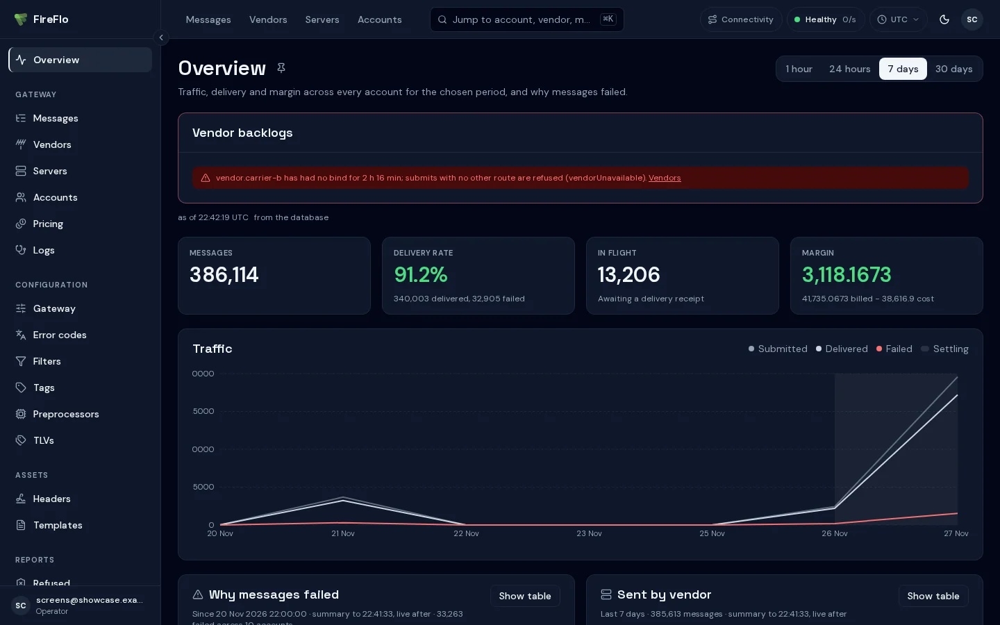

A tela Overview responde a uma pergunta: **a plataforma está carregando o que deveria, e está caindo?**
Ela deliberadamente não é uma tela de saúde. Se o software tem memória e conexões para continuar
funcionando é uma pergunta diferente, feita em [Runtime](/platform/control-panel/runtime-metrics),
e as duas são mantidas separadas porque um operador olhando um problema de entrega não quer estar
lendo sobre tamanho do heap.

Tudo na página obedece a um controle de intervalo — **1 hour**, **24 hours**, **7 days** ou
**30 days**. A página abre na última hora e, depois disso, no intervalo que você escolheu por último
naquele navegador. Ela pede cifras novas a cada trinta segundos, e para de pedir enquanto a aba do
navegador está em background.

<Frame caption="O Overview de 7 dias. Um aviso de vendor fica acima das cifras só enquanto algo está errado; o fim sombreado do gráfico ainda está se assentando.">
  
  
</Frame>

**Vendor backlogs** aparece acima das cifras quando um vendor passou do seu limite de backlog, está
sem bind há mais tempo do que a sua tolerância, ou tem uma mensagem esperando já na metade da retenção
do seu tópico. Cada linha diz para onde vai o tráfego desse vendor em vez disso, ou que os submits sem
outra rota são recusados. Numa plataforma saudável, o card nem aparece.

## Quando as cifras foram lidas

A partir da 0.12.16, as cifras são um **snapshot que o painel monta em background**, não uma query
rodada para a sua aba. Uma linha acima das cifras diz quando: **as of 10:42:17 UTC** significa que o
painel leu o banco pela última vez naquele segundo, no fuso escolhido no cabeçalho. Ao lado,
**from the database** ou **live from the gateway** diz de onde as cifras foram lidas. Abra a página em
três abas, ou deixe três operadores abrirem, e o banco faz o mesmo trabalho que para uma.

O snapshot é remontado uma vez por minuto. A maior parte dessa remontagem é pequena: as três últimas
horas e a atual são relidas, e também o dia de hoje; tudo o que é mais antigo vem de uma remontagem
completa, que acontece a cada quinze minutos. A decomposição de falhas é relida a cada cinco minutos.
Então uma mensagem submetida agora aparece em até um minuto, e um recibo que muda o desfecho de uma
mensagem de seis horas atrás aparece em até quinze minutos. Num gateway que mantém o resumo de uso por
hora (0.12.16, veja abaixo), a visão inteira de 24 horas é relida a cada minuto, porque ali isso é
barato.

Duas palavras podem aparecer ao lado do horário:

- **stale** — a última leitura da seção indicada falhou (o banco estava inalcançável, ou uma query
  estourou o tempo) e o que você vê é a leitura anterior. O horário continua avançando, porque diz
  quando o painel *tentou* pela última vez. Um badge stale que persiste é um problema de banco, não de
  tráfego.
- **Settling** — na legenda do gráfico de tráfego, com a parte mais recente do gráfico sombreada. As
  mensagens das horas ou dias sombreados ainda podem receber um recibo, então as contagens de
  entregues e falhadas não são finais. O sombreado cobre o prazo de recibo do gateway
  (`smsg.cdr.deadline.hours`, 48 horas por padrão), então, na visão de 24 horas, é o gráfico inteiro,
  e essa é a verdade: nada nessa visão se assentou ainda.

A primeira requisição depois que o painel inicia não tem nada para servir e monta o snapshot enquanto
você espera; se isso levar mais de oito segundos, a página diz que está aquecendo e pergunta de novo
no próximo poll.

A cadência é uma configuração do painel, `OVERVIEW_REFRESH_SECONDS` no ambiente do painel: 60 por
padrão, nunca abaixo de 15, e `0` desliga o snapshot e monta as cifras a cada requisição — o que o
ambiente de testes automatizados usa, e não uma configuração para uma plataforma ocupada.

### De onde vêm as cifras

As visões de 7 e 30 dias são montadas a partir do **resumo diário de uso** do gateway para todo dia
inteiro que ele resumiu, e só o dia de hoje é lido dos call records — veja
[Uso e retenção](/platform/billing/usage-and-retention#the-dashboards-read-it). A partir da 0.12.16,
o gateway também mantém um **resumo de uso por hora**, atualizado a cada minuto conforme o tráfego
flui, e um painel num gateway assim lê a visão de 24 horas e a parte de hoje das visões mais longas a
partir dele, e não dos registros: 24 linhas pequenas mais o último minuto ou dois de tráfego, seja qual
for o volume. Os dois resumos são trabalho do gateway, ligados por padrão e ajustados na página de
configurações do gateway em **Usage summaries**; o diário agora é escrito pelo próprio gateway toda
noite, e não por um comando que alguém precisa rodar.

Três consequências que vale conhecer. Num dia resumido, **In flight** mostra zero, porque o resumo
diário não registra o que ainda estava pendente; a cifra de hoje é a ao vivo. Uma mensagem que o
gateway retentou atravessando a virada de um minuto pode ser contada duas vezes no resumo por hora até
que a recontagem das horas recentes, que o gateway faz a cada quinze minutos, a corrija — retries são
uma fração pequena do tráfego e a recontagem é a verdade. E um gateway sem nenhum dos dois resumos lê
tudo ao vivo e fica mais lento conforme o intervalo cresce, como antes.

## As quatro cifras

| Card | O que conta |
| :--- | :--- |
| **Messages** | Tudo submetido no período |
| **Delivery rate** | Entregues contra falhadas, com as duas contagens embaixo |
| **In flight** | Submetidas, sem recibo ainda |
| **Margin** | Faturado menos custo do vendor, em vermelho quando negativo |

<Note>
**Um card em branco ainda está carregando, não zero.** Os cards mostram um placeholder até que a
cifra chegue, e então mostram ou o número ou o erro. Eles nunca inventarão um `0` para preencher a
lacuna, porque "sem tráfego" e "não conseguimos perguntar" são respostas diferentes e só uma delas
é seu problema.
</Note>

**In flight não é um backlog.** É tráfego que foi enviado e cobrado e simplesmente ainda não foi
reportado. Uma mensagem que nunca recebe recibo é fechada no seu prazo de expiração; até então fica
aqui, e em uma plataforma ocupada sempre ficará.

## Tráfego

Três séries — submitted, delivered, failed — sobre o intervalo escolhido. Sem nada na janela, o
gráfico é substituído por **No traffic in this period**, o que é uma declaração sobre o intervalo
que você escolheu tanto quanto sobre a plataforma. As horas da visão de 24 horas são horas de
relógio em UTC; os dias das visões mais longas são dias de billing, cortados no fuso de billing da
plataforma. A parte sombreada do gráfico ainda está se assentando (veja acima).

## Por que mensagens falharam

Dois cards ficam lado a lado abaixo do gráfico. **Why messages failed** desenha as falhas do período
como anéis: account, depois vendor, desfecho, código de erro e o código próprio da operadora.
**Sent by vendor** desenha da mesma forma o que cada vendor carregou: vendor, depois account, desfecho
e código de erro. Escolha um anel para dar zoom nele; o centro nomeia o que está sob o ponteiro, com
sua contagem e participação.

**Show table** em qualquer um dos cards lista as mesmas cifras como linhas. Em **Why messages failed**,
ele também abre a lista de tipos de falha, todo desfecho que não foi uma entrega, cada um nomeado em
linguagem simples em vez de por seu código de recibo:

- Failed at the vendor
- Rejected on submission
- Dropped before sending
- No receipt within the deadline

Ao lado de cada nome, em tipo menor, está o estado numérico do recibo e o próprio código de erro
do vendor. Isso parece duplicação e não é. `EXPIRED`, `REJECTD` e `UNDELIV` todos faturam
identicamente e significam coisas inteiramente diferentes, e quando você vai a um vendor perguntar
sobre um pico, **o número é a coisa pela qual a documentação deles é indexada**. O nome é para você;
o número é para eles.

### Dispensando uma falha

Cada linha pode ser dispensada, o que a esconde da lista sem deletar nada. Um rodapé conta o que
você escondeu e pode mostrar de novo.

<Tip>
**Uma falha dispensada volta sozinha na próxima vez que acontece.** Dispensar esconde o que você
já lidou, não o que começa de novo.
</Tip>

Dispensas vivem no navegador em que você as fez. Outro operador, ou o mesmo operador em outra
máquina, vê a lista completa — o que é deliberado, já que a triagem de uma pessoa não é uma
declaração de fato para toda a plataforma.

Essa distinção aparece nos dois estados vazios. **No failures in this period** significa que nada
falhou. **Every failure in this period has been dismissed** significa que algo falhou, e você
escolheu não olhar. A tela não reportará um período limpo com base no seu próprio arquivamento.

## Gateway health

Uma faixa de seis tiles no pé da página — memória, processador, tasks running, API requests,
internal tasks, uptime — cada uma com uma sparkline, e um link para o detalhe. É uma olhada, não uma
investigação.

<Warning>
**"Internal tasks" não são conexões de vendor.** É o trabalho de background do próprio gateway:
escritas em banco, tratamento de recibos. Em todo outro lugar do painel, um *worker* significa uma
conexão SMPP, então este tile evita a palavra inteiramente. Lê-lo como um vendor travado te leva a
procurar um problema de operadora que não existe.
</Warning>

O tile **API requests** reporta uma média desde que o processo iniciou. Ele responde "este endpoint
está lento em geral" e não pode responder "estava lento cinco minutos atrás".

Se um refresh falha enquanto cifras mais antigas ainda estão em tela, uma nota de rodapé diz que
o poll falhou e os números ficam. A tela prefere uma leitura antiga sobre a qual você é avisado a
uma em branco sobre a qual você não é.
