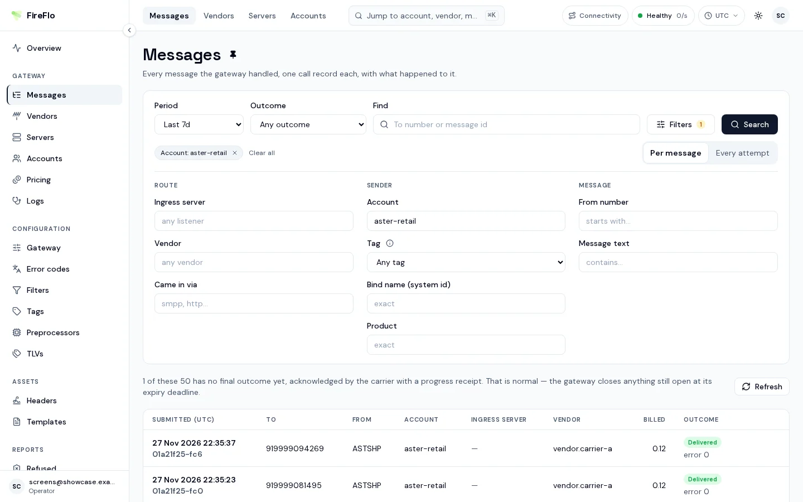
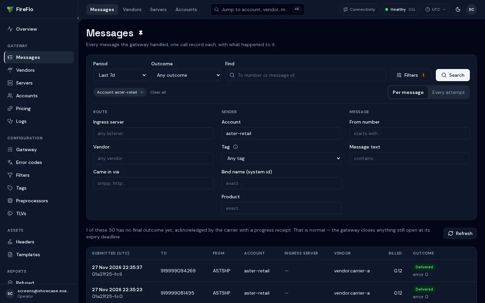
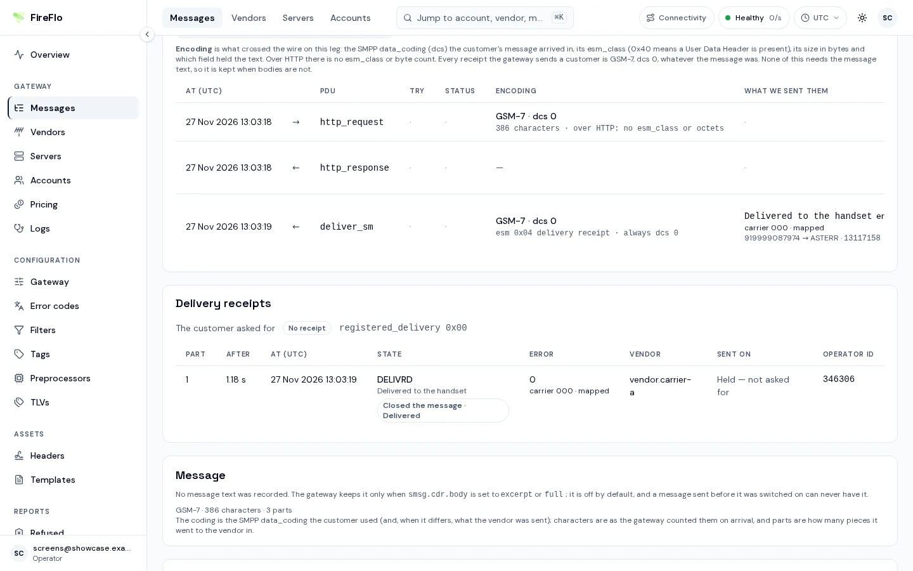
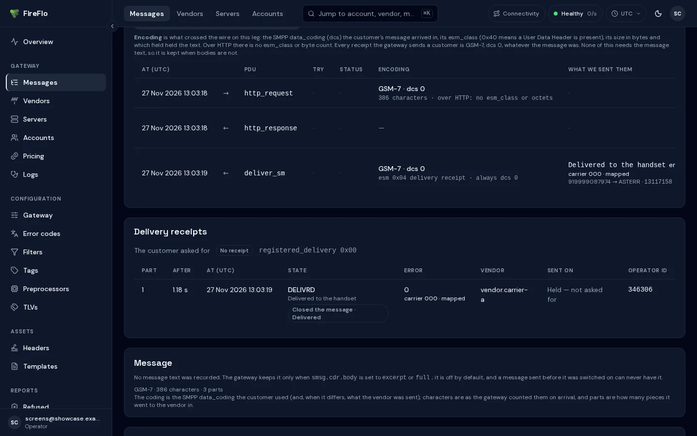

A tela que você abrirá mais. Toda mensagem, buscável, com uma visão de detalhe que reconstrói uma
mensagem de ponta a ponta.

## Encontrando uma

Filtros se aplicam quando você pressiona **Search**, não conforme digita, e viajam na barra de
endereço — portanto uma visão filtrada pode ser marcada ou colada para um colega e ele verá o que
você viu.

A linha sempre visível: **Period** (um preset, ou um intervalo de datas), **Outcome** e **Find**, uma
caixa que aceita um número de destino (casado a partir do início) ou um message id (exato) e
distingue os dois sozinha. **Filters** abre o resto em três grupos, e o seu badge conta quantos deles
estão definidos:

| Grupo | Filtros |
| :--- | :--- |
| **Route** | Ingress server, Vendor, Came in via |
| **Sender** | Account, Tag, Bind name (system id), Product |
| **Message** | From number (começa com), Message text (contém) |

**Tag** (a partir da 0.17.0) encontra mensagens de contas que têm elas mesmas essa
[tag de conta](/platform/routing/account-tags) agora. Uma mensagem não registra as tags da sua conta, e
o filtro precisa de um período diferente de todo o histórico.

Cada filtro aplicado aparece como um chip abaixo da barra; remova um com o seu X, ou todos com
**Clear all**.

<Frame caption="Messages de uma account em 7 dias, com Filters aberto. O chip da account abaixo da barra é o filtro aplicado.">
  
  
</Frame>

**Awaiting a receipt** é listado primeiro entre desfechos em vez de alfabeticamente. Em um gateway
ocupado e saudável, é o maior grupo, e é o que as pessoas geralmente estão procurando.

<Note>
**A busca por texto de mensagem não encontra nada a menos que o gateway esteja gravando o conteúdo
da mensagem**, que está desligado por padrão. Um resultado vazio pode significar que o texto não
é mantido em vez de que nada correspondeu. Veja `smsg.cdr.body` em [a referência de configuração](/reference/config/paths).
</Note>

### Uma linha por mensagem, ou uma por tentativa

A chave **Per message** / **Every attempt** ao lado dos filtros decide o grão, e muda o que os números
significam:

| Configuração | Uma linha é |
| :--- | :--- |
| **Per message** *(padrão)* | O que o cliente enviou |
| **Every attempt** | O que o gateway fez — uma linha por tentativa no vendor, incluindo retries e segmentos de mensagem longa |

Uma mensagem longa que dividiu em três, retentada duas vezes no vendor, é uma linha na primeira
configuração e várias na segunda. Se uma contagem parecer alta demais, verifique este controle
antes de concluir qualquer coisa.

## Colunas

Oito por padrão: submitted, to, from, account, ingress server, vendor, billed, outcome. O
selecionador agrupa aproximadamente mais trinta sob **Message**, **Route**, **Money** e **Outcome** — incluindo custo,
margem, ambas rate rules, estado do recibo e código de erro.

<Warning>
**Uma célula vazia e uma célula em branco são diferentes, e a distinção importa nas colunas de
TLV.**

*Nothing recorded* significa que a mensagem nunca chegou a um vendor, ou foi para um não-SMPP.
*Recorded as empty* significa que o vendor foi consultado e não carregava nenhum. Ler a primeira
como a segunda te faz procurar por uma falha de stamping que nunca aconteceu.
</Warning>

Escolhas de colunas são mantidas em seu navegador. Um link que você compartilha carrega seus
filtros, nunca suas colunas.

## Exportando

**Export these results** prepara um CSV em background, mantido por sete dias.

O export deliberadamente **carrega toda coluna qualquer que seja sua escolha em tela**. Duas
pessoas exportando os mesmos filtros precisam obter o mesmo arquivo, porque planilhas endereçam
colunas por letra e uma escolha pessoal de coluna silenciosamente mudaria o que `H` significa.

## Uma mensagem, de ponta a ponta

Abrir uma linha reconstrói tudo registrado sobre essa mensagem: rota, dinheiro, uma timeline de
toda tentativa, todo delivery receipt, o texto se foi mantido, e os TLVs.

Uma linha de resumo dá partes, tentativas e recibos. Leia as notas abaixo dela — elas explicam
resultados que de outra forma se parecem com falhas:

- **Você pediu um id de segmento.** Uma mensagem longa é enviada como várias mensagens SMPP e
  reconhecida uma vez cada, então o gateway emitiu um id por parte. Todos eles encontram este
  registro.
- **Mais de um recibo para a parte um.** Permitido. Toda outra visão mostra o primeiro; a timeline
  mostra todos.
- **Apenas a parte um carrega dinheiro.** Segmentos posteriores são escritos sem rate e sem valores,
  portanto as células de dinheiro em branco ao lado deles estão corretas em vez de faltando.

### O que um recibo realmente disse

Cada recibo mostra o mnemônico SMPP com seu significado em inglês simples, e então a parte que as
pessoas precisam: se ele **fechou a mensagem**, foi **um desfecho posterior, não o que foi
faturado**, ou foi **progresso** que deixou a mensagem aberta.

<Frame caption="Os recibos de uma mensagem longa. A linha acima da tabela diz o que o cliente pediu; Sent on diz se cada recibo foi repassado a ele.">
  
  
</Frame>

Abaixo do erro aparece o código próprio da operadora, marcado **mapped** quando os seus códigos de erro
o traduziram. **Sent on** mostra **Held — not asked for** quando o cliente não pediu recibos, então
nada foi enviado a ele.

Onde o gateway registrou o que o cliente pediu, é mostrado ao lado. Onde não, a página diz isso
explicitamente. Não é o mesmo que o cliente não ter pedido nada.

### A história do TLV

A parte mais útil da página, e a razão para vir aqui em vez da lista de mensagens.

Uma linha por tag vista em qualquer estágio, com três colunas de valor — **Received**, **Resolved**,
**Sent** — e um veredicto:

| Veredicto | Significa |
| :--- | :--- |
| **Unchanged** | Chegou e saiu como veio |
| **Replaced** | Um default de account, sender ID aprovado ou template substituiu o que foi enviado |
| **Added** | Não enviado pelo cliente — adicionado por um default, sender ID ou template |
| **Dropped** | O vendor não lista esta tag como uma que envia, portanto nunca foi |
| **Vendor default** | O vendor forneceu; a mensagem não carregava valor |
| **Vendor overrode** | O vendor enviou algo diferente do que a mensagem carregava |

**Dropped** e **Vendor overrode** são os dois que custam uma entrega, e são os dois que a página
colore. Onde qualquer um ocorre, ele lhe diz onde procurar: apenas tags na lista de envio de um
vendor chegam à operadora.

<Note>
Um traço significa *não presente naquele estágio*. Um middot significa *não registrado* — e onde
a wire é desconhecida, **nenhum veredicto reivindica nada sobre ela**. Esse é o estado honesto para
uma mensagem que nunca chegou a um vendor, foi para um vendor não-SMPP, ou é anterior à gravação
pelo gateway.
</Note>

## O que não está aqui

Um call record não armazena metadados da mensagem, id externo, nenhum dos campos definidos pelo
usuário, e nem o expiry nem o tempo de deferred-delivery. O estado in-flight também não é registrado
— apenas o desfecho. Esses vivem na mensagem enquanto ela está sendo processada e vão embora depois
que está.

Se você precisa do corpo, ele é mantido apenas quando o gateway está configurado para mantê-lo.
