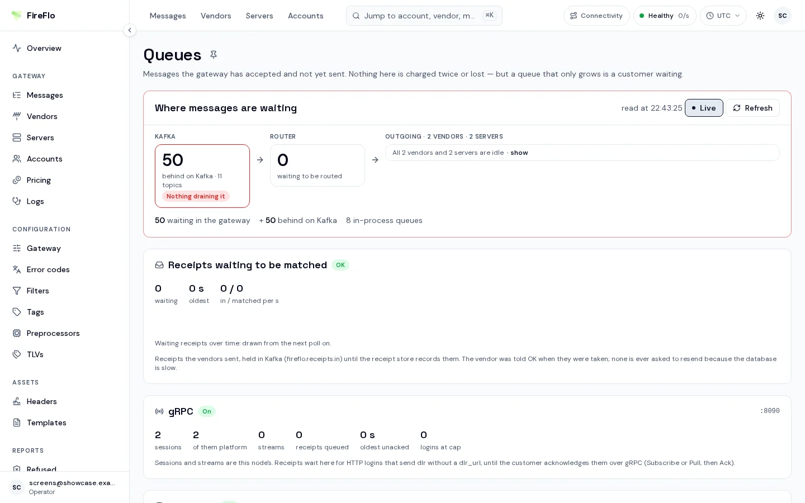
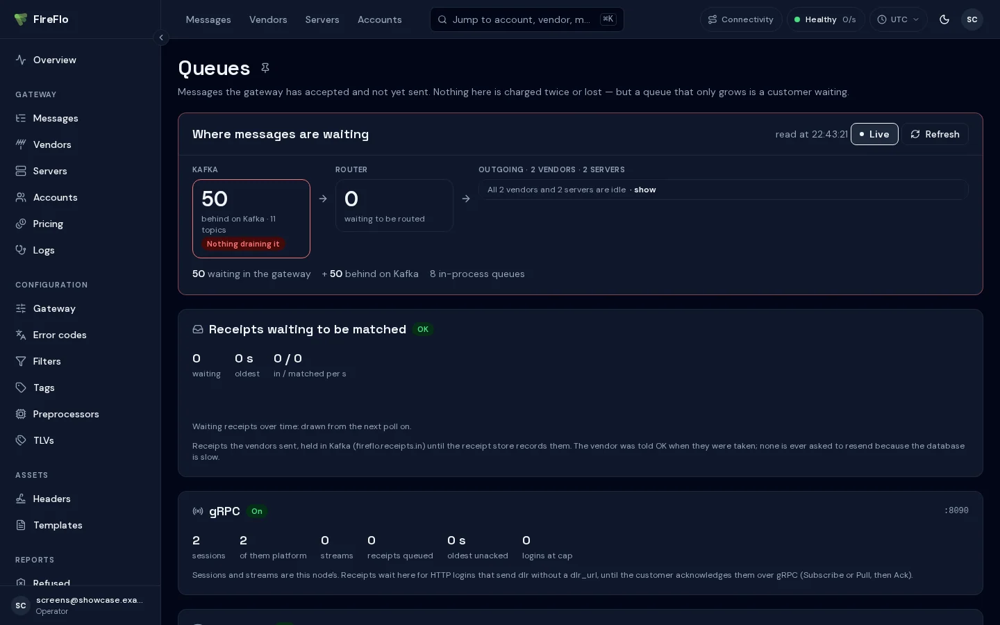
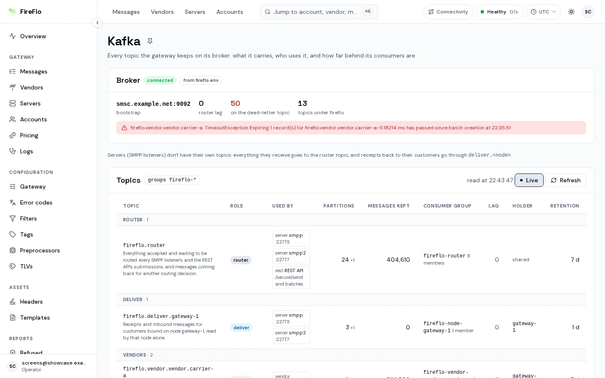
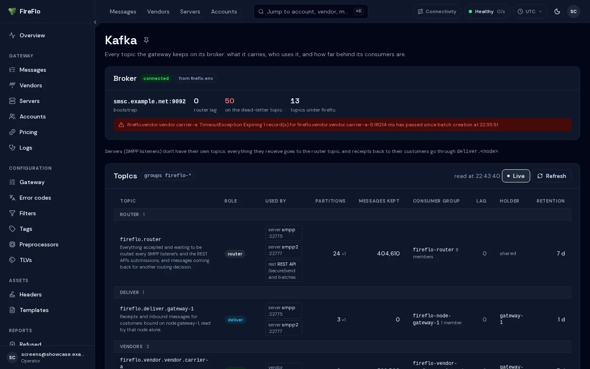
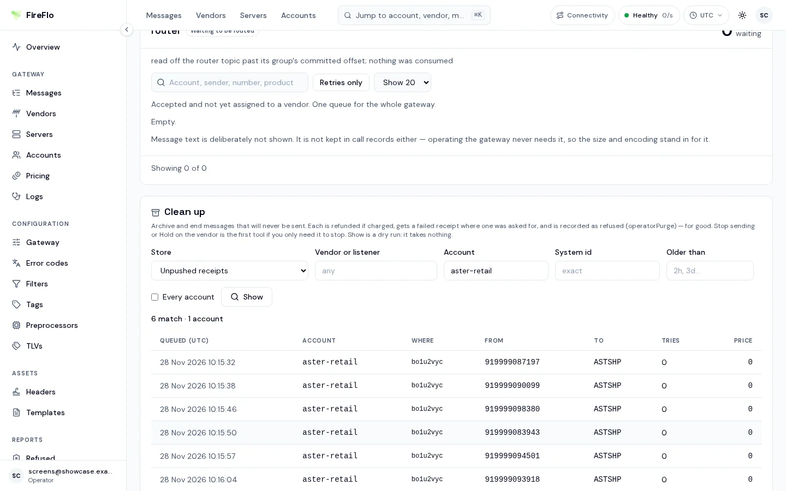
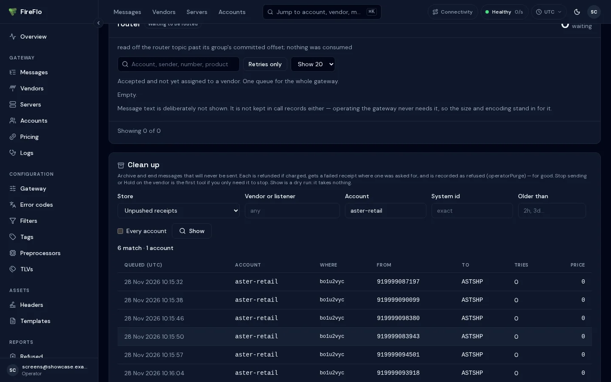

**Mensagens que o gateway aceitou e ainda não enviou. Nada aqui é cobrado duas vezes ou perdido —
mas uma fila que apenas cresce é um cliente esperando.**

A tela lê ao vivo, re-lendo a cada poucos segundos; **Live** a pausa, **Refresh** lê uma vez.

## Onde as mensagens estão esperando

O card no topo dispõe as filas como o caminho que uma mensagem percorre: **Kafka** (ou **Broker**),
depois **Router**, depois **Outgoing**, uma linha por vendor e server. As ociosas se recolhem numa
única linha que **show** abre. Abaixo do caminho, uma linha soma o que está esperando no gateway e o
que está atrasado no broker. Escolha qualquer etapa para abrir o card dela logo abaixo.

<Frame caption="Nada espera no gateway, mas 50 mensagens estão atrasadas no Kafka sem nada as drenando, então a faixa fica contornada em vermelho.">
  
  
</Frame>

Abaixo do caminho vêm três cards que não são filas de mensagens, mas as explicam: **Receipts waiting
to be matched** (recibos que um vendor enviou, retidos até o receipt store registrá-los; a partir da
0.15.3), **gRPC** (suas sessões, streams e os recibos esperando que os logins os coletem; a partir da
0.15.9) e **Database** (a conexão, os writers que gravam as mensagens e a latência que admite ou recusa
novos submits; a partir da 0.15.1). **Slow queries** abre a partir do card Database.

## O broker e o router são filas diferentes

<Warning>
**Um backlog no message broker aparece como uma fila do router *plana*.**

Uma vez que a fila in-process passa da sua marca de água alta, o consumidor para de puxar, então
a fila do router para de crescer e parece calma — enquanto mensagens se empilham no broker atrás
dela.

Se a fila do router está suspeitamente estável e clientes estão reportando atrasos, olhe primeiro a
etapa Kafka (ou Broker).
</Warning>

A primeira etapa é sempre mostrada, mesmo onde não há broker, porque *not configured* e
*configured and not answering* são fatos inteiramente diferentes e ambos de outra forma
renderizariam como nada.

| Estado | O que significa |
| :--- | :--- |
| **None** | Sem broker. REST vai direto para o router |
| **Not connected** (Kafka) ou **Not answering** | O gateway não consegue alcançar o broker; o que está nele está preso |
| **Nothing draining it** | Mensagens estão enfileiradas e nenhum consumidor está anexado. Não é lentidão — nada as está lendo |

No Kafka, a etapa conta quantas mensagens estão atrasadas em todos os seus tópicos, e o card dela,
**Kafka backbone**, lista cada tópico com o quanto está atrasado, suas partições e membros. **Open
Kafka topics** nesse card abre a página **Kafka**: todo tópico que o gateway mantém no broker, o que
ele carrega, quem o usa, seu consumer group, lag e retenção. Ela lê o broker sem consumir nada.

<Frame caption="A página Kafka: uma linha por tópico, agrupada por função, com os listeners e as APIs que o usam, seu consumer group, lag e retenção.">
  
  
</Frame>

<Note>
Quando o broker está inalcançável, sua cifra lê **unknown**, nunca zero. Uma fila presa que
mostrasse "0 waiting" seria o número mais perigoso na tela.
</Note>

## As filas in-process

Escolher o router ou uma linha de saída abre o card dessa fila, que diz o que ela contém:

| Tipo | Contém |
| :--- | :--- |
| **Waiting to be routed** | Aceitas, ainda não atribuídas a um vendor. Uma fila para o gateway inteiro |
| **Waiting for the vendor** | Roteadas, esperando a sessão daquele vendor pegá-las |
| **Scheduled retries** | O envio falhou; enfileiradas para tentar novamente |

Cada card oferece uma leitura do próprio conteúdo, e estas são as frases sobre as quais agir:

- **Mostly retries** — o vendor está falhando, não meramente lento. Adicionar capacidade não ajudará.
- **All first attempts, all from one account** — volume de um remetente, não falha de vendor.
- **All first attempts, spread across senders** — chegou mais do que está sendo drenado.

Essa leitura desaparece quando você filtra, deliberadamente: uma visão retries-only não pode
honestamente pronunciar sobre o mix.

Acima da lista, uma caixa de busca a reduz por account, sender, número ou product, **Retries only**
separa "chegou mais do que conseguimos enviar" de "o vendor está recusando", e **Show** define quantas
listar por fila: 20, 50, 100 ou 500.

A tabela mostra quando cada mensagem foi enfileirada, seu account, product, endereços, tamanho e
codificação, se é uma primeira tentativa ou retry, seu alvo, e — em uma fila de retry — quando é a
próxima devida.

<Note>
**Filtrar nunca muda a profundidade de uma fila.** A profundidade permanece o número real e a lista
abaixo é reduzida. "3 matches" entre "412 waiting" significa que três da amostra listada casaram,
não que apenas três das mensagens daquele cliente estão enfileiradas.
</Note>

## Por que o texto da mensagem não é mostrado

Deliberadamente ausente, e também não mantido em call records. Operar o gateway nunca requer ler a
mensagem de um cliente, portanto o tamanho e a codificação a substituem — o suficiente para
distinguir uma mensagem Unicode de três segmentos de uma GSM curta sem ler a correspondência de
ninguém.

## Clean up: arquivar e encerrar o que nunca será enviado

A partir da 0.12.19, abaixo das filas, um card **Clean up** encerra mensagens que nunca serão
enviadas, de forma honesta: cada uma é arquivada, reembolsada se foi cobrada, recebe um recibo de
falha onde o cliente pediu um, e é registrada como recusada (`operatorPurge`). **Stop sending ou Hold
no vendor continua sendo a primeira ferramenta** se você só precisa que o tráfego pare.

1. Escolha o **Store** — as mensagens esperando, em retry, retidas ou estacionadas de um vendor ou
   listener; a fila de roteamento, os retries de roteamento ou o estacionamento de roteamento com
   falha; os recibos não entregues; ou os retries de callback — e restrinja por **Vendor or listener**,
   **Account**, **System id** e **Older than** (`2h`, `3d`). Limpar um store inteiro sem nada indicado
   exige marcar **Every account**.
2. **Show** é uma simulação: não tira nada, e mostra quantas casam, em quantas accounts e o reembolso
   que receberiam, acima de uma amostra das mensagens que casam. Qualquer um que possa ler as filas
   pode rodá-la.
3. **Archive & clean…** só aparece para **administradores**. O diálogo repete o que vai acontecer, pede
   uma **nota** (registrada em cada entrada arquivada) e a confirmação exata `CLEAN <n>`.
4. Logo antes de começar, a contagem é lida de novo. Se mudou, o diálogo mostra o número novo e pede
   que você confirme esse — ele nunca arquiva mais do que você aceitou. Depois trabalha em lotes de até
   10 000, mostrando os totais parciais, com **Stop** (o lote em andamento termina primeiro), e termina
   com links para as execuções em [Reports → Archives](/platform/control-panel/archives).

<Frame caption="Clean up depois de Show, em recibos não entregues de uma account: seis casam, com a amostra listada. Nada foi tirado ainda.">
  
  
</Frame>

Na página do próprio vendor ou listener, o mesmo diálogo abre a partir de **Clean queue…** no rodapé,
ao lado de Stop sending, Hold e Restart, enquanto algo estiver esperando ali. Ele já vem restrito a
esse worker e mostra a contagem em cada uma das suas filas — retidas, esperando, retries e, num
listener, estacionadas — com account e idade opcionais.

O log do operador registra cada limpeza contra a pessoa que a rodou, e o arquivo do gateway leva o
mesmo nome. A linha de comando faz a mesma coisa com `fireflo queue archive`; veja
[Inspecionando uma fila](/platform/operations/queues#limpando-uma-fila-arquivar-e-encerrar).

<Note>
Uma fila mantida no message broker não pode ser limpa: o broker não consegue mostrar uma mensagem sem
tirá-la. O gateway recusa com `broker-backed`, e o diálogo mostra isso.
</Note>

## Uma tela vazia é o bom desfecho

**No in-process queues** significa que toda mensagem que chegou já foi entregue a um vendor. É como
um gateway saudável parece em repouso, e é por isso que esta tela não é um dashboard — você vem aqui
quando algo mais já disse para vir.

## Relacionado

<CardGroup cols={2}>
  <Card title="Filas e retentativas" icon="rotate" href="/platform/routing/queues-and-retries">
    Como agendamento de retry e o teto de tentativas funcionam.
  </Card>
  <Card title="Live health" icon="heart-pulse" href="/platform/operations/live-health">
    Estado de bind e profundidade de fila a partir do próprio gateway.
  </Card>
</CardGroup>
