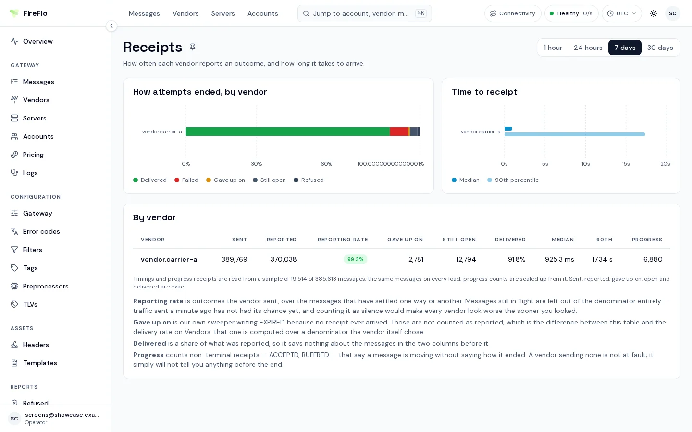
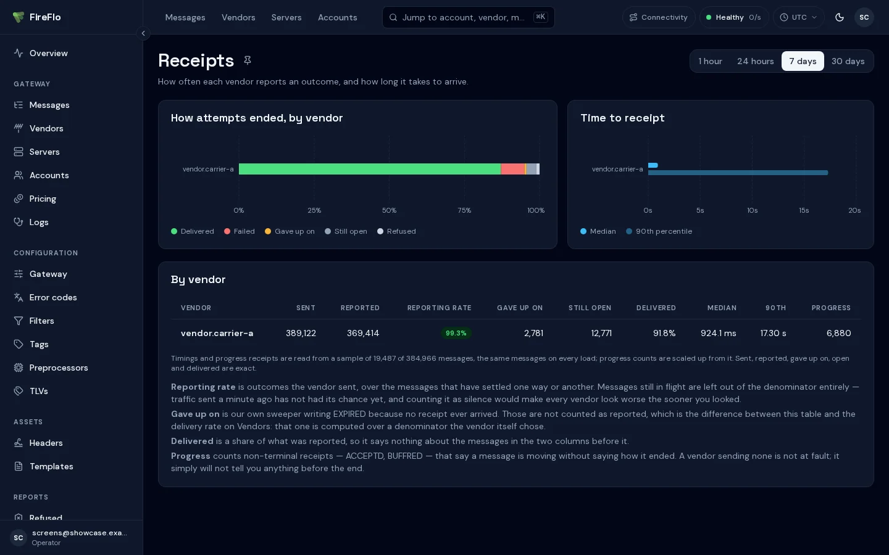
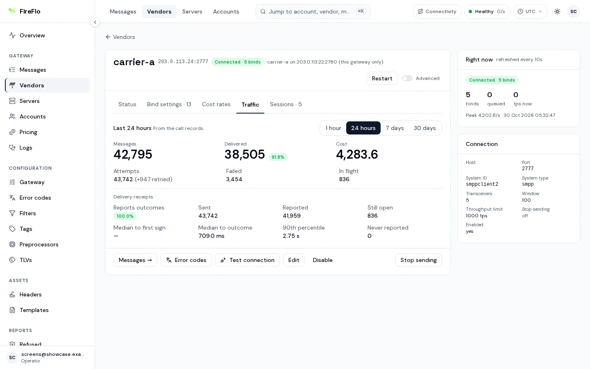

**Com que frequência cada vendor reporta um desfecho, e quanto tempo o desfecho leva para chegar.**

Esta tela existe por causa de um jeito específico de ser enganado. A taxa de entrega na página
Vendors é computada sobre tráfego *reportado* — portanto um vendor que reporta em duas mensagens
de cinco pode mostrar 95% ali enquanto três em cinco de tudo que você enviou a ele não têm
desfecho algum. A taxa não está errada. Ela está respondendo a uma pergunta mais estreita do que
aparenta.

Esta página amplia o denominador. Ela é **Receipts**, em Reports, lida sobre **1 hour**,
**24 hours**, **7 days** ou **30 days**; abre na última hora e, depois disso, no intervalo que você
escolheu por último naquele navegador.

## Os gráficos

**How attempts ended, by vendor** divide tudo o que cada vendor recebeu em cinco partes que sempre
somam a barra: entregue, com falha, desistido, ainda aberto e recusado (uma tentativa que o vendor
recusou nunca recebe recibo). **Time to receipt** põe a mediana de cada vendor ao lado do seu
percentil 90. Os dois são desenhados a partir das linhas da tabela abaixo, então sempre concordam
com ela.

<Frame caption="Receipts de 7 dias. A barra de um vendor é quase toda verde, e o seu percentil 90 fica bem à direita da sua mediana.">
  
  
</Frame>

## A tabela

Uma linha por vendor, sobre o intervalo escolhido:

| Coluna | Significado |
| :--- | :--- |
| **Sent** | Mensagens submetidas àquele vendor |
| **Reported** | Desfechos que o vendor enviou de volta |
| **Reporting rate** | Reportadas sobre o que se liquidou |
| **Gave up on** | Fechadas como expiradas porque nada chegou |
| **Still open** | Enviadas, não liquidadas, ainda dentro do prazo |
| **Delivered** | Do que foi reportado |
| **Median** / **90th** | Tempo da submissão ao desfecho |
| **Progress** | Recibos não-terminais |

A reporting rate é a única cifra aqui mostrada como um badge colorido — verde em 95% e acima,
plano de 70%, vermelho abaixo. Um vendor abaixo de 70% está lhe custando sua própria visão do que
aconteceu com tráfego pelo qual você já pagou.

Um vendor sem nome registrado aparece como **no vendor**.

Num intervalo longo, os tempos e os recibos de progresso são lidos de uma **amostra** das mensagens, e
uma linha abaixo da tabela diz quantas de quantas. A amostra é das mesmas mensagens a cada
carregamento, e as contagens de progresso são extrapoladas a partir dela. Sent, reported, gave up on,
still open e delivered são sempre exatos.

## As quatro coisas que vale a pena ler duas vezes

**Reporting rate deixa tráfego in-flight completamente de fora do denominador.** Mensagens enviadas
há um minuto ainda não tiveram sua chance, e contá-las como silêncio faria todo vendor parecer pior
quanto mais cedo você olhasse.

**"Gave up on" somos nós, não eles.** É nosso próprio sweeper escrevendo uma expiração porque nenhum
recibo chegou. Essas não são contadas como reportadas — que é exatamente a diferença entre esta
tabela e a taxa de entrega em outros lugares, onde o denominador é um que o próprio vendor escolheu.

**"Delivered" é uma fração do que foi reportado.** Não diz absolutamente nada sobre as mensagens
nas duas colunas anteriores. Um vendor reportando 40% do seu tráfego e entregando 99% desses
entregou, até onde alguém pode provar, 40% do que você enviou.

**Progress conta recibos não-terminais** — `ACCEPTD`, `BUFFRED` — que dizem que uma mensagem está
se movendo sem dizer como terminou. Um vendor não enviando nenhum destes não está errado; ele
simplesmente não vai te contar nada antes do fim.

<Note>
Em um gateway que não grava recibos interim, a coluna Progress está **em branco em vez de zero**,
e a página diz isso abaixo da tabela. Um zero seria uma afirmação sobre o vendor. Um branco é uma
afirmação sobre o gateway, que é a verdadeira.
</Note>

## Lendo em um incidente

Um vendor cuja reporting rate caiu enquanto sua delivery rate se mantém estável não começou a
falhar na entrega. Começou a falhar em *te contar*, e as duas são indistinguíveis apenas pela
página Vendors. Tráfego ainda sai, clientes ainda são cobrados, e sua evidência silenciosamente
para de se acumular.

As mesmas cifras aparecem para um vendor na própria página dele, na aba **Traffic**, em **Delivery
receipts**: **Reports outcomes**, **Sent**, **Reported**, **Still open**, **Median to first sign**,
**Median to outcome**, **90th percentile** e **Never reported**. **Median to first sign** é o tempo até
o primeiro sinal de vida do vendor; posto ao lado de **Median to outcome**, ele separa um vendor que
confirma na hora e liquida tarde de um que não diz nada até o fim.

<Frame caption="A aba Traffic de um vendor em 24 horas. Delivery receipts dá a sua reporting rate com as contagens de que ela é a razão.">
  
  
</Frame>

## O que ela precisa para dizer algo

Tanto a submissão quanto seu recibo, através de pelo menos dois vendors — com um vendor a tabela é
uma única linha e não há nada para comparar. Se nada se liquidou na janela, a página lê **No
traffic in this period**.
