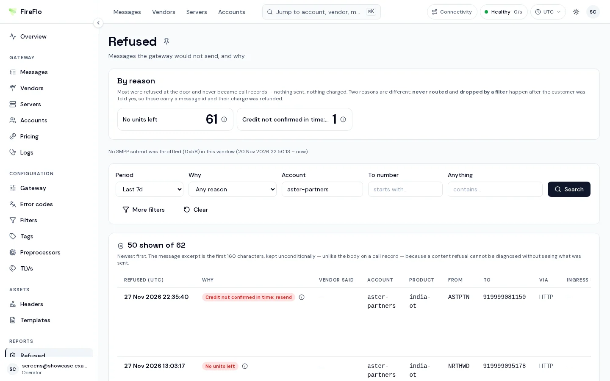
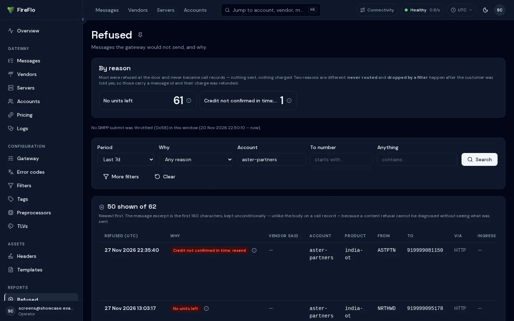
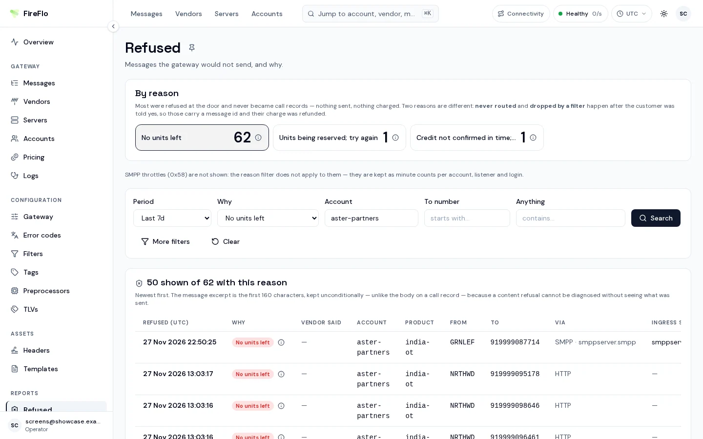
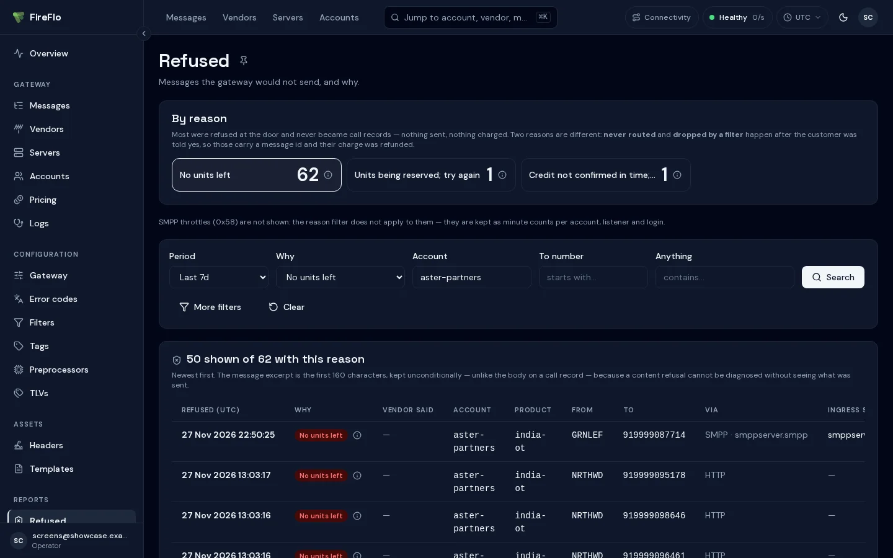

**Mensagens que o gateway não enviou, e por quê.** A primeira tela a abrir quando um cliente diz
que nada está chegando.

A maioria das recusas aconteceu na porta: nada foi enviado e nada foi cobrado. Algumas não, e a
diferença é a coisa mais importante desta página.

## Recusada na porta, ou recusada depois da aceitação

<Warning>
**Quatro motivos acontecem depois que o cliente ouviu sim** — *never routed*, *vendor refused it*,
*dropped by a filter* e *expired waiting for its vendor*.

Essas mensagens foram aceitas e cobradas, e em *vendor refused it* efetivamente enviadas. Elas
carregam um **message id**, aparecem nos call records, e **sua cobrança foi reembolsada**. Todo o resto nesta
página foi barrado antes de virar tráfego.

O filtro **Stage** separa os dois, e é o filtro a que recorrer ao reconciliar a contagem de um
cliente contra a sua.
</Warning>

## Os motivos

**By reason** lidera a página — um card por motivo, com uma contagem para toda a janela e um botão de
informação que o explica. Os cards não se movem enquanto você pagina, e escolher um filtra para ele;
escolha-o de novo para limpar. A partir da 0.12.14, o resumo é feito sobre as **últimas 50 000
recusas** e a página diz isso: num gateway que recusa mais do que isso na janela, os cards descrevem
a forma recente em vez de um total exato, e a tabela abaixo continua completa.

<Frame caption="Recusas de uma account em 7 dias: um card por motivo acima dos filtros e as recusas mais recentes.">
  
  
</Frame>

<Frame caption="A mesma página depois de escolher o card No units left: o card fica destacado, Why passa a ser ele, e a contagem acima da tabela é só desse motivo.">
  
  
</Frame>

Submits SMPP respondidos com throttle (`0x58`) não são linhas aqui. Eles são guardados como contagens
por minuto por account, listener e login, e uma linha abaixo dos cards diz quantos houve na janela,
ou que não houve nenhum.

| Motivo | Geralmente significa |
| :--- | :--- |
| **Sender ID not approved** | O sender não está na lista aprovada da account para aquele product |
| **Content not approved** | O corpo não casou com nenhum template aprovado — uma palavra alterada basta |
| **Out of credit** | Crédito prepaid não cobriria |
| **No units left** | A partir da 0.16.0. Um login de uma [conta de unidades](/platform/billing/units-accounts) não tem mais unidades do seu product. A account mostrada é a conta-pai, que paga |
| **Units being reserved; try again** | As unidades de uma conta de unidades estavam retidas por outro nó por um momento. Um retry passa |
| **Required parameter missing** | Um TLV que a entrada exige estava ausente, e nada o forneceu |
| **Rate limit exceeded** | Acima das mensagens por segundo da account |
| **Product not sold** | O login nomeou um product sem linha habilitada no catálogo |
| **No price configured** | Nenhum rate do lado de venda casou, e o gateway recusa em vez de enviar sem faturar |
| **Product not allowed for this login** | O login não pode nomear aquele product |
| **Credit not confirmed in time; resend** | A partir da 0.17.2 (`creditPending`). O crédito de uma account fundeada não foi confirmado dentro de `smsg.balance.park.seconds`, geralmente porque o banco de dados estava lento ou sem responder. Nada cobrado; um reenvio passa. Veja [Recusas](/platform/troubleshooting/refusals#crédito-não-confirmado-a-tempo) |
| **Too many waiting for credit; resend** | A partir da 0.17.2 (`creditQueueFull`). 10,000 mensagens da account, ou 100,000 no gateway, já estavam esperando crédito. A mesma causa da anterior, em volume |
| **Queue full** | A fila do router estava na capacidade e recusou em vez de crescer o heap. Antes da 0.17.2, envios REST e gRPC recusados por crédito não confirmado a tempo também eram contados aqui |
| **Could not be queued** | Aceita pelas verificações, mas não pôde ser entregue — geralmente o broker |
| **Vendor backlog full** | A partir da 0.15.1. Todo vendor para o qual a mensagem poderia ir tinha passado do seu limite de backlog, e nenhuma outra rota era utilizável. Nada cobrado |
| **Vendor unavailable** | A partir da 0.15.1. O vendor para o qual ela iria está sem bind há mais tempo do que `smsg.vendor.unbound.refuse.after.seconds`, e nenhuma outra rota era utilizável. Nada cobrado |
| **Database not answering; try again** | A partir da 0.15.1. O banco de dados estava lento demais para receber novas mensagens, então novos submits foram recusados antes de qualquer cobrança. As mensagens já aceitas seguem em frente |
| **Gateway stopping** | O gateway estava desligando e não recebeu novas mensagens. Nada cobrado; um retry passa assim que outro nó ou o gateway reiniciado o receber |
| **Hand-off outcome unknown** | Aceita e entregue ao broker, e a entrega terminou sem resposta definida: pode ter sido enviada. Não reembolsada, para não poder ser faturada duas vezes; o gateway a acerta quando a resposta for conhecida |
| **Never routed** | *Após aceitação.* Nenhuma regra habilitada casou; reembolsado |
| **Vendor refused it** | *Após aceitação.* A operadora rejeitou o submit; reembolsado |
| **Dropped by a filter** | *Após aceitação.* Um filtro de roteamento a parou; reembolsado |
| **Expired waiting for its vendor** | *Após aceitação.* Enfileirada para um vendor, esperou mais do que `smsg.vendor.backlog.expire.seconds` (ou a sua própria validade) e não foi enviada; reembolsado, com um recibo de falha onde um foi pedido |

<Note>
**As mensagens de uma conta fundeada esperam pelo seu crédito** após um restart, ou sempre que seu
bloco acaba, em vez de serem recusadas. Muitas recusas **Credit not confirmed in time** em várias
accounts nos mesmos minutos apontam para o banco de dados. **Out of credit** em uma conta fundeada
que persiste é uma escassez real, ou crédito retido em `reserved`.
</Note>

Dois motivos merecem sua própria nota. **Content not approved** é uma comparação exata fora dos
placeholders — uma única palavra alterada recusa. E em **vendor refused it**, o próprio status
numérico da operadora fica ao lado da linha; a família 192–196 é sempre sobre TLVs, o que em uma
lane DLT indiana geralmente significa um entity ou template id ausente ou não carimbado.

Um resumo vazio diz isso claramente, e adiciona a verificação que vale a pena fazer primeiro: se
você esperava recusas e não vê nenhuma, confirme se a aplicação está ligada — **um whitelist não
carregado permite tudo por design**.

## Encontrando uma

A linha sempre visível é **Period**, **Why** (o motivo), **Account** (exato), **To number** (começa
com) e **Anything**. **Anything** é a rede ampla: olha dentro de account, sender, destino, product,
login, detalhe da recusa e trecho da mensagem de uma vez. **More filters** adiciona **Bind name
(system id)**, **Product**, **Came in via**, **Listener**, **From number**, **Message id**, **Carrier
status** e **Stage**. **Clear** esvazia todos.

**Carrier status** recebe o número da operadora em decimal — 69 é o genérico "recusou e não vai
dizer por quê" — e apenas recusas de vendor carregam um.

**A página sempre precisa de um período, de no máximo 92 dias.** As recusas não podem ser listadas
sobre todo o histórico: builds anteriores mostravam silenciosamente as recusas de um dia sob o
título **All time**, que é o tipo de erro em que as pessoas acreditam, então a partir da 0.12.14 a
página pede um período.

## A tabela

Dez colunas por padrão: refused, why, vendor said, account, product, from, to, via, ingress server,
message. O selecionador adiciona o motivo em inglês, o detalhe da recusa, se foi cobrada e
reembolsada, o que foi dito ao cliente, o nome do código do vendor, e os ids da linha e da mensagem.

O **trecho da mensagem** — os primeiros 160 caracteres — é mantido **incondicionalmente**, diferente
do corpo em um call record. Uma recusa de conteúdo não pode ser diagnosticada sem ver o que foi
enviado, então este é o único lugar onde o texto da mensagem está sempre disponível.

<Note>
Um traço em **Parts** significa que a mensagem foi recusada antes que seus segmentos fossem contados
— não zero partes. **Data coding** de fato mostra `0`, que é real: isso é GSM 7-bit.
</Note>

## Exportando

Preparado em background, mantido sete dias, e — como em Messages — **carrega toda coluna mais o
motivo em inglês e o código da operadora**, qualquer que seja sua escolha em tela. Esses arquivos
são lidos por pessoas sem painel aberto.

## Relacionado

<CardGroup cols={2}>
  <Card title="Por que uma mensagem foi recusada" icon="circle-question" href="/platform/troubleshooting/refusals">
    Trabalhando de trás para frente a partir de uma recusa até sua causa.
  </Card>
  <Card title="Rejeições de vendor" icon="triangle-exclamation" href="/platform/troubleshooting/vendor-rejections">
    O que cada código de status da operadora significa.
  </Card>
</CardGroup>
