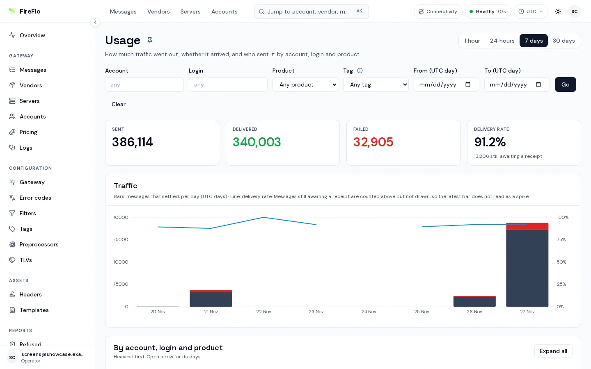
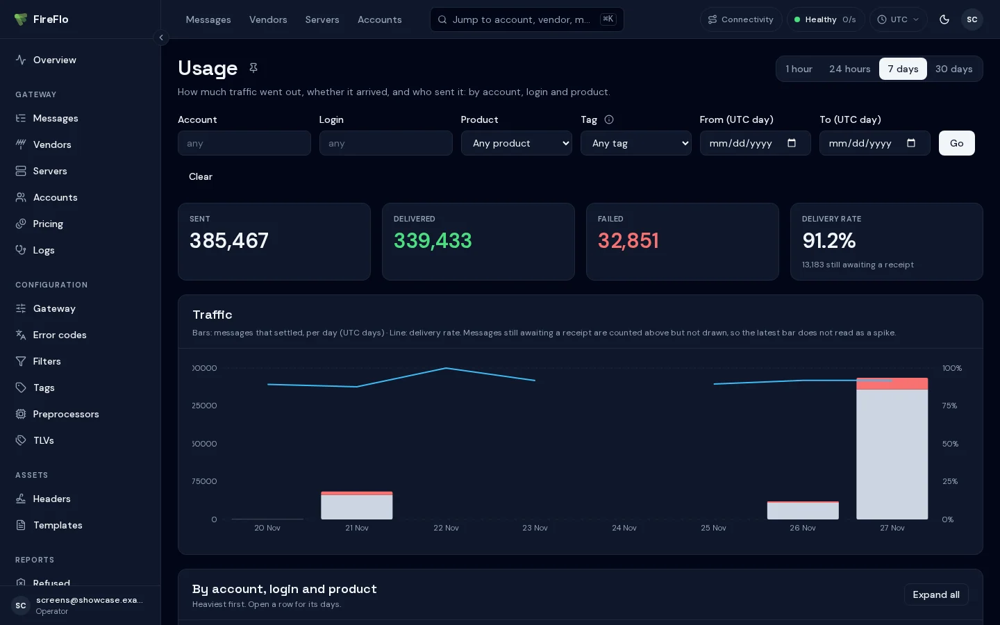
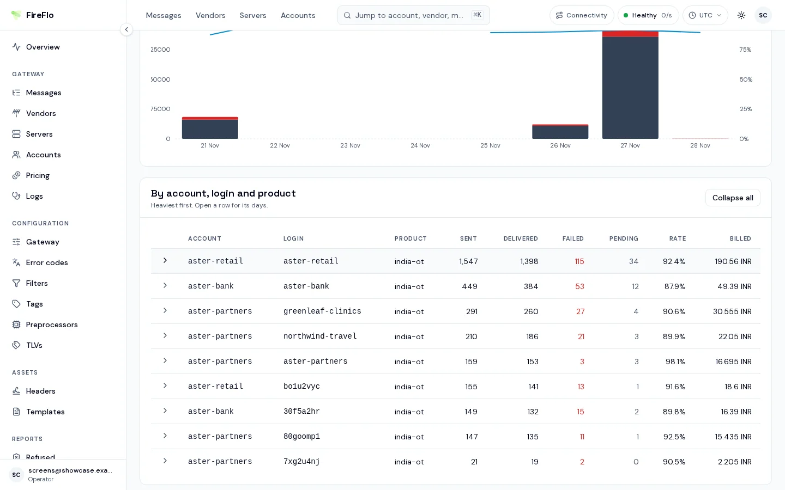
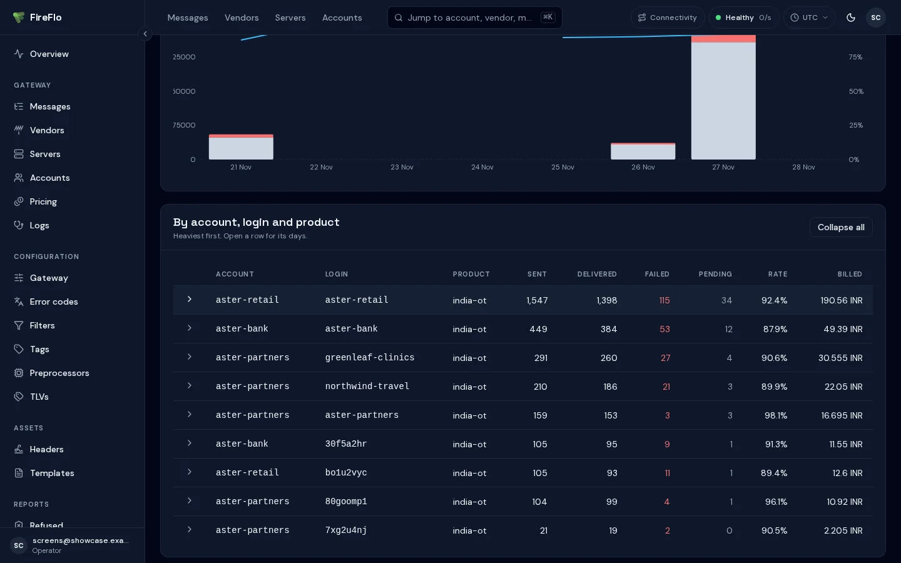

Quanto tráfego saiu, se chegou, e quem enviou: por account, login e product. Volume e entrega
lideram; dinheiro é a última coluna em vez do título — a pergunta comercial é respondida em
[Receita](/platform/control-panel/revenue).

O selecionador de intervalo oferece **1 hour**, **24 hours**, **7 days** ou **30 days**. Como toda
página de tráfego, abre na última hora e, depois disso, no intervalo que você escolheu por último
naquele navegador. Um dia é a unidade em que uma pergunta de uso costuma ser feita, então, para ver o
formato de dia útil versus fim de semana, escolha 7 ou 30 dias.

<Frame caption="Uso em 7 dias. As barras contam só as mensagens que se liquidaram; a linha é a taxa de entrega contra o seu próprio eixo de 0–100%.">
  
  
</Frame>

## Filtros

Abaixo do título: **Account** e **Login** (cada um sugere nomes enquanto você digita), **Product**,
**Tag**, e os dias **From** e **To** no fuso de billing. Nada é lido até você apertar **Go**;
**Clear** remove todos. Um intervalo de datas substitui o selecionador de intervalo enquanto estiver
definido. Os filtros que você aplicou ficam lembrados naquele navegador.

## As cifras

Quatro cards — **Sent**, **Delivered**, **Failed**, **Delivery rate** — com o card de rate
notando quantas mensagens ainda aguardam recibo.

<Warning>
**A taxa de entrega é entregues sobre o que se liquidou, não sobre o que foi enviado.**

Dividir por enviado contaria toda mensagem ainda in-flight como falha. A taxa colapsaria toda tarde
ocupada e se recuperaria sozinha à noite, e ninguém poderia distinguir um problema real de entrega
do tráfego normal.

Portanto uma taxa de 98% significa 98% *das mensagens que têm um desfecho*. Mensagens ainda
esperando são contadas em **Sent**, e em **Pending** na tabela, e estão em nenhuma metade da taxa.
</Warning>

A partir da 0.15.1, a página lê apenas os resumos de uso do gateway, e os call records dos últimos
minutos e nada mais, seja o que for filtrado ou aberto — é isso que mantém uma visão de 30 dias
rápida em volume. O **Pending** de uma hora ou de um dia resumido é o que ainda aguardava recibo
quando o gateway o resumiu pela última vez.

## Tráfego

Entregues e falhadas empilhadas por dia (por hora nos intervalos mais curtos) contra volume à
esquerda, e a taxa de entrega como uma
linha contra um eixo fixo 0–100% à direita.

Duas escolhas deliberadas que vale saber:

- **Mensagens ainda aguardando recibo são contadas nos totais mas não desenhadas.** Hoje seria de
  outra forma sempre lido como um pico de desconhecidos.
- **Um dia sem nada liquidado não tem taxa alguma**, e a linha quebra em vez de cair para zero.
  Uma lacuna é "sem evidência"; um zero seria "tudo falhou".

## Por account, login e product

O mais pesado primeiro, uma linha por account, login e product:
**Account · Login · Product · Sent · Delivered · Failed · Pending · Rate · Billed**. Cinquenta linhas
por página.

Abra uma linha pela sua seta para ver os dias dela, ou as horas na visão de 24 horas; **Expand all**
abre as primeiras 25 linhas de uma vez. A visão de 1 hora não tem nada para abrir.

<Frame caption="A tabela por account, login e product em 7 dias. A seta em cada linha abre os seus dias.">
  
  
</Frame>

Cada account leva através para aquele cliente, onde a mesma pergunta é respondida apenas para eles.

A partir da 0.17.0 o filtro **Tag** limita a página às contas que têm elas mesmas uma
[tag de conta](/platform/routing/account-tags). Ele lê as tags que as contas têm agora: uma mensagem não
registra as tags da sua conta, então um período passado é lido com as de hoje.

Tráfego que não nomeou uma account mostra um traço na coluna **Account** — não é erro, e não é uma
account cujo nome está vazio. É tráfego que chegou sem uma, o que geralmente significa um login sem
account anexada, e vale a pena investigar porque precifica e fatura diferentemente. Os dias que o
gateway resumiu antes de registrar logins (antes da 0.15.1) mostram todos os logins juntos numa
linha, e a página diz isso.

## Uso contra o statement

Esta tela conta mensagens. O [statement](/platform/billing/statements) de um cliente conta
dinheiro, e é faturado na submissão em vez da entrega — portanto a cifra de entregues aqui continua
se movendo depois que um statement é emitido enquanto o valor faturado não.

Eles não devem concordar em entrega. Devem concordar em **enviado**.

## Relacionado

<CardGroup cols={2}>
  <Card title="Receita" icon="coins" href="/platform/control-panel/revenue">
    O mesmo tráfego, valorizado.
  </Card>
  <Card title="Rollups de uso e retenção" icon="database" href="/platform/billing/usage-and-retention">
    O rollup diário do qual esta tela depende, e o que o purge deleta.
  </Card>
</CardGroup>
