Uma **account** é um id sobre o qual um login, um rate scope, uma linha de balance e um call record
todos concordam. Nada precisa criá-la: uma account existe no momento em que um login a nomeia ou uma
mensagem chega carregando-a, e a linha `app_account` é um rótulo aparafusado depois.

<Frame caption="A lista Accounts, uma linha por login. Not named yet conta os account ids em uso que não têm nome próprio.">
  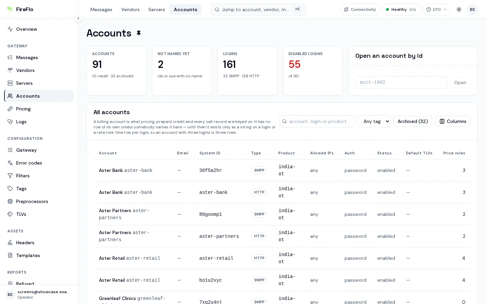
  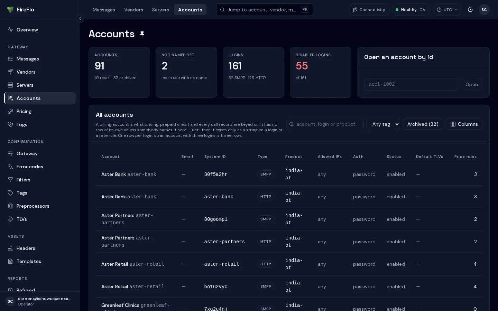
</Frame>

## Deixe `accountId` em branco e algo mais se torna a account

`accountId` é opcional em uma credencial, e o que preenche a lacuna **difere por protocolo**.

| Protocolo | Cai de volta para |
| :--- | :--- |
| SMPP | o `systemId` |
| HTTP | a *lookup key*, que é o `apiKey` quando configurado |

<Warning>
**Um login HTTP com um `apiKey` e sem `accountId` fatura para a própria API key.** O segredo cai em
`cdr_submit.account_id`, nas cifras de receita do painel de controle e em todo export CSV — copiado
para registros que vivem enquanto histórico de billing vive, e que deixam a plataforma em planilhas.
Rotacionar a chave depois divide a história daquele cliente entre dois ids.

Configure `accountId` explicitamente em toda credencial e nenhum fallback importa.
</Warning>

<Frame caption="Um login aberto para edição. Account fica em Billing and tariff: rate scopes e balances prepaid são indexados por ela, e ela fica fixa depois que o login é criado.">
  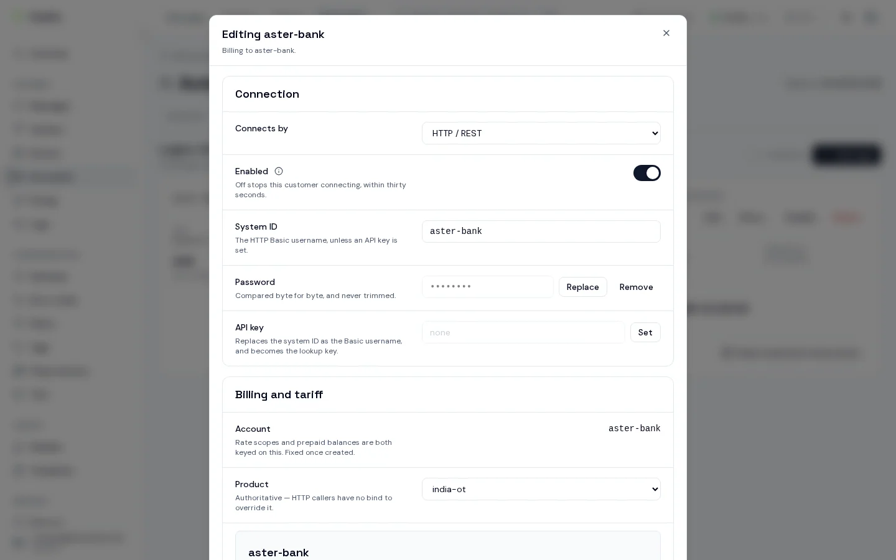
  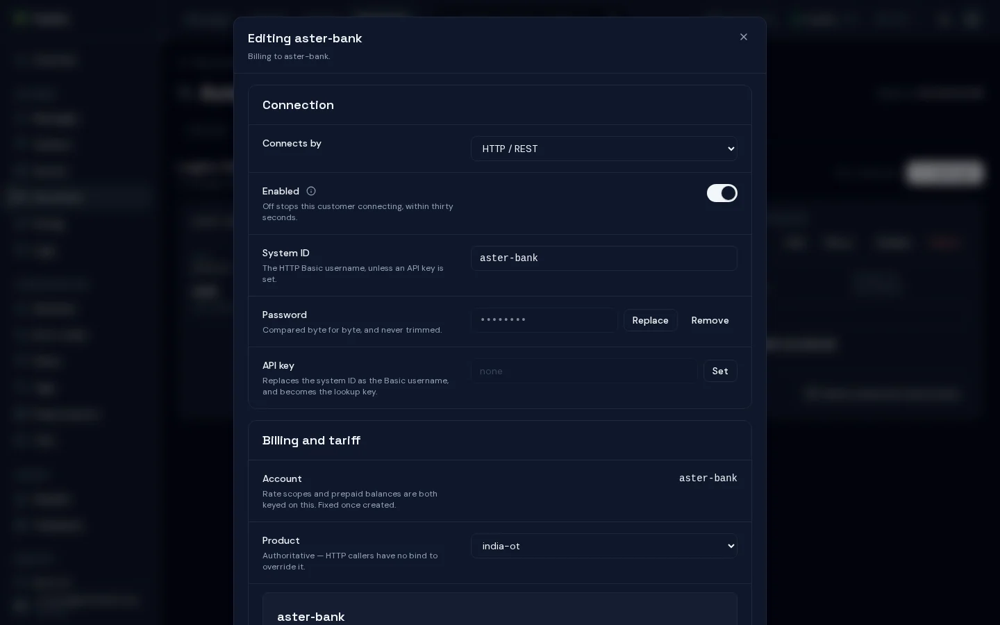
</Frame>

## Por que a account e não o login

Uma account pode conter várias logins, e tudo que carrega dinheiro ou um teto é indexado pela
account:

| Indexado pela account | Onde vive |
| :--- | :--- |
| Balance prepaid e crédito reservado | `account_balance` |
| Credit limit e billing mode | `account_balance.billing_mode`, `credit_limit` |
| Tarifa — o que este cliente paga | um rate scope nomeado como o account id |
| Statement e usage diário | `cdr_submit`, `usage_daily` |
| Tetos de rate | a account, não o bind |

<Note>
Um limite por login permitiria a um cliente aumentar o próprio teto criando outro login. Indexar
pela account é o que faz qualquer disso significar algo.
</Note>

Aprovações são a única coisa que pode ir de qualquer forma: uma linha de sender ID ou template pode
nomear um `system_id` para vinculá-la a um login, ou deixá-lo nulo para todos os logins da account.
Veja [Sender IDs](/platform/customers/sender-ids).

## O que a linha do catálogo efetivamente contém

`app_account` é nome, contato e hierarquia. Quando o gateway carrega os logins, ele lê dela só duas
coisas: se a account está habilitada e se está arquivada.

| Coluna | Significado |
| :--- | :--- |
| `id` | A chave de billing. Trim e não-vazio, e a chave primária. |
| `label`, `description` | Para as pessoas lendo o painel (**Name** e **Notes**). |
| `email` | O endereço de contato da account e um login do portal. Uma account por endereço, ignorando maiúsculas. |
| `enabled` | **Enabled**, em Settings → Advanced. Desligado pausa a account: seus logins param e ninguém consegue entrar no portal por ela. |
| `resells` | **Resells services**: esta account pode conter outras e mover balance para elas. |
| `parent_account_id` | **Belongs to**: o reseller sob o qual ela está. |

A árvore tem exatamente dois níveis de profundidade, e o banco aplica isso: `app_account_two_levels`
recusa uma linha que tanto nomeia um pai quanto revende, portanto uma account ou contém outras ou
pertence a uma.

<Frame caption="A aba Settings de uma account. Organisation reúne o nome, o e-mail, as notas e as tags; Advanced reúne Enabled, a revenda e o pai; Archive fica embaixo.">
  
  
</Frame>

<Warning>
**Desligar uma account para o tráfego dela.** O gateway deixa de servir os logins da account em um
poll de configuração (30 segundos por padrão), e ninguém consegue entrar no portal por ela. Os binds
já abertos continuam de pé até caírem.

Para parar um login em vez da account inteira, desabilite esse **login**. Para parar spend, use o
balance.
</Warning>

Para aposentar uma account de vez, use **Archive** no pé da aba Settings. Os logins dela são
desligados, os binds ativos são derrubados e o sign-in no portal é fechado; o balance e o histórico
ficam, e ela sai da lista de accounts. **Unarchive** religa exatamente o que o arquivamento desligou,
e os clientes reconectam seus binds por conta própria.

## Resellers e sub-accounts

Ligue **Resells services** e a account vira um reseller. As pessoas dela passam a administrar os
próprios clientes pelo portal, em **Customers → Sub-accounts**. São dois níveis, nunca mais: uma
sub-account não pode revender.

<Frame caption="A lista Sub-accounts de um reseller no portal. O crédito de cada sub-account vem do balance do próprio reseller.">
  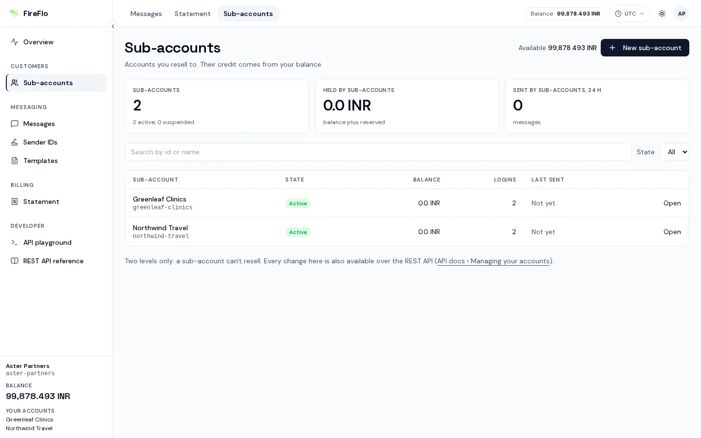
  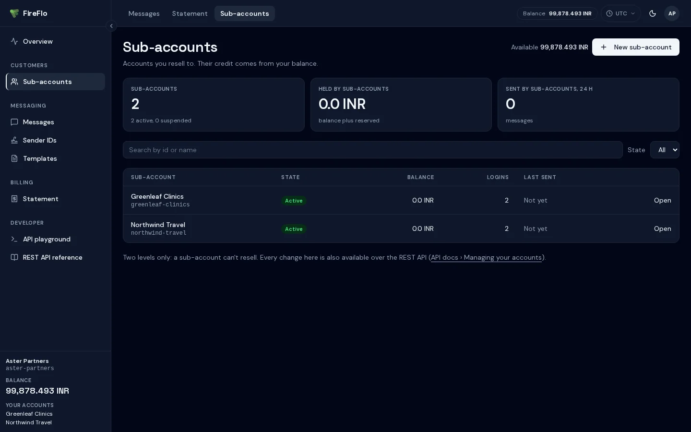
</Frame>

**New sub-account** pede um account id (fixo depois de criado), um nome e um crédito inicial, movido do
balance do reseller na hora; deixe em 0 para recarregar depois. A sub-account ganha um login HTTP
imediatamente, e os logins SMPP são adicionados na aba Logins dela.

<Frame caption="New sub-account. O crédito inicial mostra o balance do reseller depois da movimentação, antes de qualquer coisa ser criada.">
  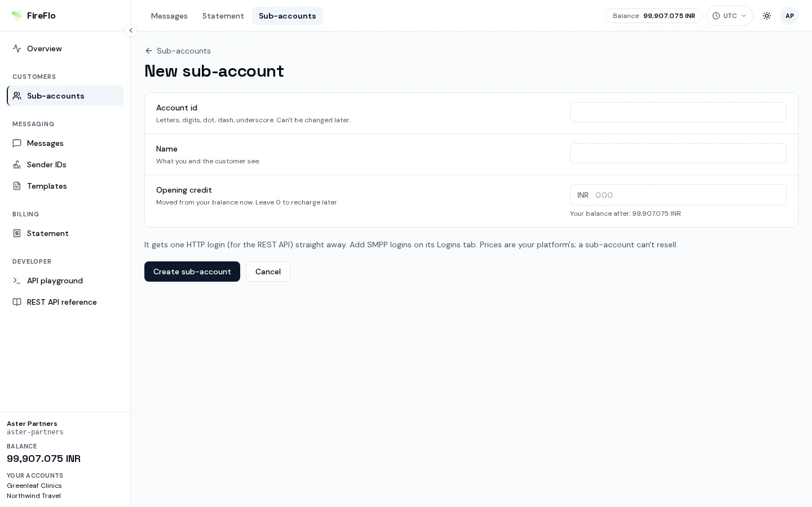
  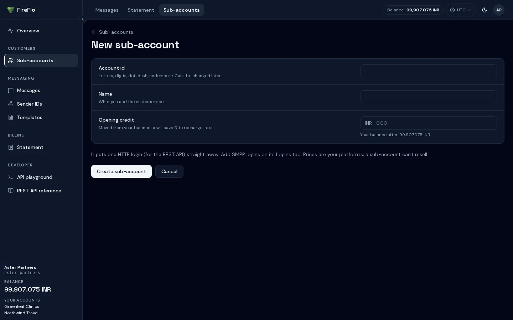
</Frame>

A página de uma sub-account mostra o balance dela, **Recharge** e **Withdraw** para mover crédito
entre ela e o reseller, e as suas transferências, com abas para logins, mensagens, aprovações,
statement, termos de crédito e configurações.

<Frame caption="Uma sub-account no portal do reseller. Withdraw libera o crédito reservado para mensagens sendo enviadas antes de movê-lo de volta.">
  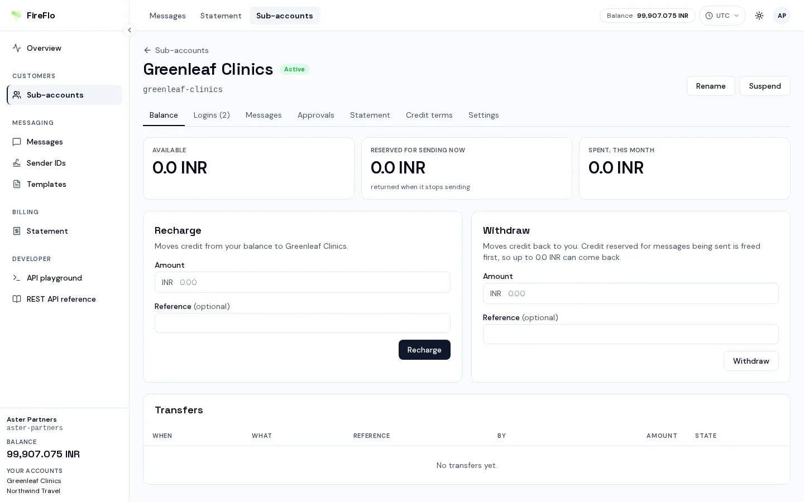
  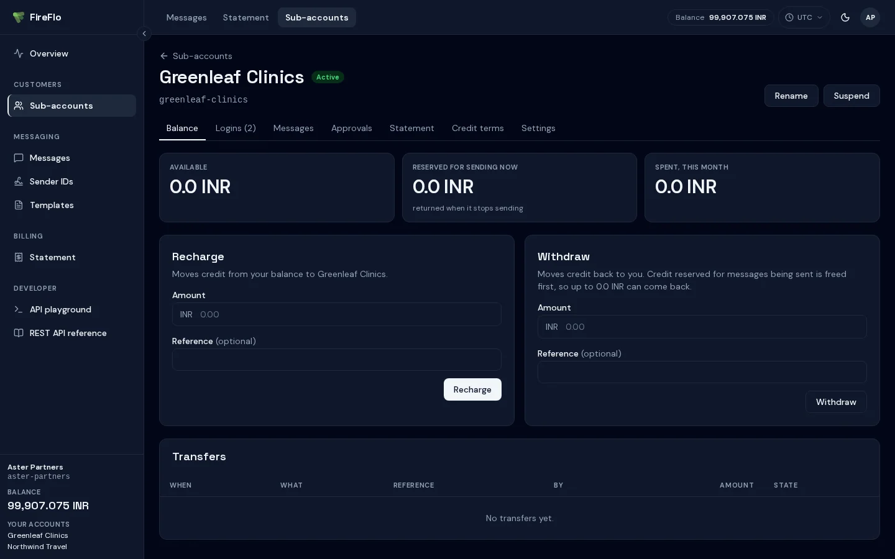
</Frame>

## Criar um login não cria um balance

Uma account sem linha `account_balance` **não está em zero** — ela não tem balance, que é um
estado diferente e o que silenciosamente engole um top-up.

<Warning>
**Um `RECHARGE` escrito para uma account sem linha de balance credita nada.** Fica pendente e loga,
e se aplica no momento em que a linha aparece — mas até lá o cliente pagou e não pode enviar. Abra
a account para crédito primeiro (*Open for credit* na página da account), então faça top-up.
</Warning>

O painel distingue os dois deliberadamente: "no balance row" e "credit switched off" são mostrados
como respostas diferentes em vez de colapsados em uma cifra vazia. Veja
[Crédito prepaid](/platform/billing/prepaid-credit).

## Um account id que também é um nome de vendor

Rating casa um rate scope apenas por nome, e a mesma tabela mantém os dois lados da negociação. Um
id que também é um nome de instância de vendor tem suas regras lidas como **nosso custo para
aquele vendor**, além do que este cliente paga.

A página da account pinta isso de vermelho em vez de deixar ser descoberto em um relatório de
margem. Renomeie um antes de precificar qualquer um. `*` é reservado de saída e não pode ser
usado como nome de account ou vendor.

## O que está na página da account

Uma aba por vez: **Overview**, **Settings**, **Logins**, **Approvals**, **Billing**, **Tariff** e
**Statement**. Uma conta de unidades não tem as abas Tariff nem Statement; os preços e o statement
dela são da conta-pai.

<Frame caption="A aba Overview de uma account: seu tráfego por login e product, seu teto SMPP, uma verificação de entrega e para onde suas mensagens foram.">
  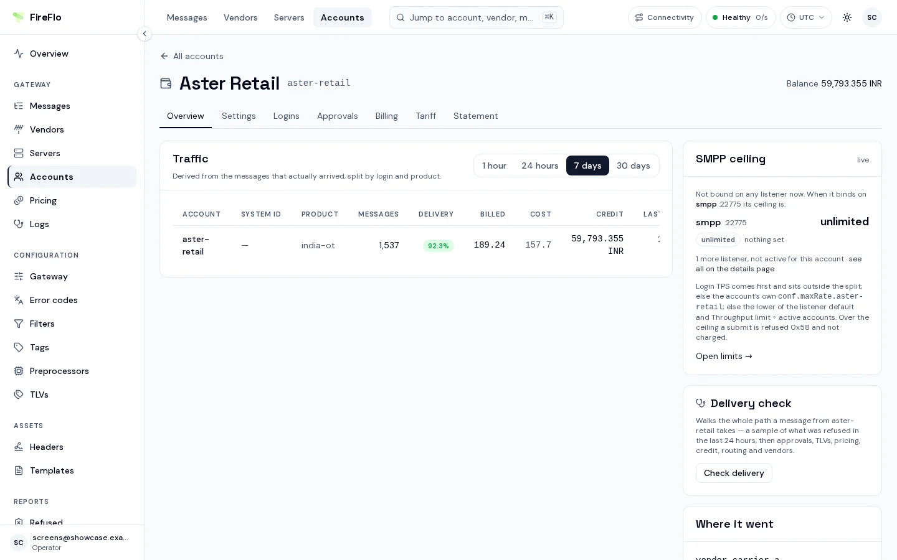
  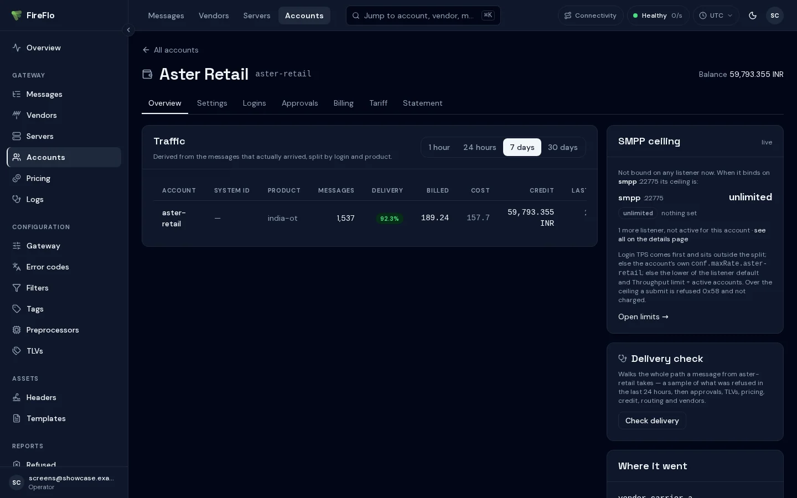
</Frame>

<CardGroup cols={2}>
<Card title="Logins" href="/platform/connections/credentials">
Quem pode se conectar como esta account, qual product cada um carrega, e rotacionar um segredo.
</Card>
<Card title="Tarifa customizada" href="/platform/billing/tariffs">
O que esta account paga. Sem regras próprias significa que é precificada por qualquer catch-all que a cubra.
</Card>
<Card title="Statement" href="/platform/billing/statements">
O que é devido por um período, faturado por submitted — portanto o valor para de se mover quando o período para.
</Card>
<Card title="Sender IDs e conteúdo" href="/platform/customers/whitelisting-rollout">
As duas listas de aprovação e o switch de enforcement ao lado delas.
</Card>
</CardGroup>

Tráfego na página é derivado das mensagens que efetivamente chegaram, dividido por login e product
— portanto ele mostra tráfego que veio sob esta account de um login que este painel nunca viu.
