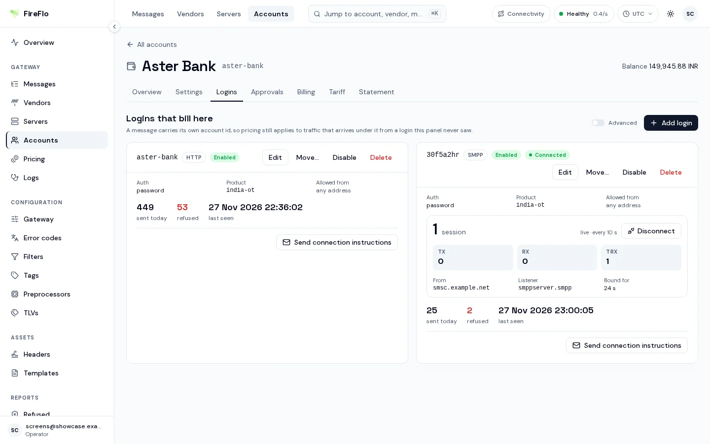
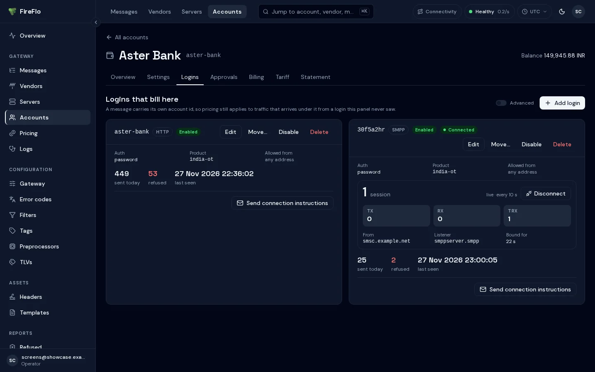

Os clientes entram no portal com um **login do portal**: um endereço de email que entra por um link de
uso único enviado por email, ou com uma senha depois que uma for definida. Os logins do portal de uma
conta ficam na aba **Settings** dela, no cartão **Portal access**.

## O que um operador configura

<Steps>
<Step title="Defina o endereço de email">
O campo **Email** no cartão **Organisation**. Uma conta por endereço, ignorando
maiúsculas/minúsculas — uma segunda conta reivindicando o mesmo endereço é recusada em vez de
silenciosamente sobrepor a primeira.

Um endereço malformado é recusado enquanto você digita, então um endereço que foi salvo é um endereço
que o portal consegue reconhecer. Salvá-lo dá à conta um login do portal para esse endereço. Se esse
login estiver faltando, o cartão Portal access oferece **Create a login for** o endereço.
</Step>

<Step title="Escolha como ele entra">
Cada login no cartão Portal access diz como entra: **Emailed link only** ou **Password, or emailed
link**. **Set password** ou **Change password** define uma senha; **Remove password** volta para só
links. Sem senha, o cliente entra pelo link enviado por email e pode definir uma senha pelo portal.
</Step>

<Step title="Mantenha a conta habilitada">
A chave **Enabled**, em **Advanced**. Ninguém consegue entrar no portal por uma conta que está
desligada ou arquivada.
</Step>
</Steps>

<Frame caption="A aba Settings de uma conta. O login do portal fica à direita, com a forma como ele entra e quando entrou pela última vez.">
  
  
</Frame>

Para impedir uma pessoa de entrar, aperte **Turn off** no login dela; **Turn on** a deixa entrar de
novo. Desligar a conta inteira também para o tráfego dela — veja
[Accounts](/platform/customers/accounts#o-que-a-linha-do-catálogo-efetivamente-contém).

## O que o deployment precisa

O painel precisa ser capaz de enviar email, e precisa conhecer seu próprio endereço público, ou nenhum
link poderá ser emitido. Onde qualquer um dos dois estiver ausente, o cliente é informado claramente
que o acesso por email não está disponível neste painel e que deve procurar seu gerente de conta. É
uma recusa honesta, em vez de um link que nunca chega. Consulte [a configuração do painel de
controle](/reference/config/control-panel).

## O que o cliente vê, e o que não será dito a você

Depois de enviar um endereço, o cliente sempre recebe a mesma resposta:

> If that address is on an account, a sign-in link is on its way. It expires in 15 minutes.

<Note>
**Essa resposta é idêntica quer o endereço exista, pertença a uma conta desabilitada, ou nunca tenha
sido visto.** Um formulário que dissesse "conta não encontrada" permitiria que qualquer pessoa
testasse uma lista de endereços contra sua base de clientes e descobrisse quais clientes dos seus
concorrentes também são seus.

A consequência para o suporte vale a pena saber: **o painel não pode confirmar a você que o endereço
de um cliente foi reconhecido.** Se um cliente relatar que nenhum link chegou, verifique o endereço
na conta em vez de procurar uma rejeição que nunca foi exibida.
</Note>

Os links funcionam uma única vez e expiram após quinze minutos. Um link usado ou expirado informa isso
e oferece um novo. As solicitações têm limites por conta e por rede, e atingir o limite por conta é
respondido com a mesma frase neutra — o cliente não é informado de que foi limitado.

## O que o acesso ao portal não é

**A aba Logins não é acesso ao portal.** Ela armazena credenciais SMPP e HTTP, que são como o
*software* do cliente se conecta. Nada nela concede ou revoga o acesso de uma pessoa. Uma conta pode
ter uma dúzia de logins e nenhum acesso ao portal, ou acesso ao portal e nenhum login.

<Frame caption="A aba Logins: os logins SMPP e HTTP que faturam para a conta, se cada um está conectado, e as suas sessões ativas. Nenhum deles é um sign-in do portal.">
  
  
</Frame>

Uma vez dentro, um cliente vê seu próprio tráfego, extrato, IDs de remetente, templates e o playground
da API. E nunca vê seu custo, sua margem ou qual fornecedor carregou o quê. O que eles podem fazer
por lá está descrito para eles em [o portal](/developers/portal/signing-in).
