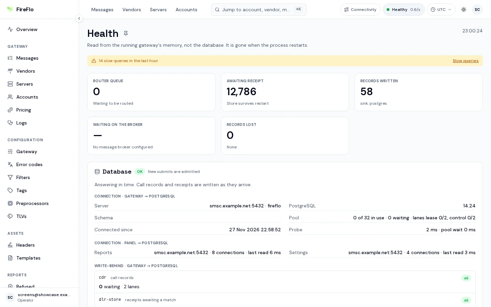
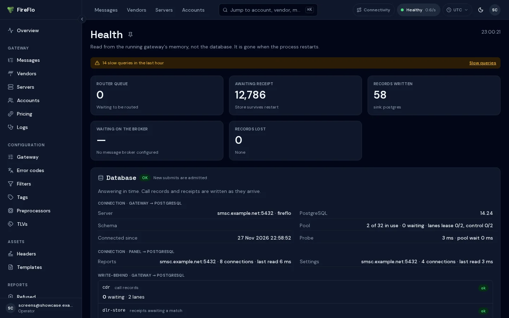
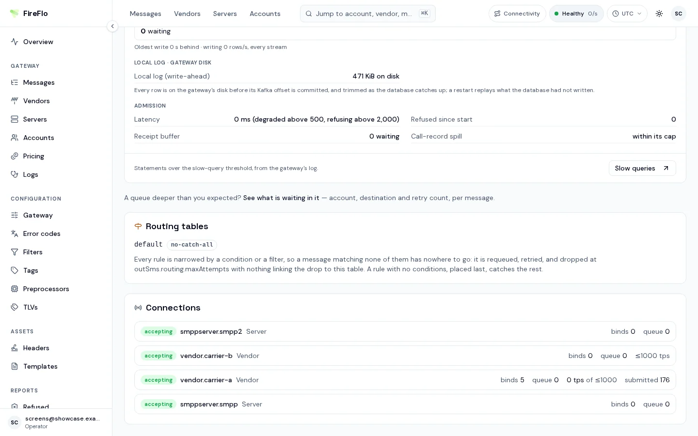
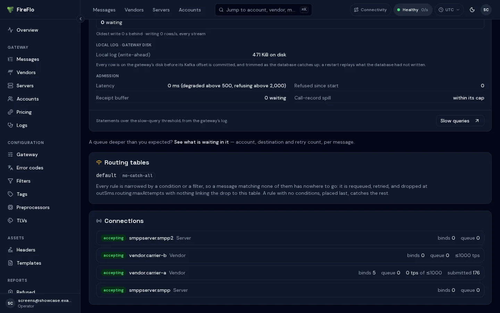
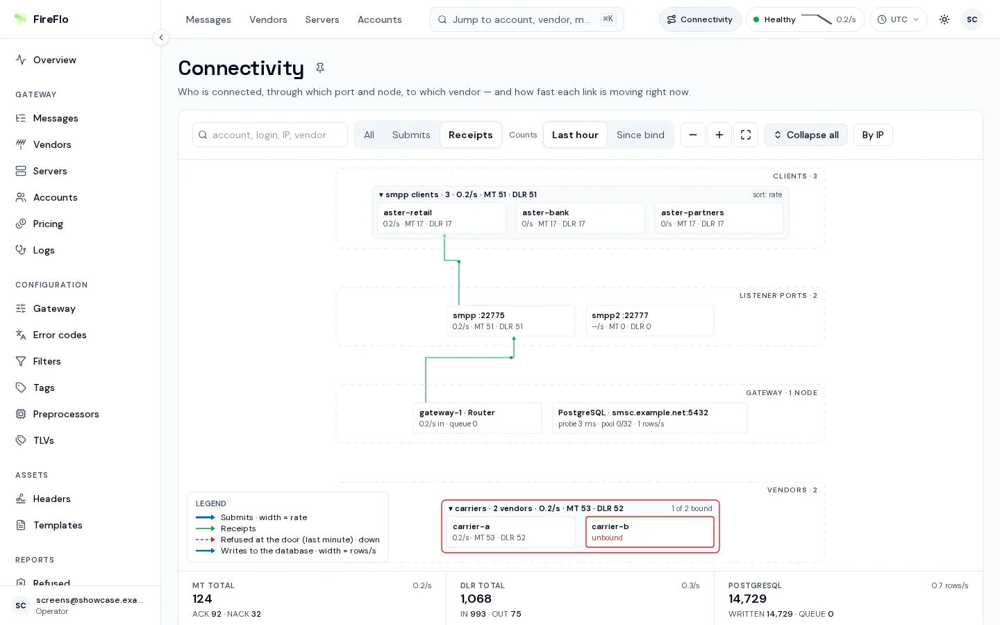
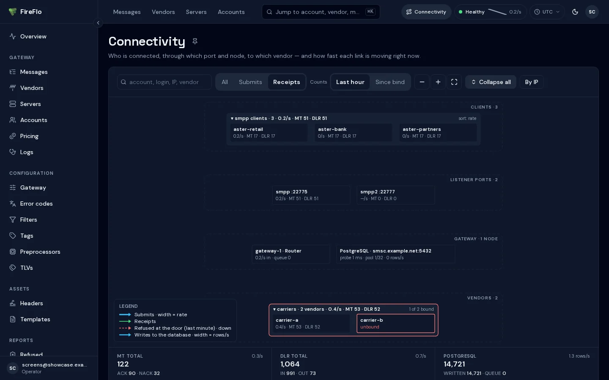

Três superfícies respondem a três perguntas diferentes, e pegar a errada desperdiça um incidente:

| Superfície | Responde |
| :--- | :--- |
| `/q/metrics` | **Quanto, ao longo do tempo** |
| Tabelas de call-record | **O que aconteceu** com uma mensagem específica |
| `/ops/health` | **O que é verdade agora** — binds, profundidade de fila, receipts em voo |

O terceiro existe porque esse estado vive apenas na JVM em execução. Nada mais pode reportá-lo.

```bash
curl -H "Authorization: Bearer $TOKEN" http://localhost:9000/ops/health
```

```json
{
  "data": {
    "observed_at": "2026-08-05T11:28:50Z",
    "router_queue": 0,
    "router_queue_capacity": 50000,
    "awaiting_receipt": 5139,
    "dlr_store_persistent": true,
    "config_sources": {
      "properties": "database", "credentials": "file",
      "routing": "database", "rates": "database"
    },
    "tps_window_seconds": 5,
    "cdr": { "enabled": true, "sink": "postgres", "written": 1, "failed": 0 },
    "workers": [
      { "name": "smppclient.vendor1", "type": "smppclient", "accepting": true,
        "bound": 1, "bound_transmittable": 1,
        "queue_depth": 0, "queue_capacity": 50000, "submitted": 1,
        "tps_limit": 200, "tps_measured": 12.4,
        "sessions_total": 1,
        "sessions": [ "…" ] },
      { "name": "smppclient.vendor2", "type": "smppclient", "accepting": false,
        "bound": 0, "queue_depth": 0,
        "last_error": "Bind failed: ESME_RINVPASWD (Invalid password)",
        "last_error_at": "2026-08-06T09:12:04Z" }
    ]
  }
}
```

## `sessions` é uma amostra, não o conjunto

<Warning>
**No máximo 20 sessões por worker aparecem nesta resposta, seja o que for que `sessions_total` diga.**

Health é consultado a cada poucos segundos por todo dashboard aberto, e um listener carregando
quinhentos binds estava enviando quinhentas linhas a cada vez.

**Contar o array para responder "quantos estão conectados" dá um número errado que parece
plausível.** Use `bound`, ou `sessions_total` para a contagem de linhas.
</Warning>

Para ver ou pesquisar o conjunto todo, pagine-o:

```bash
curl -H "Authorization: Bearer $TOKEN" \
  'http://localhost:9000/ops/workers/smppserver.smpp/sessions?q=acme&offset=0&limit=50'
```

```json
{ "data": { "rows": [ "…" ], "total": 412, "matched": 3, "offset": 0, "limit": 50 } }
```

`q` casa de forma case-insensitive por substring em `account`, `system_id`, `host`, `system_type` e
`bind_type`. **Colunas numéricas deliberadamente não são pesquisadas** — `50` casaria com um
throughput de 50, uma porta de 2750 e uma sessão ativa há 50 segundos ao mesmo tempo.

`total` conta toda sessão; `matched` conta as que passam em `q`. Ambos são reportados porque um
operador que filtrou para um cliente ainda precisa saber que o listener está carregando quatrocentos
binds.

`limit` tem padrão 50, teto de 200, e **a resposta ecoa o tamanho realmente aplicado** — então um
chamador pedindo 10 000 pode ver que recebeu 200 em vez de concluir que só havia 200 sessões.

## Os campos que valem alerta

| Campo | Observe |
| :--- | :--- |
| `bound_transmittable` | Zero enquanto `bound` não é — uma sessão só de recepção não carrega nada |
| `last_error` | **Presente** significa que um bind foi recusado; **vazio** significa que o socket nunca abriu |
| `router_queue` contra `router_queue_capacity` | Crescimento sustentado é roteamento mais lento que ingress |
| `awaiting_receipt` | Crescimento significa que receipts não estão voltando |
| `queue_depth` por worker | Um único fornecedor acumulando |
| `cdr.failed` | Não-zero significa que registros estão sendo perdidos |

<Tip>
**`last_error` é o campo que separa as duas falhas que um badge não separa.** Um valor significa que
o socket abriu e o bind foi recusado — credenciais, system type, IP, um limite de bind. Vazio
significa que o socket nunca abriu — firewall, DNS, ou a outra ponta fora.

Ele limpa no momento em que um bind tem sucesso.
</Tip>

## `config_sources` responde a uma pergunta que as pessoas fazem ao contrário

Ele diz, por domínio, se o gateway está lendo arquivos ou o banco.

Isso importa porque **uma mudança feita no painel não faz nada se o gateway está lendo um arquivo
para aquele domínio** — e o sintoma é "minha edição não aplicou", que manda as pessoas olharem para
a edição.

## `bound: 0` em um listener geralmente está tudo bem

Em um **fornecedor** significa que nada está conectado e nada pode ser enviado.

Em um **listener** geralmente significa que nenhum cliente está conectado agora — o que é quieto em
vez de quebrado. Por isso um listener com ninguém conectado não é pintado de vermelho da forma como
um fornecedor sem sessão é.

## No painel de controle

A **pílula de saúde** no cabeçalho de toda página do painel lê este endpoint: um ponto, uma palavra
como **Healthy** e a taxa de saída. Escolha-a para abrir **Health**, que é a mesma resposta organizada
para leitura. Ela é lida da memória do gateway em execução, não do banco de dados, e some quando o
processo reinicia.

<Frame caption="Health: a fila do router, os receipts esperando correspondência e os registros escritos ou perdidos no topo, e depois o banco de dados em que o gateway escreve.">
  
  
</Frame>

| Bloco | Campo |
| :--- | :--- |
| **Router queue** | `router_queue` |
| **Awaiting receipt** | `awaiting_receipt`; a linha abaixo diz se o store sobrevive a um restart |
| **Records written** | `cdr.written`, com o sink |
| **Waiting on the broker** | a profundidade do broker, ou que nenhum está configurado |
| **Records lost** | `cdr.failed`; escritas que falharam não são retentadas |

Abaixo dos blocos, o card **Database** mostra a conexão do gateway, os seus writers e a latência que
admite ou recusa novos submits. Um card **Routing tables** só aparece quando uma tabela tem um
problema que vale a pena dizer, como nenhuma regra que pegue todo o resto. **Connections** lista todo
listener e fornecedor com o seu estado, as sessões conectadas (e quantas podem transmitir, quando isso
difere), a fila, a taxa contra o seu teto e as mensagens submetidas; uma linha com sessões se abre para
listá-las.

<Frame caption="Connections em Health: um fornecedor conectado cinco vezes e enviando, o outro aceitando sem bind; listeners sem ninguém conectado estão quietos, não quebrados.">
  
  
</Frame>

### O mapa Connectivity

**Connectivity**, ao lado da pílula de saúde, desenha o mesmo estado ao vivo como um mapa: os clientes
conectados no topo, depois as portas de listener por onde entraram, o nó do gateway e o seu banco de
dados, e os fornecedores embaixo, com o tráfego andando ao longo de cada ligação. A largura de uma
ligação é a sua taxa; uma ligação vermelha tracejada são recusas na porta no último minuto, ou uma
ligação que caiu.

- **All**, **Submits** e **Receipts** escolhem quais fluxos são desenhados.
- **Counts** lê MT e DLR na **Last hour**, ou **Since bind** a partir dos contadores de cada sessão.
- A busca encontra uma conta, login, IP ou fornecedor no mapa; zoom e **Fit** o movem; **Expand all**
  abre todos os grupos; **By IP** divide cada cliente em uma caixa por endereço de onde ele se conecta.
- Escolha uma caixa para ver o que você pode fazer com ela: abrir a sua conta, listener ou fornecedor,
  a sua saúde, filas ou tabela de roteamento, ou agir sobre ela no mesmo menu.

Os totais de MT, DLR e escritas no banco ficam abaixo do mapa.

<Frame caption="O mapa com Receipts escolhido e todos os grupos abertos: três clientes conectados em uma porta, receipts voltando até eles de um fornecedor enquanto o outro está sem bind.">
  
  
</Frame>

## Relacionado

<CardGroup cols={2}>
  <Card title="The management port" icon="server" href="/reference/management/endpoints">
    Cada endpoint, e qual token cada um precisa.
  </Card>
  <Card title="Binds and listeners" icon="triangle-exclamation" href="/platform/troubleshooting/binds-and-listeners">
    Três falhas que parecem todas "ninguém está conectado".
  </Card>
</CardGroup>
