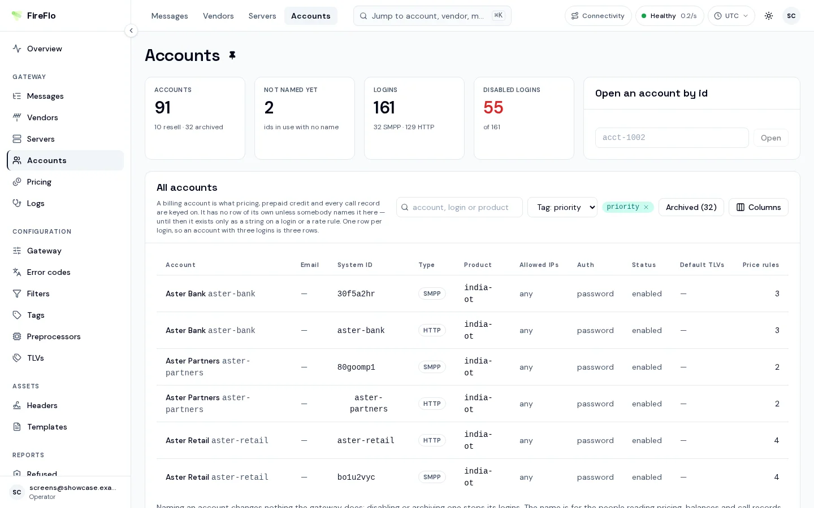
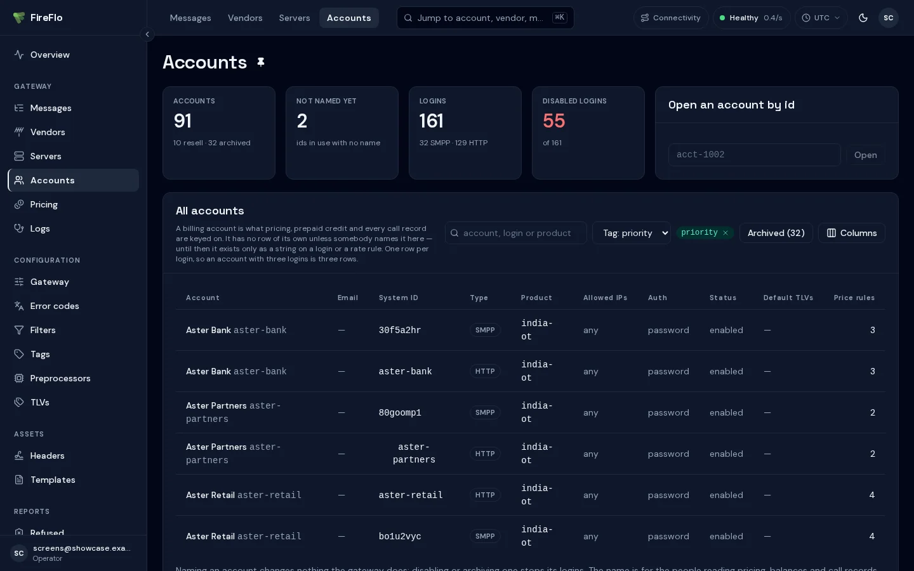
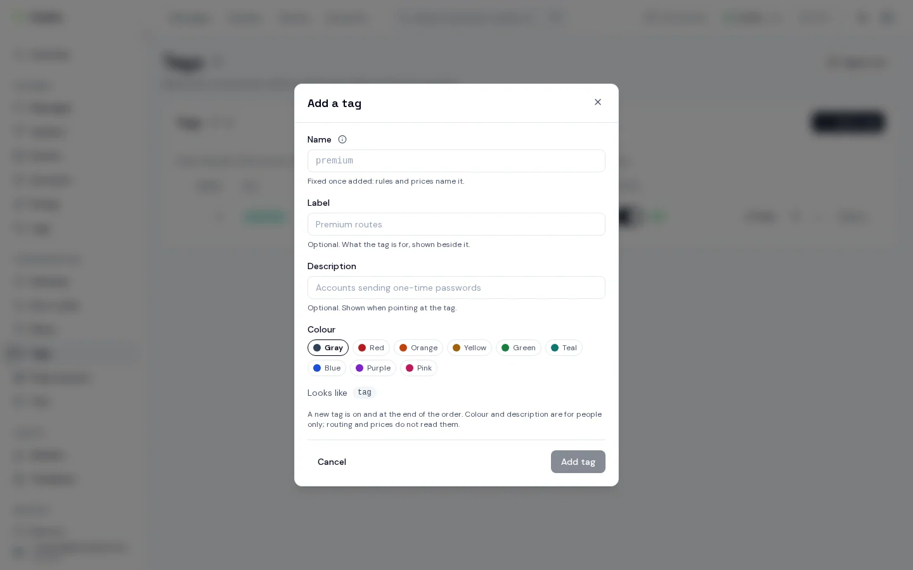
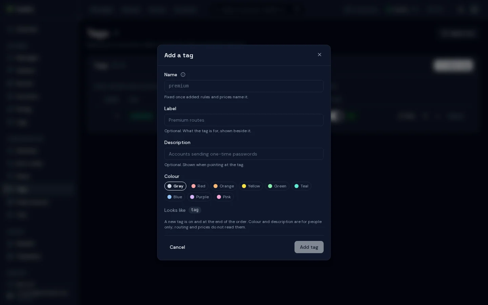

A partir da **0.17.0** (painel de controle 0.17.0.0), o operador pode colocar **tags** nas contas:
nomes curtos como `otp`, `premium` ou `bank`. Uma conta pode ter várias. Uma regra de roteamento, uma
regra de preço ou um filtro nomeado pode então testar a tag em vez de nomear contas, e uma tag pode ter
preços próprios.

Nada muda até que uma tag seja criada, colocada numa conta e nomeada por uma regra ou um preço.

## Quem coloca, e quem vê

- **Só o operador.** As tags são colocadas no painel de controle ou pela plataforma que gerencia as
  contas. Revendedores e clientes nunca as veem nem as mudam, nem no portal nem em nenhuma API que
  usem.
- **Uma conta de unidades também carrega as tags da sua conta-pai.** Colocar uma tag num revendedor
  cobre os clientes dele. Uma conta de unidades também pode ter tags próprias. Veja
  [Contas de unidades](/platform/billing/units-accounts).
- **Só com a configuração no banco de dados.** Com a configuração em arquivos não há contas para
  marcar, então uma regra que testa uma tag não casa com nada. Veja
  [Escolhendo uma fonte de configuração](/platform/install/configuration-source).

## A condição "Account tag"

Regras de roteamento, regras de preço e filtros nomeados têm uma condição sobre as tags da conta. Como
ela funciona nas regras de roteamento, uma regra que entrega mensagens a um pré-processador também pode
usá-la.

| No painel de controle | Numa regra | Casa quando a conta |
| :--- | :--- | :--- |
| **has** | `tag:equals:otp` | tem `otp` |
| **has all of** | `tag:equals:otp,bank` | tem todas as tags da lista |
| **has any of** | `tag:startsWithAny:otp,bank` | tem pelo menos uma tag da lista |
| **has none of** | `tag:!startsWithAny:otp,bank` | não tem nenhuma tag da lista |
| **has no tag** | `tag:isNull` | não tem nenhuma tag, própria ou da conta-pai |

Cada forma pode ser negada com um `!` na frente. Os nomes são comparados exatamente. **Qualquer outro
operador em `tag` é recusado quando a regra carrega**, e o gateway mantém a configuração anterior.

A conta testada é a conta de unidades da mensagem quando ela tem uma; senão, a conta em que a mensagem é
faturada. Uma tag desativada é tratada como ausente. Uma mensagem não registra as tags da sua conta: a
condição lê as tags que a conta tem quando a mensagem é roteada ou precificada.

No painel de controle, "Account tag" é uma das condições guiadas do assistente de filtros, do editor de
regras de rota e do editor de regras de preço. Escolher uma tag onde uma regra escolhe seus filtros
adiciona a condição para você.

## Preços por tag

A precificação tem um nível **Tag prices** entre os preços próprios de uma conta e o default. Numa
tabela de tarifas é o scope `tag:<nome>`. O preço de uma mensagem é procurado nesta ordem, e o primeiro
que casar vence:

1. **Os preços próprios da conta.**
2. **Os preços das suas tags**, na ordem da lista Tags. Quando uma conta tem várias tags com preços,
   vence a que está mais acima na lista.
3. **O default**, `*`.

Uma conta de unidades é precificada como a sua conta-pai, que é quem paga: os preços próprios da
conta-pai, depois os das tags dela, depois o default. A cotação e o testador de mensagens a precificam
da mesma forma.

A cotação, o testador e a página de tarifa de uma conta mostram qual preço se aplica e por quê. Um scope
`tag:` que nomeia uma tag desconhecida ou desativada carrega, não precifica ninguém e é registrado uma
vez como `rates.tagScope.unreachable`.

Veja [Como o pricing funciona](/platform/billing/how-pricing-works) para os scopes e o default.

## Filtrar listas e relatórios por tag

A lista de contas tem uma coluna **Tags** (ligue-a em **Columns**) e um filtro por tag. **Usage** e
**Messages** têm um filtro **Tag**.

<Frame caption="A lista Accounts filtrada para as contas que têm a tag priority.">
  
  
</Frame>

<Note>
**O filtro lê as tags que as contas têm agora.** Uma mensagem não registra as tags que a conta tinha
quando foi enviada, então um período passado é lido com as tags de hoje. O filtro mostra as contas que
têm a tag elas mesmas, não por meio de uma conta-pai. Em Messages ele precisa de um período diferente
de todo o histórico.
</Note>

## Quando uma mudança vale

Uma mudança numa tag, ou em quais contas a têm, é adotada na próxima consulta de configuração, **em até
30 segundos**. Roteamento e precificação são reconstruídos juntos, e as sessões SMPP conectadas são
reprecificadas: um cliente já conectado não precisa refazer o bind. Uma mudança feita pela API é
adotada na hora no nó que recebeu a chamada.

Num gateway cuja licença não está em dia, as mudanças de configuração ficam congeladas, inclusive as de
tags.

## A página Tags

**Tags** fica ao lado de **Filters** no painel de controle. Para cada tag ela mostra:

| | |
| :--- | :--- |
| **Nome** | Letras minúsculas, dígitos, `-` e `_`, começando por uma letra ou um dígito, no máximo 40 caracteres. Regras, filtros e preços se referem à tag pelo nome, então ela não pode ser renomeada. |
| **Label** e **descrição** | Para que serve a tag. Opcionais, só para exibição. A descrição tem no máximo 200 caracteres. |
| **Cor** | Uma de nove, sempre ao lado do nome. |
| **Ordem** | Movida para cima e para baixo na lista. Decide qual preço vence. |
| **Ativada** | Ligada ou desligada. |
| **Contas** | Quantas contas têm a tag elas mesmas. |
| **Usada em** | Quais regras de roteamento, regras de preço, filtros e preços por tag a nomeiam. |

- **Uma tag que uma regra, um filtro ou uma lista de preços ainda nomeia não pode ser apagada**, só
  desligada. Uma regra que nomeasse uma tag inexistente deixaria de casar sem que nada avisasse.
- **Uma tag desativada não casa com nada e não precifica nada**, mas continua nas suas contas. Ligada de
  novo, volta a valer.
- Apagar uma tag que nada nomeia a tira de todas as contas.

**Add a tag** pede o nome, um rótulo e uma descrição opcionais, e uma cor. Uma tag nova vem ligada e
vai para o fim da ordem. Cor e descrição são só para pessoas; o roteamento e os preços não as leem.

<Frame caption="Add a tag: o nome fica fixo depois de adicionado, porque regras e preços o citam.">
  
  
</Frame>

As tags são colocadas numa conta na aba **Settings** dela. Uma conta de unidades mostra ali as tags da
conta-pai, só para leitura.

## Para integrações

### API de plataforma

O gateway anuncia a capacidade **`account_tags`** quando sua configuração está no banco de dados.

| | |
| :--- | :--- |
| `tags` | Todas as tags definidas pelo operador, ativadas ou não, na ordem da lista Tags: `name`, `label`, `description`, `color`, `seq`, `enabled`. |
| `Account.tags` | As tags próprias da conta, ativadas ou não. |
| `Account.effectiveTags` | O que regras e preços veem: as tags próprias ativadas e, para uma conta de unidades, as da conta-pai. |
| `accounts(tag:)` | Só as contas que têm a tag elas mesmas, não por meio de uma conta-pai. |
| `setAccountTags` | Adiciona e remove tags. **Nunca substitui a lista**: as tags não nomeadas ficam. Uma tag que o gateway não define responde `UNKNOWN_TAG` e nada muda. Repetir uma chamada não muda nada. |
| `ProvisionInput.tags` | Tags dadas **só quando a chamada cria a conta**. Ignoradas para uma conta que já existe. Uma tag desconhecida responde `UNKNOWN_TAG` e nenhuma conta é criada. |

### API de gerenciamento

- `GET /manage/accounts/{id}` inclui `tags`, as tags próprias da conta.
- `PUT /manage/accounts/{id}/tags` recebe `add` e `remove`, duas listas, e responde com a conta e suas
  tags depois da mudança. Desde 0.17.3 também exige o `ref` da plataforma — veja
  [a API de gerenciamento assinada](/reference/management/endpoints). Nunca substitui a lista. Uma tag que o gateway não define, ou uma adicionada e
  removida ao mesmo tempo, responde `400`.

### API de revendedores

Sem mudanças. Revendedores não veem tags.

## Atualizando para a 0.17.0

O schema passa de 1.132.0 para 1.133.0, com duas tabelas novas e vazias, então atualize com
`--migrate`. O painel de controle 0.17.0.0 espera 1.133.0: atualize o gateway primeiro. Nenhuma chave de
configuração nova. Voltar atrás é o gateway e o painel anteriores; as duas tabelas podem ficar.

<Warning>
**Um passo manual quando o painel de controle escreve com um papel de banco de dados próprio.** A
migração não concede nada aos papéis do painel, porque os nomes deles são de cada instalação. Depois da
atualização, como dono das tabelas:

```sql
GRANT SELECT, INSERT, UPDATE, DELETE ON app_tag, app_account_tag TO <o papel de escrita do painel>;
```

Um painel que se conecta como dono das tabelas não precisa de nada. Sem a permissão, a página Tags
mostra um erro de permissão; as mensagens não são afetadas.
</Warning>

## Relacionado

<CardGroup cols={2}>
  <Card title="Filtros" icon="filter" href="/platform/routing/filters">
    Condições nomeadas compartilhadas pelo roteamento e pela precificação.
  </Card>
  <Card title="Como o pricing funciona" icon="tag" href="/platform/billing/how-pricing-works">
    Scopes, o default e a ordem dos preços.
  </Card>
</CardGroup>
