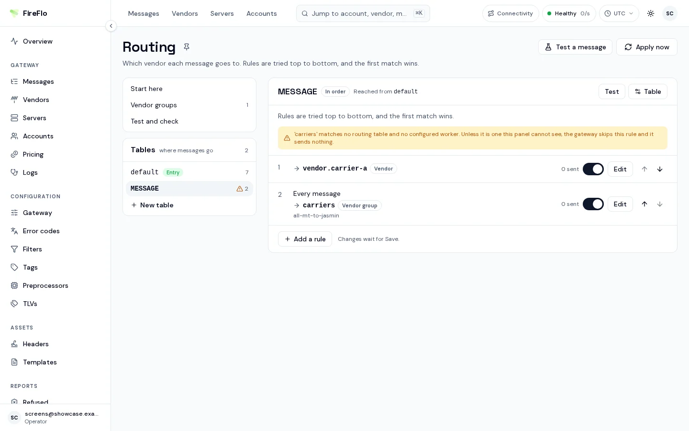
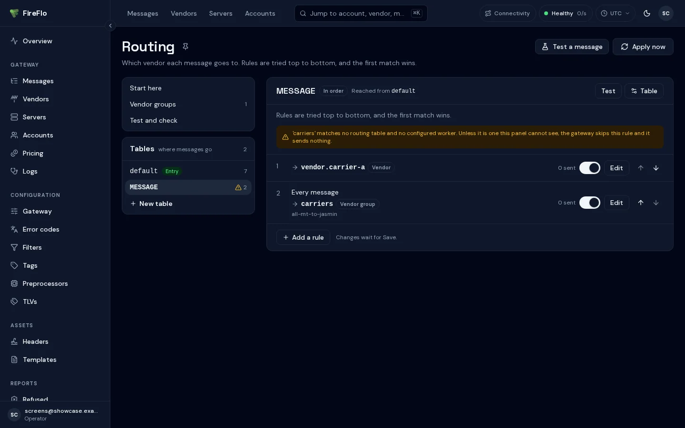
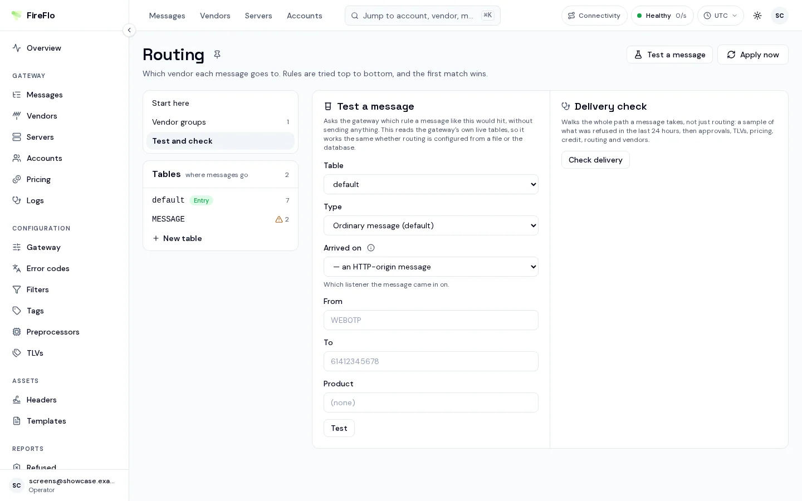
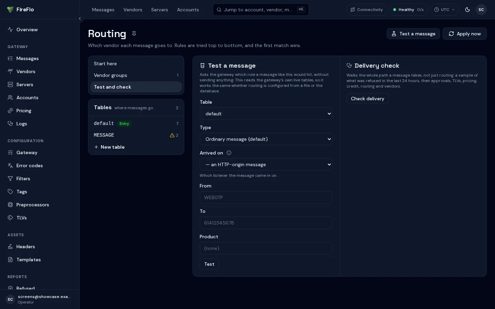
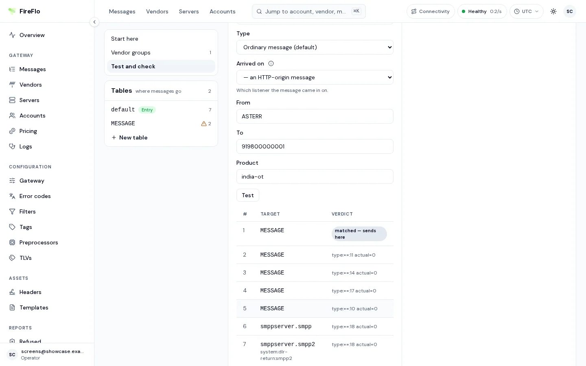
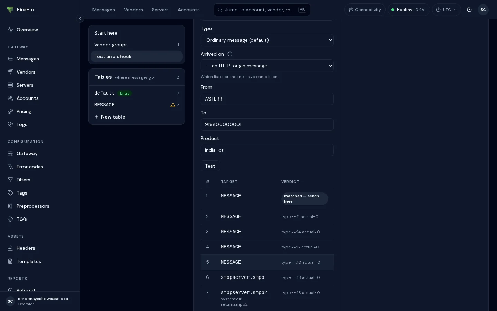
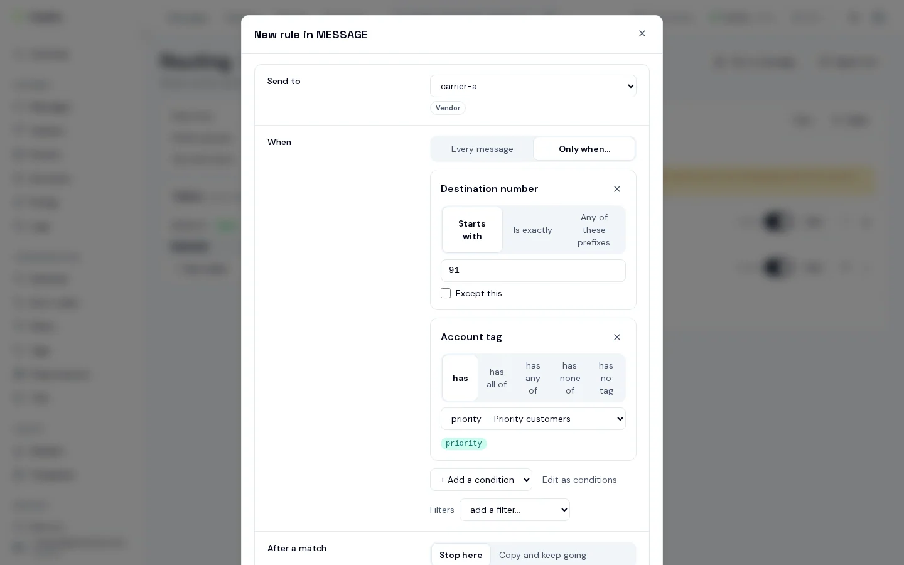
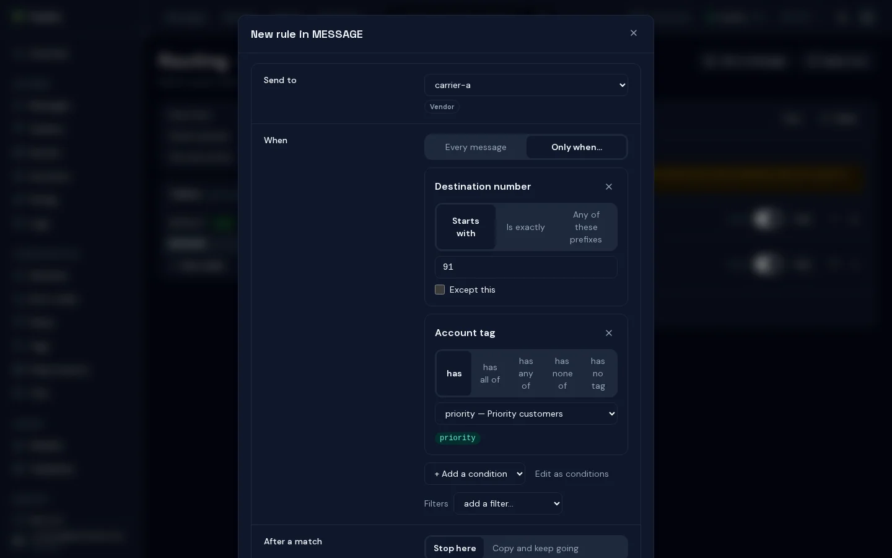

## Três formas de escrever uma regra que nunca é verdadeira

Cada uma destas carrega sem reclamar, não dá match em nada e custa uma tarde.

<Warning>
**`==` é um operador numérico.** `vendor1:from:==:MyBrand` não falha silenciosamente ao dar match. Ele
falha ao *analisar*, o que faz o reload inteiro falhar e deixa a tabela anterior em serviço. Use
`equals` para texto.

```
vendor1:from:equals:MyBrand      correto
vendor1:from:==:MyBrand          falha no parse
```
</Warning>

<Warning>
**`matches` é uma expressão regular e está ancorada**, porque o gateway chama `Pattern.matches` em vez
de `find`. `^61.*` casa com um destino inteiro; um `61` sozinho casa apenas com a string de dois
caracteres `61`.

**`startsWith` compara texto literal.** Uma expressão regular entregue a ele pergunta se um destino
começa literalmente com os caracteres `^(?:\+61`. Nada começa, então a regra é salva, carregada,
exibida e nunca dispara. O painel de controle avisa sobre isso; um arquivo editado à mão não.
</Warning>

<Warning>
**Um campo não definido não dá match em nenhum operador positivo.** `product:equals:premium` não casa
com uma mensagem que não carrega produto nenhum, e nem `product:startsWith:prem`. Só `isNull` casa.

O contrário pega as pessoas do outro lado: `product:!equals:premium` **dispara** para uma mensagem sem
produto, porque a negação inverte o match que falhou.
</Warning>

## A gramática

```
Target:Attribute:Operator:Value
```

As regras são avaliadas de cima para baixo dentro de uma tabela e o primeiro match vence. `Target` é
uma instância de worker (`vendor1`, `smppserver.smpp`), um **grupo**, ou outra tabela para encadear
(`MESSAGE`).

<Tabs>
  <Tab title="Painel de controle">
    **Routing** lista cada tabela com suas regras em ordem, cada uma com seu alvo, uma chave liga/desliga
    e quantas mensagens ela casou desde que o gateway iniciou pela última vez. **Add a rule** abre o
    editor; mudanças numa tabela esperam por **Save**. O editor valida o operador contra o campo antes
    de salvar, recusa um operador numérico em um campo de texto, e avisa sobre uma expressão regular
    escrita em um operador literal.
  </Tab>
  <Tab title="routingTable.conf">
```ini
[MESSAGE]
vendor2:to:startsWith:614          # AU mobile
vendor2:from:equals:MyBrand        # um sender ID
vendor3:systemId:equals:acme-smpp  # um cliente bound
vendor1::default:                  # o catch-all, POR ÚLTIMO
```
  </Tab>
</Tabs>

<Frame caption="Uma tabela de roteamento: suas regras em ordem, cada uma com seu alvo, sua chave e sua contagem de matches. O aviso diz que uma regra nomeia um alvo que o gateway não conhece.">
  
  
</Frame>

<Warning>
**O catch-all vai no fim.** Acima de outras regras ele torna toda regra abaixo inalcançável, e nada
avisa você no arquivo. Elas dão parse bem, simplesmente nunca executam. O painel reporta isso; o
gateway registra como `unreachable-rules` em `/ops/health` e segue em frente.
</Warning>

## Operadores

Qualquer operador pode ser negado com um `!` na frente. No editor de regras, isso é **Except this**
(**Except these** para uma lista de prefixos) abaixo de uma condição.

| Tipo | Operadores |
| :--- | :--- |
| Sempre verdadeiro | `default` — atributo e valor deixados em branco |
| Texto | `equals`, `equalsIgnoreCase`, `matches`, `startsWith`, `startsWithAny`, `endsWith`, `greaterThan`, `greaterEqual`, `lessThan`, `lessEqual`, `isNull` |
| Booleano | `isTrue`, `isFalse` |
| Numérico | `==`, `>`, `>=`, `<`, `<=` |

`startsWithAny` recebe uma lista de prefixos literais separados por vírgula, sem espaços:
`91,+91,0091`. Cada um é comparado exatamente como escrito — `91` não casa com `+919812345678` — e uma
lista longa não custa mais por mensagem do que uma curta. Uma lista vazia, ou uma entrada com espaço,
é recusada quando a regra carrega.

## Quando uma mudança entra em vigor

O gateway pega uma tabela salva em até trinta segundos. **Apply now**, nas páginas Routing, Pricing e
Filters e abaixo de uma tabela que você acabou de salvar, faz com que ele leia a mudança na hora. Num
gateway cuja licença não está em dia, o botão diz isso: as mudanças de configuração ficam congeladas
até a licença estar, e nada do que você salvar chega ao gateway em execução.

## Testando uma mensagem antes de ela ser enviada

**Test a message**, nas páginas Routing, Pricing e Filters, recebe um destino, um sender ID, um product
e uma conta, e pergunta ao gateway em execução o que ele faria com eles — nada é enviado nem cobrado.
Deixe o product vazio e o teste roda como o login da conta enviaria: uma mensagem real sempre carrega
o product do seu login (ou o `system_type` com que fez bind), e uma regra de preço salva sob um product
só precifica mensagens que o carregam. O testador diz em toda aba com qual product rodou. Três abas
respondem a partir dos mesmos matchers que o caminho da mensagem usa:

- **Routing** percorre as tabelas de `default` até o fornecedor, e mostra toda regra que tentou com a
  condição que falhou, contra o texto exato comparado.
- **Pricing** mostra a regra que define o preço da conta, o custo do fornecedor e a margem.
- **Filters** mostra todo filtro nomeado, casado ou não, e as regras que o usam.

Quando nada casa, ele oferece criar a regra, aberta no editor com o código de país do destino
preenchido para você corrigir.

**Test and check**, na barra lateral da página Routing, coloca um testador só de roteamento ao lado de
**Delivery check**. O testador recebe a tabela de onde começar, o tipo de mensagem, o listener por onde
ela chegou, um remetente, um destino e um product, e lê as tabelas ao vivo do gateway, esteja o
roteamento configurado a partir de um arquivo ou do banco. **Delivery check** percorre o caminho
inteiro de uma mensagem, não só o roteamento: uma amostra do que foi recusado nas últimas 24 horas, e
depois aprovações, TLVs, pricing, crédito, roteamento e fornecedores. Onde encontra uma falha, diz
como corrigi-la.

<Frame caption="Test and check: o testador de mensagens à esquerda, o delivery check à direita. Nenhum dos dois envia nada.">
  
  
</Frame>

A resposta do testador lista as regras da tabela em ordem: a que a mensagem atinge e, para cada regra
que não casou, a condição que falhou e o que a mensagem continha.

<Frame caption="O veredito de um teste: a regra 1 casou e manda para cá; para as outras, o tipo que cada uma queria e o tipo que a mensagem tinha.">
  
  
</Frame>

As quatro comparações de texto são lexicográficas, não numéricas. `greaterThan` em um número de
telefone compara strings.

## Quem enviou

| Atributo | Origem |
| :--- | :--- |
| `owner_id` | O `accountId` da credencial, caindo de volta para o `systemId`. Na HTTP API um parâmetro `account` explícito sobrescreve. |
| `systemId` | O `systemId` da credencial — o cliente bound específico, quando vários compartilham uma conta. |
| `product` | O `system_type` no bind SMPP do cliente, caindo de volta para o `product` da credencial. Chamadores HTTP não têm bind, então sempre usam o valor da credencial. |
| `tag` | A partir da 0.17.0, as tags da conta: as próprias e, para uma conta de unidades, as da conta-pai. Só `equals` (tem a tag; uma lista separada por vírgulas exige todas), `startsWithAny` (tem alguma de uma lista) e `isNull` (não tem nenhuma), cada um negável. Só com a configuração no banco de dados. Veja [Tags de conta](/platform/routing/account-tags). |

`product` é como um cliente seleciona roteamento por sessão: a mesma credencial fazendo bind com
`system_type=premium` e `system_type=bulk` produz duas sessões que roteiam de formas diferentes. Veja
[Conceitos](/platform/concepts).

Tipos de mensagem para regras de `type`: `0` texto, `10` binário, `11` UCS-2, `14` flash, `17` push,
`18` delivery receipt.

## Condições no alvo, não na mensagem

Prefixar um campo com `target.` lê um campo do worker de destino em vez do da mensagem, que é como uma
regra desvia de um fornecedor que está acumulando fila:

```
vendor2:target.queueSize:>i:5000
```

Existem exatamente quatro — `queueSize`, `sentPendingRate`, `sentDeliveredRate`, `sentFailRate` —
comparados sem distinção de maiúsculas, e um não reconhecido é recusado no parse listando os quatro.

<Note>
`marginPercentage` e `marginStatus` são campos da **mensagem**, então tire o prefixo `target.` e eles
resolvem. Fique atento ao que eles contêm: ambos são definidos na resposta do submit, depois de a
mensagem ter partido, então uma condição de roteamento em qualquer um lê `NOT_CALCULATED` em toda
primeira tentativa.
</Note>

## Copiar e continuar

Um `+` no alvo copia a mensagem para aquele alvo e **continua o scan**, em vez de rotear e parar. No
banco isso é a coluna `copied`. No editor de regras, é **After a match → Copy and keep going**;
**Stop here** é a regra comum.

<Frame caption="Uma regra nova: para onde ela manda, suas condições (destino começando com 91, tag de conta priority), seus filtros, e se ela para ali.">
  
  
</Frame>

## Grupos de fornecedores

Uma regra pode apontar para um grupo em vez de um fornecedor único. O grupo escolhe um membro,
**pulando qualquer um que esteja suspenso ou não aceitando**. Esse skip é o failover que uma regra de
alvo único não faz.

```ini
[group:asia->policy(weighted)]
vendor1 = 70
vendor2 = 30

[group:primary-then-backup->policy(failover)]
vendor1
vendor2
```

| Política | Escolhe |
| :--- | :--- |
| `round-robin` *(padrão)* | O próximo membro em turno |
| `weighted` | Em proporção aos pesos, deterministicamente. 70/30 é exatamente 70/30 em cem mensagens, intercalado em vez de em blocos |
| `failover` | Sempre o primeiro membro que estiver up, na ordem declarada |

<Warning>
**Blocos de grupo devem vir antes do primeiro cabeçalho `[table]`.** Dentro de um bloco de tabela uma
linha de membro não casa com nada e é descartada em silêncio, então o grupo acaba com menos membros do
que aparenta ter. Ou nenhum.

Um peso é lido apenas por `weighted`. Definir um nos outros dois não muda nada, e o gateway diz isso
em WARN em vez de deixar você acreditar que uma divisão está acontecendo.
</Warning>

<Note>
**Uma mensagem, um débito, um destino.** Um grupo sempre seleciona exatamente um membro, e `+copied`
em uma regra de grupo ainda copia para um membro. Fazer fan-out seria N envios contra uma única
cobrança.

Se todos os membros estão down, a regra não envia nada, registra `cause=group-all-dead` nomeando todos
que tentou, e o scan **continua para a próxima regra**, que é o que mantém uma regra de fallback
escrita abaixo de uma regra de grupo alcançável.
</Note>

Referência completa da gramática: [routingTable.conf](/reference/files/routing-table).
